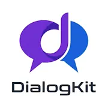

# DialogKit
Generate, manage, and analyze dialogues in Python. Create synthetic multi-party conversations, store them in a clean structured format, and run analytics on turns, speakers, and content. Ideal for NLP research, chatbot testing, and training-data pipelines.

**This project is work in progress (WIP).**

[View Documentation](docs/index.md)

 

# The Idea
My work in ASR and NLP has repeatedly brought me to dialogues. Before the rise of LLMs, I was fortunate to work extensively with real-world dialogue data, and I've found it a fascinating field, though one that still lacks proven, reliable tooling.

Today, working with dialogues is orders of magnitude easier. Yet I still haven't found a "golden tool", something like a master craftsman for this domain.
So I decided to create a prototype - **DialogKit** is my attempt to build one.

# What Works
It's still early days, and only selected tools are doing anything useful.

You can try today:

* [View Documentation](docs/index.md)
* Compress dialogues with: `utils/compress_<METHOD>.py`

# Links

* Repo: [DSPM — memory for LLM conversations that keeps your constraints](https://github.com/zatchbell1311-wq/Kernl)
* Article: [Using LLM Summarization in Your Scikit-Learn Pipelines with Scikit-LLM](https://www.kdnuggets.com/using-llm-summarization-in-your-scikit-learn-pipelines-with-scikit-llm)

# Brain Storm
At this stage, it looks like a wish list. However, it's worth writing down long-term goals and any ideas.
- Generating:
  - Spec-driven generating synthetic dialogues.
  - Controlling personas, roles, intentions, styles, emotions, flow and conversational dynamics.
  - Injecting information, facts and attributes.
  - Simulation of "noise" after ASR (substitutions, deletions, insertions).
  - Multiple language and language switching support.
- Visualization:
  - Conversation flow graph.
  - Dialog viewer (terminal, HTML, MarkDown).
  - Dialog diff.
- Verification & Testing
  - LLM as a judge verifies whether the generated dialogue complies with the specification.
  - Deterministic rules: length, number of turns, number of speakers, participation of speakers in the conversation (dominance), and whether the injected phrases were actually spoken.
- Processing/Analyzing/Detection:
  - PII detection.
  - Annotator/Detector approach.
  - Topic detection.
  - Taxonomy-based processing.
  - Ontology-based processing.
  - Finite State Transducers (FST) processing (optional).
  - JSpeech Grammar Format (JSGF) processing (optional).
 - Transforming:
   - Anonymization.
   - Augmentation: paraphrases, noise, original, change of style or persona.
   - Information injection.
- Integration:
  - JSON/JSONL
  - ASR results as input.
  - Subtitles (SRT/VTT/..).
  - Hugging Face Datasets.
  - spaCy.
  - Ontology (RDF/OWL).
  - Taxonomies (SKOS).
   - Compression (summary, essence).
   - Conversion (knowledge base).
