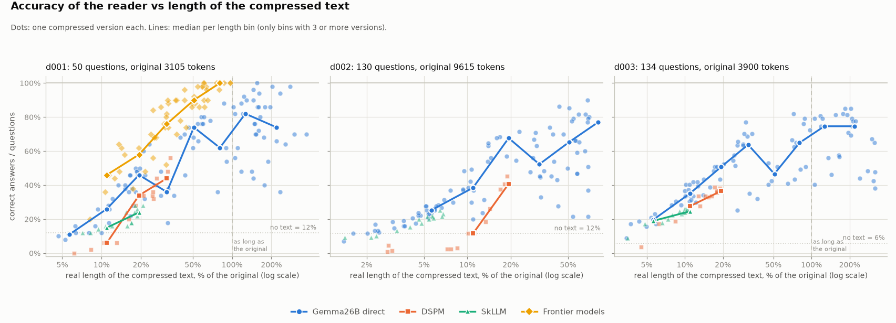
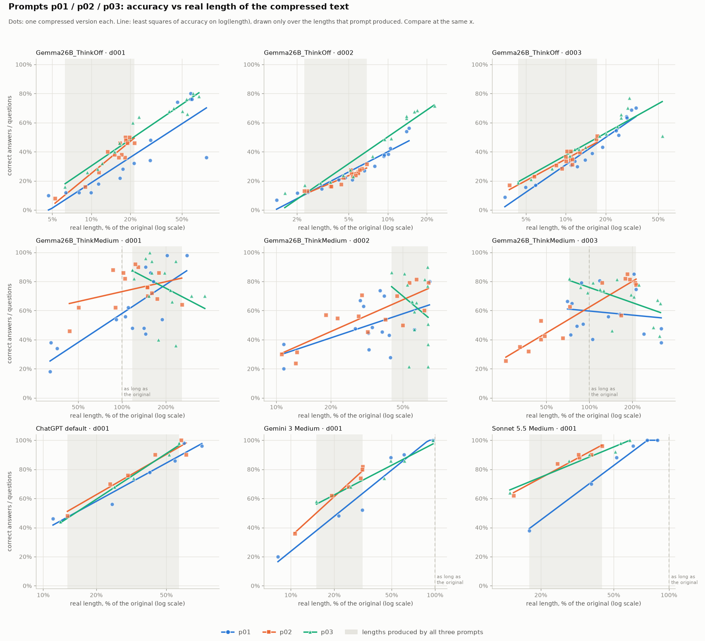

# ⚠️ Note: Preliminary Results
These are early results from a benchmark developed and run by Claude, and they still require human review. 
Additionally, please note that DSPM is designed for two-participant dialogues, whereas the test dialogues presented here involve three participants.

## Main observations

Hand-written notes (this file: `docs/benchmark_notes.md`); everything below them is generated from the result files. The statements are about this reader (Gemma 26B, thinking off) and these three dialogues, so treat them as a first picture.

1. **The reader refuses instead of guessing.** About half of all queries (21 451 of 42 304) got no clear answer, because the text did not contain the fact; the replies say so ("The provided text does not contain information regarding..."). So accuracy mostly measures how many facts survived the compression. Among the questions the reader does answer, it is right most of the time (see "accuracy among answered" and the charts).
2. **Frontier models keep the most facts per token (d001 only):** mean accuracy 78% at a median of 37% of the original tokens.
3. **The local Gemma compressors are weaker.** `compress_Gemma26B`, counting only versions that are really shorter than the original: 43–45% mean accuracy at a median of 14–20% of the tokens. DSPM and SkLLM compress hardest (5–21% of the tokens) and keep the fewest facts (16–30% mean accuracy). Note the warning above: DSPM is designed for two participants and these dialogues have three.
4. **`compress_Gemma26B` with thinking medium often does not compress:** on d001 37 of 90 and on d003 28 of 90 versions of `compress_Gemma26B` are as long as the original or longer. Read the "really shorter" tables for this method.
5. **Prompts, compared at the same real length:** p01 ("just shorten it") is the weakest in 5 of the 6 cases where the comparison is meaningful (Gemma with thinking off on three dialogues, three Frontier models on d001; the exception is Gemma with thinking off on d002, where p02 is 1 point lower). p02 and p03, which also say what to keep, are close to each other: p03 is a little ahead on Gemma with thinking off, p02 on the Frontier models, by 1–6 points. The plain means over the same targets favour p03 mostly because it writes longer texts. Gemma with thinking medium ignores the requested length (texts 4–9 times longer than asked), so it cannot be compared.
6. **Noise:** the same queries asked again do not always get the same reply (the reference points of one dialogue differ between runs by one question; a full repeat of the d001 queries gave the same score for 157 of 186 texts and differed by up to 2 questions for the rest). So differences of 1–2 questions between versions mean nothing.
7. **This report replaces an earlier one** that was made with an outdated copy of the benchmark script (before #8: one order of answers for all texts and an older parser). The rerun with the current script changed the mean accuracies in the summaries by at most about 1 point; the conclusions above did not change.
8. **A small weakness of `parse_letter`:** the refusal `None of the provided options (A,` is read as the answer A (13 of the 9300 d001 replies, see the parser section at the end). These replies are counted as wrong anyway, so the scores do not change; only the number of "no answer" is a little too low.

# Benchmark: compressed dialogues read by an LLM

Date: 2026-11-17 · Reader: `cyankiwi/gemma-4-26B-A4B-it-AWQ-4bit` (config `Gemma26B_ThinkOff`) · Seed: 42

The reader LLM gets **only the compressed text** (as chat history) and answers a single-choice survey (5 answers, one correct) written for the original dialogue. The share of correct answers is the score of the compressed text. Every question is asked in a separate chat, and the order of answers is drawn anew for every query from one seeded generator, so a run can be repeated exactly. See `utils/benchmark_compressed.py` for details. This file is generated by `utils/benchmark_report.py`; the notes above it are written by hand.

## How to read the numbers

- **Accuracy** = correct answers / questions. A missing or unclear answer counts as wrong.
- **No answer** = the reply had no clear letter (see `parse_letter` in the benchmark). The examples at the end of this file show what such replies say.
- **No Text** (floor): the reader sees only the questions and answers. Here: 6%–12%. A random guess would give 20%; a reader that refuses instead of guessing scores lower.
- **Original Text** (ceiling): the reader sees the full dialogue. A compressed text is good when it is close to this number.
- **target words** is only the length the compressor was asked for. The benchmark always uses the whole text that really came out; its real length is in **words** and **tokens**.
- **% of original**: real tokens of the compressed text / tokens of the original text.

## Setup

- Reader settings: temperature 0.0, top_p 1.0, max answer tokens 8, reasoning off, concurrency 32
- 12 runs, 42304 LLM queries, 21451 of them without a clear answer (50.7%)

Each run (raw results in `data/`):

```
uv run utils/benchmark_compressed.py data/data.d001.toml data/compress.DSPM.toml --base-url <LLM server> --output data/benchmark.DSPM.d001.toml
uv run utils/benchmark_compressed.py data/data.d002.toml data/compress.DSPM.toml --base-url <LLM server> --output data/benchmark.DSPM.d002.toml
uv run utils/benchmark_compressed.py data/data.d003.toml data/compress.DSPM.toml --base-url <LLM server> --output data/benchmark.DSPM.d003.toml
uv run utils/benchmark_compressed.py data/data.d001.toml data/compress.Frontier.p01.d001.toml --base-url <LLM server> --output data/benchmark.Frontier.p01.d001.toml
uv run utils/benchmark_compressed.py data/data.d001.toml data/compress.Frontier.p02.d001.toml --base-url <LLM server> --output data/benchmark.Frontier.p02.d001.toml
uv run utils/benchmark_compressed.py data/data.d001.toml data/compress.Frontier.p03.d001.toml --base-url <LLM server> --output data/benchmark.Frontier.p03.d001.toml
uv run utils/benchmark_compressed.py data/data.d001.toml data/compress.Gemma26B.toml --base-url <LLM server> --output data/benchmark.Gemma26B.d001.toml
uv run utils/benchmark_compressed.py data/data.d002.toml data/compress.Gemma26B.toml --base-url <LLM server> --output data/benchmark.Gemma26B.d002.toml
uv run utils/benchmark_compressed.py data/data.d003.toml data/compress.Gemma26B.toml --base-url <LLM server> --output data/benchmark.Gemma26B.d003.toml
uv run utils/benchmark_compressed.py data/data.d001.toml data/compress.SkLLM.toml --base-url <LLM server> --output data/benchmark.SkLLM.d001.toml
uv run utils/benchmark_compressed.py data/data.d002.toml data/compress.SkLLM.toml --base-url <LLM server> --output data/benchmark.SkLLM.d002.toml
uv run utils/benchmark_compressed.py data/data.d003.toml data/compress.SkLLM.toml --base-url <LLM server> --output data/benchmark.SkLLM.d003.toml
```

## Charts: how each method works depending on the length of the compressed text

Each dot is one compressed version, the line is the median of the versions in a length bin (bins with fewer than 3 versions are not drawn). The x axis is the real length as a share of the original, on a log scale; right of the dashed line the text is longer than the original.




## d001: 50 questions, original text 2065 words / 3105 tokens

Floor (no text): **6/50 = 12.0%** (44 no answer). Ceiling (original text): **50/50 = 100.0%** (0 no answer).

### Summary by method

| method | versions | % of original (median) | accuracy mean | accuracy best | no answer (mean) | accuracy among answered (mean) |
|---|---:|---:|---:|---:|---:|---:|
| Gemma26B direct | 90 | 58% | 57.1% | 100.0% | 39% | 93.3% |
| DSPM | 15 | 21% | 28.0% | 56.0% | 70% | 82.4% |
| SkLLM | 15 | 16% | 19.1% | 28.0% | 80% | 94.9% |
| Frontier models | 54 | 37% | 78.0% | 100.0% | 20% | 97.1% |

### Only versions that are really shorter than the original

| method | versions | % of original (median) | accuracy mean | accuracy best | no answer (mean) | accuracy among answered (mean) |
|---|---:|---:|---:|---:|---:|---:|
| Gemma26B direct | 53 / 90 | 20% | 44.6% | 88.0% | 53% | 94.2% |
| DSPM | 15 / 15 | 21% | 28.0% | 56.0% | 70% | 82.4% |
| SkLLM | 15 / 15 | 16% | 19.1% | 28.0% | 80% | 94.9% |
| Frontier models | 54 / 54 | 37% | 78.0% | 100.0% | 20% | 97.1% |

<details><summary>d001: every version of Gemma26B direct (90)</summary>

| prompt | source LLM | target words | words | tokens | % of original | correct | accuracy | no answer |
|---|---|---:|---:|---:|---:|---:|---:|---:|
| p01 | Gemma26B_ThinkMedium | 1200 | 6829 | 8634 | 278% | 49/50 | 98.0% | 0 |
| p01 | Gemma26B_ThinkMedium | 1100 | 4156 | 6313 | 203% | 49/50 | 98.0% | 1 |
| p01 | Gemma26B_ThinkMedium | 1000 | 3122 | 4516 | 145% | 45/50 | 90.0% | 5 |
| p01 | Gemma26B_ThinkMedium | 900 | 3999 | 4879 | 157% | 43/50 | 86.0% | 6 |
| p01 | Gemma26B_ThinkMedium | 800 | 3181 | 5110 | 165% | 40/50 | 80.0% | 3 |
| p01 | Gemma26B_ThinkMedium | 700 | 2557 | 3433 | 111% | 31/50 | 62.0% | 17 |
| p01 | Gemma26B_ThinkMedium | 600 | 2736 | 3663 | 118% | 24/50 | 48.0% | 23 |
| p01 | Gemma26B_ThinkMedium | 500 | 2059 | 2826 | 91% | 27/50 | 54.0% | 21 |
| p01 | Gemma26B_ThinkMedium | 400 | 3214 | 4382 | 141% | 24/50 | 48.0% | 19 |
| p01 | Gemma26B_ThinkMedium | 350 | 4030 | 5831 | 188% | 27/50 | 54.0% | 20 |
| p01 | Gemma26B_ThinkMedium | 300 | 3205 | 4507 | 145% | 22/50 | 44.0% | 27 |
| p01 | Gemma26B_ThinkMedium | 250 | 833 | 1113 | 36% | 17/50 | 34.0% | 33 |
| p01 | Gemma26B_ThinkMedium | 200 | 711 | 995 | 32% | 9/50 | 18.0% | 41 |
| p01 | Gemma26B_ThinkMedium | 150 | 2214 | 3265 | 105% | 28/50 | 56.0% | 17 |
| p01 | Gemma26B_ThinkMedium | 100 | 682 | 1007 | 32% | 19/50 | 38.0% | 29 |
| p02 | Gemma26B_ThinkMedium | 1200 | 2716 | 4003 | 129% | 45/50 | 90.0% | 1 |
| p02 | Gemma26B_ThinkMedium | 1100 | 4145 | 5535 | 178% | 43/50 | 86.0% | 2 |
| p02 | Gemma26B_ThinkMedium | 1000 | 2138 | 3162 | 102% | 43/50 | 86.0% | 1 |
| p02 | Gemma26B_ThinkMedium | 900 | 2732 | 3829 | 123% | 46/50 | 92.0% | 0 |
| p02 | Gemma26B_ThinkMedium | 800 | 1779 | 2691 | 87% | 44/50 | 88.0% | 3 |
| p02 | Gemma26B_ThinkMedium | 700 | 2150 | 3255 | 105% | 41/50 | 82.0% | 5 |
| p02 | Gemma26B_ThinkMedium | 600 | 3888 | 4956 | 160% | 36/50 | 72.0% | 11 |
| p02 | Gemma26B_ThinkMedium | 500 | 2690 | 4640 | 149% | 38/50 | 76.0% | 7 |
| p02 | Gemma26B_ThinkMedium | 400 | 1904 | 2801 | 90% | 31/50 | 62.0% | 18 |
| p02 | Gemma26B_ThinkMedium | 350 | 3073 | 4622 | 149% | 38/50 | 76.0% | 4 |
| p02 | Gemma26B_ThinkMedium | 300 | 3081 | 4668 | 150% | 35/50 | 70.0% | 14 |
| p02 | Gemma26B_ThinkMedium | 250 | 1012 | 1562 | 50% | 31/50 | 62.0% | 16 |
| p02 | Gemma26B_ThinkMedium | 200 | 859 | 1350 | 43% | 23/50 | 46.0% | 26 |
| p02 | Gemma26B_ThinkMedium | 150 | 3327 | 5425 | 175% | 34/50 | 68.0% | 8 |
| p02 | Gemma26B_ThinkMedium | 100 | 5269 | 7982 | 257% | 32/50 | 64.0% | 10 |
| p03 | Gemma26B_ThinkMedium | 1200 | 3292 | 4964 | 160% | 43/50 | 86.0% | 0 |
| p03 | Gemma26B_ThinkMedium | 1100 | 3416 | 4983 | 160% | 47/50 | 94.0% | 2 |
| p03 | Gemma26B_ThinkMedium | 1000 | 2653 | 4511 | 145% | 48/50 | 96.0% | 1 |
| p03 | Gemma26B_ThinkMedium | 900 | 3215 | 4818 | 155% | 50/50 | 100.0% | 0 |
| p03 | Gemma26B_ThinkMedium | 800 | 2537 | 3657 | 118% | 44/50 | 88.0% | 4 |
| p03 | Gemma26B_ThinkMedium | 700 | 4277 | 7241 | 233% | 47/50 | 94.0% | 2 |
| p03 | Gemma26B_ThinkMedium | 600 | 2570 | 3749 | 121% | 41/50 | 82.0% | 8 |
| p03 | Gemma26B_ThinkMedium | 500 | 3899 | 6077 | 196% | 43/50 | 86.0% | 6 |
| p03 | Gemma26B_ThinkMedium | 400 | 6820 | 11497 | 370% | 35/50 | 70.0% | 11 |
| p03 | Gemma26B_ThinkMedium | 350 | 3252 | 4751 | 153% | 35/50 | 70.0% | 14 |
| p03 | Gemma26B_ThinkMedium | 300 | 4075 | 6647 | 214% | 37/50 | 74.0% | 11 |
| p03 | Gemma26B_ThinkMedium | 250 | 3218 | 5498 | 177% | 20/50 | 40.0% | 29 |
| p03 | Gemma26B_ThinkMedium | 200 | 3578 | 6823 | 220% | 33/50 | 66.0% | 15 |
| p03 | Gemma26B_ThinkMedium | 150 | 4657 | 9283 | 299% | 35/50 | 70.0% | 12 |
| p03 | Gemma26B_ThinkMedium | 100 | 4142 | 7276 | 234% | 18/50 | 36.0% | 29 |
| p01 | Gemma26B_ThinkOff | 1200 | 1284 | 1862 | 60% | 38/50 | 76.0% | 11 |
| p01 | Gemma26B_ThinkOff | 1100 | 1227 | 1813 | 58% | 38/50 | 76.0% | 11 |
| p01 | Gemma26B_ThinkOff | 1000 | 1259 | 1810 | 58% | 40/50 | 80.0% | 10 |
| p01 | Gemma26B_ThinkOff | 900 | 2069 | 2404 | 77% | 18/50 | 36.0% | 31 |
| p01 | Gemma26B_ThinkOff | 800 | 1018 | 1440 | 46% | 37/50 | 74.0% | 12 |
| p01 | Gemma26B_ThinkOff | 700 | 644 | 882 | 28% | 17/50 | 34.0% | 29 |
| p01 | Gemma26B_ThinkOff | 600 | 635 | 887 | 29% | 24/50 | 48.0% | 23 |
| p01 | Gemma26B_ThinkOff | 500 | 473 | 661 | 21% | 16/50 | 32.0% | 33 |
| p01 | Gemma26B_ThinkOff | 400 | 394 | 542 | 17% | 14/50 | 28.0% | 35 |
| p01 | Gemma26B_ThinkOff | 350 | 369 | 518 | 17% | 11/50 | 22.0% | 38 |
| p01 | Gemma26B_ThinkOff | 300 | 278 | 353 | 11% | 9/50 | 18.0% | 40 |
| p01 | Gemma26B_ThinkOff | 250 | 241 | 309 | 10% | 6/50 | 12.0% | 43 |
| p01 | Gemma26B_ThinkOff | 200 | 187 | 249 | 8% | 6/50 | 12.0% | 44 |
| p01 | Gemma26B_ThinkOff | 150 | 150 | 197 | 6% | 6/50 | 12.0% | 44 |
| p01 | Gemma26B_ThinkOff | 100 | 105 | 145 | 5% | 5/50 | 10.0% | 45 |
| p02 | Gemma26B_ThinkOff | 1200 | 383 | 584 | 19% | 24/50 | 48.0% | 23 |
| p02 | Gemma26B_ThinkOff | 1100 | 361 | 567 | 18% | 25/50 | 50.0% | 23 |
| p02 | Gemma26B_ThinkOff | 1000 | 393 | 611 | 20% | 25/50 | 50.0% | 24 |
| p02 | Gemma26B_ThinkOff | 900 | 360 | 574 | 18% | 24/50 | 48.0% | 24 |
| p02 | Gemma26B_ThinkOff | 800 | 325 | 516 | 17% | 23/50 | 46.0% | 27 |
| p02 | Gemma26B_ThinkOff | 700 | 445 | 666 | 21% | 23/50 | 46.0% | 26 |
| p02 | Gemma26B_ThinkOff | 600 | 394 | 589 | 19% | 23/50 | 46.0% | 27 |
| p02 | Gemma26B_ThinkOff | 500 | 366 | 564 | 18% | 18/50 | 36.0% | 29 |
| p02 | Gemma26B_ThinkOff | 400 | 342 | 531 | 17% | 19/50 | 38.0% | 28 |
| p02 | Gemma26B_ThinkOff | 350 | 326 | 504 | 16% | 18/50 | 36.0% | 31 |
| p02 | Gemma26B_ThinkOff | 300 | 300 | 469 | 15% | 19/50 | 38.0% | 31 |
| p02 | Gemma26B_ThinkOff | 250 | 263 | 415 | 13% | 20/50 | 40.0% | 29 |
| p02 | Gemma26B_ThinkOff | 200 | 232 | 356 | 11% | 13/50 | 26.0% | 37 |
| p02 | Gemma26B_ThinkOff | 150 | 173 | 278 | 9% | 8/50 | 16.0% | 42 |
| p02 | Gemma26B_ThinkOff | 100 | 103 | 163 | 5% | 4/50 | 8.0% | 44 |
| p03 | Gemma26B_ThinkOff | 1200 | 1036 | 1567 | 50% | 34/50 | 68.0% | 13 |
| p03 | Gemma26B_ThinkOff | 1100 | 1381 | 2103 | 68% | 39/50 | 78.0% | 11 |
| p03 | Gemma26B_ThinkOff | 1000 | 1144 | 1683 | 54% | 38/50 | 76.0% | 11 |
| p03 | Gemma26B_ThinkOff | 900 | 1258 | 1898 | 61% | 40/50 | 80.0% | 8 |
| p03 | Gemma26B_ThinkOff | 800 | 1131 | 1709 | 55% | 33/50 | 66.0% | 16 |
| p03 | Gemma26B_ThinkOff | 700 | 844 | 1240 | 40% | 34/50 | 68.0% | 14 |
| p03 | Gemma26B_ThinkOff | 600 | 912 | 1341 | 43% | 35/50 | 70.0% | 14 |
| p03 | Gemma26B_ThinkOff | 500 | 517 | 722 | 23% | 32/50 | 64.0% | 16 |
| p03 | Gemma26B_ThinkOff | 400 | 443 | 651 | 21% | 30/50 | 60.0% | 19 |
| p03 | Gemma26B_ThinkOff | 350 | 337 | 511 | 16% | 23/50 | 46.0% | 25 |
| p03 | Gemma26B_ThinkOff | 300 | 299 | 471 | 15% | 20/50 | 40.0% | 29 |
| p03 | Gemma26B_ThinkOff | 250 | 246 | 377 | 12% | 16/50 | 32.0% | 32 |
| p03 | Gemma26B_ThinkOff | 200 | 214 | 348 | 11% | 14/50 | 28.0% | 35 |
| p03 | Gemma26B_ThinkOff | 150 | 152 | 289 | 9% | 13/50 | 26.0% | 36 |
| p03 | Gemma26B_ThinkOff | 100 | 106 | 195 | 6% | 8/50 | 16.0% | 42 |

</details>

<details><summary>d001: every version of DSPM (15)</summary>

| prompt | source LLM | target words | words | tokens | % of original | correct | accuracy | no answer |
|---|---|---:|---:|---:|---:|---:|---:|---:|
| NA | DSPM/Gemma26B | 1200 | 764 | 1043 | 34% | 28/50 | 56.0% | 20 |
| NA | DSPM/Gemma26B | 1100 | 737 | 996 | 32% | 24/50 | 48.0% | 24 |
| NA | DSPM/Gemma26B | 1000 | 573 | 796 | 26% | 20/50 | 40.0% | 27 |
| NA | DSPM/Gemma26B | 900 | 559 | 778 | 25% | 16/50 | 32.0% | 33 |
| NA | DSPM/Gemma26B | 800 | 562 | 765 | 25% | 17/50 | 34.0% | 32 |
| NA | DSPM/Gemma26B | 700 | 603 | 819 | 26% | 22/50 | 44.0% | 27 |
| NA | DSPM/Gemma26B | 600 | 469 | 624 | 20% | 17/50 | 34.0% | 33 |
| NA | DSPM/Gemma26B | 500 | 557 | 767 | 25% | 18/50 | 36.0% | 32 |
| NA | DSPM/Gemma26B | 400 | 482 | 650 | 21% | 17/50 | 34.0% | 32 |
| NA | DSPM/Gemma26B | 350 | 413 | 565 | 18% | 14/50 | 28.0% | 35 |
| NA | DSPM/Gemma26B | 300 | 345 | 502 | 16% | 10/50 | 20.0% | 39 |
| NA | DSPM/Gemma26B | 250 | 255 | 405 | 13% | 3/50 | 6.0% | 46 |
| NA | DSPM/Gemma26B | 200 | 191 | 326 | 10% | 3/50 | 6.0% | 46 |
| NA | DSPM/Gemma26B | 150 | 117 | 258 | 8% | 1/50 | 2.0% | 48 |
| NA | DSPM/Gemma26B | 100 | 77 | 192 | 6% | 0/50 | 0.0% | 49 |

</details>

<details><summary>d001: every version of SkLLM (15)</summary>

| prompt | source LLM | target words | words | tokens | % of original | correct | accuracy | no answer |
|---|---|---:|---:|---:|---:|---:|---:|---:|
| NA | Gemma26B | 1200 | 413 | 581 | 19% | 13/50 | 26.0% | 35 |
| NA | Gemma26B | 1100 | 417 | 580 | 19% | 11/50 | 22.0% | 39 |
| NA | Gemma26B | 1000 | 396 | 556 | 18% | 12/50 | 24.0% | 38 |
| NA | Gemma26B | 900 | 458 | 645 | 21% | 14/50 | 28.0% | 34 |
| NA | Gemma26B | 800 | 383 | 527 | 17% | 9/50 | 18.0% | 41 |
| NA | Gemma26B | 700 | 391 | 526 | 17% | 9/50 | 18.0% | 39 |
| NA | Gemma26B | 600 | 360 | 488 | 16% | 8/50 | 16.0% | 40 |
| NA | Gemma26B | 500 | 407 | 562 | 18% | 14/50 | 28.0% | 34 |
| NA | Gemma26B | 400 | 359 | 478 | 15% | 12/50 | 24.0% | 38 |
| NA | Gemma26B | 350 | 282 | 373 | 12% | 8/50 | 16.0% | 42 |
| NA | Gemma26B | 300 | 256 | 333 | 11% | 8/50 | 16.0% | 42 |
| NA | Gemma26B | 250 | 218 | 294 | 9% | 7/50 | 14.0% | 43 |
| NA | Gemma26B | 200 | 193 | 254 | 8% | 6/50 | 12.0% | 44 |
| NA | Gemma26B | 150 | 159 | 221 | 7% | 6/50 | 12.0% | 44 |
| NA | Gemma26B | 100 | 113 | 171 | 6% | 6/50 | 12.0% | 44 |

</details>

<details><summary>d001: every version of Frontier models (54)</summary>

| prompt | source LLM | target words | words | tokens | % of original | correct | accuracy | no answer |
|---|---|---:|---:|---:|---:|---:|---:|---:|
| p01 | ChatGPT default | 1200 | 1751 | 2471 | 80% | 48/50 | 96.0% | 1 |
| p01 | ChatGPT default | 1000 | 1382 | 1953 | 63% | 49/50 | 98.0% | 1 |
| p01 | ChatGPT default | 800 | 1218 | 1738 | 56% | 43/50 | 86.0% | 6 |
| p01 | ChatGPT default | 600 | 861 | 1247 | 40% | 39/50 | 78.0% | 10 |
| p01 | ChatGPT default | 400 | 530 | 766 | 25% | 28/50 | 56.0% | 21 |
| p01 | ChatGPT default | 200 | 254 | 353 | 11% | 23/50 | 46.0% | 25 |
| p02 | ChatGPT default | 1200 | 1577 | 1880 | 61% | 50/50 | 100.0% | 0 |
| p02 | ChatGPT default | 1000 | 1445 | 2014 | 65% | 45/50 | 90.0% | 4 |
| p02 | ChatGPT default | 800 | 1091 | 1339 | 43% | 45/50 | 90.0% | 5 |
| p02 | ChatGPT default | 600 | 750 | 937 | 30% | 38/50 | 76.0% | 11 |
| p02 | ChatGPT default | 400 | 577 | 742 | 24% | 35/50 | 70.0% | 13 |
| p02 | ChatGPT default | 200 | 320 | 426 | 14% | 24/50 | 48.0% | 24 |
| p03 | ChatGPT default | 1200 | 1240 | 1824 | 59% | 49/50 | 98.0% | 1 |
| p03 | ChatGPT default | 1000 | 1261 | 1835 | 59% | 49/50 | 98.0% | 1 |
| p03 | ChatGPT default | 800 | 1104 | 1610 | 52% | 45/50 | 90.0% | 4 |
| p03 | ChatGPT default | 600 | 696 | 1010 | 33% | 37/50 | 74.0% | 10 |
| p03 | ChatGPT default | 400 | 506 | 787 | 25% | 34/50 | 68.0% | 14 |
| p03 | ChatGPT default | 200 | 243 | 389 | 13% | 22/50 | 44.0% | 26 |
| p01 | Gemini 3 Medium | 1200 | 2065 | 3007 | 97% | 50/50 | 100.0% | 0 |
| p01 | Gemini 3 Medium | 1000 | 1391 | 1891 | 61% | 45/50 | 90.0% | 5 |
| p01 | Gemini 3 Medium | 800 | 1134 | 1537 | 50% | 44/50 | 88.0% | 6 |
| p01 | Gemini 3 Medium | 600 | 714 | 973 | 31% | 26/50 | 52.0% | 23 |
| p01 | Gemini 3 Medium | 400 | 471 | 669 | 22% | 24/50 | 48.0% | 25 |
| p01 | Gemini 3 Medium | 200 | 195 | 253 | 8% | 10/50 | 20.0% | 39 |
| p02 | Gemini 3 Medium | 1200 | 649 | 975 | 31% | 41/50 | 82.0% | 7 |
| p02 | Gemini 3 Medium | 1000 | 677 | 971 | 31% | 40/50 | 80.0% | 9 |
| p02 | Gemini 3 Medium | 800 | 673 | 947 | 30% | 37/50 | 74.0% | 10 |
| p02 | Gemini 3 Medium | 600 | 541 | 783 | 25% | 34/50 | 68.0% | 14 |
| p02 | Gemini 3 Medium | 400 | 420 | 598 | 19% | 31/50 | 62.0% | 19 |
| p02 | Gemini 3 Medium | 200 | 239 | 331 | 11% | 18/50 | 36.0% | 30 |
| p03 | Gemini 3 Medium | 1200 | 2065 | 3009 | 97% | 50/50 | 100.0% | 0 |
| p03 | Gemini 3 Medium | 1000 | 1038 | 1532 | 49% | 43/50 | 86.0% | 4 |
| p03 | Gemini 3 Medium | 800 | 1298 | 1911 | 62% | 43/50 | 86.0% | 7 |
| p03 | Gemini 3 Medium | 600 | 942 | 1380 | 44% | 37/50 | 74.0% | 12 |
| p03 | Gemini 3 Medium | 400 | 547 | 810 | 26% | 34/50 | 68.0% | 15 |
| p03 | Gemini 3 Medium | 200 | 289 | 468 | 15% | 29/50 | 58.0% | 19 |
| p01 | Sonnet 5.5 Medium | 1200 | 1833 | 2684 | 86% | 50/50 | 100.0% | 0 |
| p01 | Sonnet 5.5 Medium | 1000 | 1595 | 2363 | 76% | 50/50 | 100.0% | 0 |
| p01 | Sonnet 5.5 Medium | 800 | 1346 | 1979 | 64% | 48/50 | 96.0% | 1 |
| p01 | Sonnet 5.5 Medium | 600 | 1089 | 1611 | 52% | 44/50 | 88.0% | 4 |
| p01 | Sonnet 5.5 Medium | 400 | 777 | 1171 | 38% | 35/50 | 70.0% | 12 |
| p01 | Sonnet 5.5 Medium | 200 | 349 | 538 | 17% | 19/50 | 38.0% | 30 |
| p02 | Sonnet 5.5 Medium | 1200 | 997 | 1340 | 43% | 48/50 | 96.0% | 2 |
| p02 | Sonnet 5.5 Medium | 1000 | 907 | 1172 | 38% | 45/50 | 90.0% | 5 |
| p02 | Sonnet 5.5 Medium | 800 | 759 | 1009 | 32% | 44/50 | 88.0% | 5 |
| p02 | Sonnet 5.5 Medium | 600 | 753 | 998 | 32% | 45/50 | 90.0% | 5 |
| p02 | Sonnet 5.5 Medium | 400 | 556 | 767 | 25% | 42/50 | 84.0% | 8 |
| p02 | Sonnet 5.5 Medium | 200 | 295 | 441 | 14% | 31/50 | 62.0% | 19 |
| p03 | Sonnet 5.5 Medium | 1200 | 1266 | 1898 | 61% | 50/50 | 100.0% | 0 |
| p03 | Sonnet 5.5 Medium | 1000 | 1103 | 1697 | 55% | 49/50 | 98.0% | 1 |
| p03 | Sonnet 5.5 Medium | 800 | 1043 | 1585 | 51% | 46/50 | 92.0% | 3 |
| p03 | Sonnet 5.5 Medium | 600 | 756 | 1141 | 37% | 45/50 | 90.0% | 5 |
| p03 | Sonnet 5.5 Medium | 400 | 555 | 884 | 28% | 43/50 | 86.0% | 7 |
| p03 | Sonnet 5.5 Medium | 200 | 253 | 421 | 14% | 32/50 | 64.0% | 16 |

</details>

## d002: 130 questions, original text 7409 words / 9615 tokens

Floor (no text): **15/130 = 11.5%** (115 no answer). Ceiling (original text): **130/130 = 100.0%** (0 no answer).

### Summary by method

| method | versions | % of original (median) | accuracy mean | accuracy best | no answer (mean) | accuracy among answered (mean) |
|---|---:|---:|---:|---:|---:|---:|
| Gemma26B direct | 90 | 14% | 43.4% | 90.0% | 50% | 85.4% |
| DSPM | 13 | 10% | 15.9% | 45.4% | 82% | 73.2% |
| SkLLM | 15 | 5% | 18.1% | 25.4% | 79% | 83.2% |

### Only versions that are really shorter than the original

| method | versions | % of original (median) | accuracy mean | accuracy best | no answer (mean) | accuracy among answered (mean) |
|---|---:|---:|---:|---:|---:|---:|
| Gemma26B direct | 90 / 90 | 14% | 43.4% | 90.0% | 50% | 85.4% |
| DSPM | 13 / 13 | 10% | 15.9% | 45.4% | 82% | 73.2% |
| SkLLM | 15 / 15 | 5% | 18.1% | 25.4% | 79% | 83.2% |

<details><summary>d002: every version of Gemma26B direct (90)</summary>

| prompt | source LLM | target words | words | tokens | % of original | correct | accuracy | no answer |
|---|---|---:|---:|---:|---:|---:|---:|---:|
| p01 | Gemma26B_ThinkMedium | 1200 | 2133 | 2796 | 29% | 87/130 | 66.9% | 33 |
| p01 | Gemma26B_ThinkMedium | 1100 | 5250 | 6736 | 70% | 104/130 | 80.0% | 10 |
| p01 | Gemma26B_ThinkMedium | 1000 | 2744 | 3587 | 37% | 96/130 | 73.9% | 26 |
| p01 | Gemma26B_ThinkMedium | 900 | 2283 | 2916 | 30% | 82/130 | 63.1% | 35 |
| p01 | Gemma26B_ThinkMedium | 800 | 2786 | 3785 | 39% | 91/130 | 70.0% | 24 |
| p01 | Gemma26B_ThinkMedium | 700 | 1903 | 2618 | 27% | 62/130 | 47.7% | 59 |
| p01 | Gemma26B_ThinkMedium | 600 | 2581 | 3258 | 34% | 63/130 | 48.5% | 62 |
| p01 | Gemma26B_ThinkMedium | 500 | 2302 | 3094 | 32% | 58/130 | 44.6% | 65 |
| p01 | Gemma26B_ThinkMedium | 400 | 2875 | 4025 | 42% | 56/130 | 43.1% | 61 |
| p01 | Gemma26B_ThinkMedium | 350 | 3219 | 4105 | 43% | 36/130 | 27.7% | 91 |
| p01 | Gemma26B_ThinkMedium | 300 | 2583 | 3121 | 32% | 43/130 | 33.1% | 81 |
| p01 | Gemma26B_ThinkMedium | 250 | 4238 | 5561 | 58% | 61/130 | 46.9% | 58 |
| p01 | Gemma26B_ThinkMedium | 200 | 746 | 1056 | 11% | 26/130 | 20.0% | 99 |
| p01 | Gemma26B_ThinkMedium | 150 | 2397 | 3684 | 38% | 59/130 | 45.4% | 64 |
| p01 | Gemma26B_ThinkMedium | 100 | 764 | 1058 | 11% | 48/130 | 36.9% | 79 |
| p02 | Gemma26B_ThinkMedium | 1200 | 2111 | 2856 | 30% | 92/130 | 70.8% | 30 |
| p02 | Gemma26B_ThinkMedium | 1100 | 4030 | 5211 | 54% | 103/130 | 79.2% | 19 |
| p02 | Gemma26B_ThinkMedium | 1000 | 4452 | 6644 | 69% | 103/130 | 79.2% | 15 |
| p02 | Gemma26B_ThinkMedium | 900 | 4445 | 5705 | 59% | 106/130 | 81.5% | 14 |
| p02 | Gemma26B_ThinkMedium | 800 | 1989 | 2738 | 28% | 73/130 | 56.1% | 50 |
| p02 | Gemma26B_ThinkMedium | 700 | 3211 | 4455 | 46% | 91/130 | 70.0% | 30 |
| p02 | Gemma26B_ThinkMedium | 600 | 1567 | 2096 | 22% | 71/130 | 54.6% | 54 |
| p02 | Gemma26B_ThinkMedium | 500 | 2212 | 3063 | 32% | 59/130 | 45.4% | 65 |
| p02 | Gemma26B_ThinkMedium | 400 | 1265 | 1802 | 19% | 74/130 | 56.9% | 50 |
| p02 | Gemma26B_ThinkMedium | 350 | 3266 | 4788 | 50% | 65/130 | 50.0% | 58 |
| p02 | Gemma26B_ThinkMedium | 300 | 4793 | 6302 | 66% | 78/130 | 60.0% | 42 |
| p02 | Gemma26B_ThinkMedium | 250 | 2707 | 3849 | 40% | 70/130 | 53.8% | 54 |
| p02 | Gemma26B_ThinkMedium | 200 | 812 | 1229 | 13% | 31/130 | 23.8% | 93 |
| p02 | Gemma26B_ThinkMedium | 150 | 871 | 1252 | 13% | 41/130 | 31.5% | 85 |
| p02 | Gemma26B_ThinkMedium | 100 | 671 | 1028 | 11% | 39/130 | 30.0% | 88 |
| p03 | Gemma26B_ThinkMedium | 1200 | 4191 | 6568 | 68% | 117/130 | 90.0% | 0 |
| p03 | Gemma26B_ThinkMedium | 1100 | 3467 | 4905 | 51% | 111/130 | 85.4% | 13 |
| p03 | Gemma26B_ThinkMedium | 1000 | 3077 | 4166 | 43% | 112/130 | 86.2% | 12 |
| p03 | Gemma26B_ThinkMedium | 900 | 4461 | 6342 | 66% | 106/130 | 81.5% | 15 |
| p03 | Gemma26B_ThinkMedium | 800 | 3823 | 5085 | 53% | 101/130 | 77.7% | 18 |
| p03 | Gemma26B_ThinkMedium | 700 | 5400 | 6589 | 69% | 100/130 | 76.9% | 22 |
| p03 | Gemma26B_ThinkMedium | 600 | 3779 | 5371 | 56% | 86/130 | 66.1% | 29 |
| p03 | Gemma26B_ThinkMedium | 500 | 3787 | 5426 | 56% | 86/130 | 66.1% | 35 |
| p03 | Gemma26B_ThinkMedium | 400 | 4220 | 5716 | 59% | 85/130 | 65.4% | 31 |
| p03 | Gemma26B_ThinkMedium | 350 | 3928 | 5565 | 58% | 61/130 | 46.9% | 59 |
| p03 | Gemma26B_ThinkMedium | 300 | 3832 | 5556 | 58% | 77/130 | 59.2% | 36 |
| p03 | Gemma26B_ThinkMedium | 250 | 4067 | 6599 | 69% | 48/130 | 36.9% | 70 |
| p03 | Gemma26B_ThinkMedium | 200 | 4819 | 6610 | 69% | 66/130 | 50.8% | 52 |
| p03 | Gemma26B_ThinkMedium | 150 | 2754 | 5180 | 54% | 28/130 | 21.5% | 94 |
| p03 | Gemma26B_ThinkMedium | 100 | 3574 | 6621 | 69% | 28/130 | 21.5% | 96 |
| p01 | Gemma26B_ThinkOff | 1200 | 1061 | 1403 | 15% | 73/130 | 56.1% | 45 |
| p01 | Gemma26B_ThinkOff | 1100 | 1002 | 1337 | 14% | 70/130 | 53.8% | 46 |
| p01 | Gemma26B_ThinkOff | 1000 | 747 | 973 | 10% | 50/130 | 38.5% | 66 |
| p01 | Gemma26B_ThinkOff | 900 | 770 | 1009 | 10% | 55/130 | 42.3% | 67 |
| p01 | Gemma26B_ThinkOff | 800 | 678 | 896 | 9% | 48/130 | 36.9% | 73 |
| p01 | Gemma26B_ThinkOff | 700 | 674 | 900 | 9% | 49/130 | 37.7% | 74 |
| p01 | Gemma26B_ThinkOff | 600 | 573 | 765 | 8% | 39/130 | 30.0% | 80 |
| p01 | Gemma26B_ThinkOff | 500 | 487 | 636 | 7% | 35/130 | 26.9% | 88 |
| p01 | Gemma26B_ThinkOff | 400 | 394 | 514 | 5% | 27/130 | 20.8% | 95 |
| p01 | Gemma26B_ThinkOff | 350 | 342 | 454 | 5% | 29/130 | 22.3% | 93 |
| p01 | Gemma26B_ThinkOff | 300 | 306 | 402 | 4% | 27/130 | 20.8% | 96 |
| p01 | Gemma26B_ThinkOff | 250 | 228 | 299 | 3% | 19/130 | 14.6% | 105 |
| p01 | Gemma26B_ThinkOff | 200 | 185 | 235 | 2% | 16/130 | 12.3% | 110 |
| p01 | Gemma26B_ThinkOff | 150 | 151 | 194 | 2% | 15/130 | 11.5% | 110 |
| p01 | Gemma26B_ThinkOff | 100 | 99 | 134 | 1% | 9/130 | 6.9% | 117 |
| p02 | Gemma26B_ThinkOff | 1200 | 458 | 661 | 7% | 41/130 | 31.5% | 83 |
| p02 | Gemma26B_ThinkOff | 1100 | 399 | 569 | 6% | 34/130 | 26.2% | 89 |
| p02 | Gemma26B_ThinkOff | 1000 | 409 | 569 | 6% | 33/130 | 25.4% | 90 |
| p02 | Gemma26B_ThinkOff | 900 | 422 | 606 | 6% | 37/130 | 28.5% | 87 |
| p02 | Gemma26B_ThinkOff | 800 | 370 | 500 | 5% | 36/130 | 27.7% | 89 |
| p02 | Gemma26B_ThinkOff | 700 | 386 | 504 | 5% | 33/130 | 25.4% | 91 |
| p02 | Gemma26B_ThinkOff | 600 | 438 | 587 | 6% | 36/130 | 27.7% | 86 |
| p02 | Gemma26B_ThinkOff | 500 | 405 | 543 | 6% | 31/130 | 23.8% | 95 |
| p02 | Gemma26B_ThinkOff | 400 | 361 | 517 | 5% | 30/130 | 23.1% | 94 |
| p02 | Gemma26B_ThinkOff | 350 | 328 | 441 | 5% | 29/130 | 22.3% | 95 |
| p02 | Gemma26B_ThinkOff | 300 | 302 | 420 | 4% | 23/130 | 17.7% | 102 |
| p02 | Gemma26B_ThinkOff | 250 | 247 | 349 | 4% | 21/130 | 16.2% | 101 |
| p02 | Gemma26B_ThinkOff | 200 | 248 | 354 | 4% | 21/130 | 16.2% | 103 |
| p02 | Gemma26B_ThinkOff | 150 | 163 | 231 | 2% | 17/130 | 13.1% | 107 |
| p02 | Gemma26B_ThinkOff | 100 | 145 | 219 | 2% | 17/130 | 13.1% | 107 |
| p03 | Gemma26B_ThinkOff | 1200 | 1597 | 2200 | 23% | 93/130 | 71.5% | 27 |
| p03 | Gemma26B_ThinkOff | 1100 | 1223 | 1622 | 17% | 89/130 | 68.5% | 30 |
| p03 | Gemma26B_ThinkOff | 1000 | 1167 | 1539 | 16% | 88/130 | 67.7% | 32 |
| p03 | Gemma26B_ThinkOff | 900 | 1023 | 1343 | 14% | 82/130 | 63.1% | 42 |
| p03 | Gemma26B_ThinkOff | 800 | 1014 | 1343 | 14% | 84/130 | 64.6% | 41 |
| p03 | Gemma26B_ThinkOff | 700 | 769 | 1023 | 11% | 64/130 | 49.2% | 55 |
| p03 | Gemma26B_ThinkOff | 600 | 682 | 911 | 9% | 63/130 | 48.5% | 58 |
| p03 | Gemma26B_ThinkOff | 500 | 534 | 734 | 8% | 48/130 | 36.9% | 71 |
| p03 | Gemma26B_ThinkOff | 400 | 385 | 520 | 5% | 30/130 | 23.1% | 89 |
| p03 | Gemma26B_ThinkOff | 350 | 355 | 495 | 5% | 36/130 | 27.7% | 83 |
| p03 | Gemma26B_ThinkOff | 300 | 310 | 438 | 5% | 31/130 | 23.8% | 92 |
| p03 | Gemma26B_ThinkOff | 250 | 240 | 347 | 4% | 25/130 | 19.2% | 100 |
| p03 | Gemma26B_ThinkOff | 200 | 206 | 292 | 3% | 24/130 | 18.5% | 101 |
| p03 | Gemma26B_ThinkOff | 150 | 153 | 221 | 2% | 22/130 | 16.9% | 100 |
| p03 | Gemma26B_ThinkOff | 100 | 96 | 155 | 2% | 15/130 | 11.5% | 110 |

</details>

<details><summary>d002: every version of DSPM (13)</summary>

| prompt | source LLM | target words | words | tokens | % of original | correct | accuracy | no answer |
|---|---|---:|---:|---:|---:|---:|---:|---:|
| NA | DSPM/Gemma26B | 1200 | 1335 | 1815 | 19% | 59/130 | 45.4% | 68 |
| NA | DSPM/Gemma26B | 1100 | 1243 | 1744 | 18% | 53/130 | 40.8% | 72 |
| NA | DSPM/Gemma26B | 1000 | 1135 | 1623 | 17% | 49/130 | 37.7% | 75 |
| NA | DSPM/Gemma26B | 900 | 909 | 1372 | 14% | 34/130 | 26.2% | 93 |
| NA | DSPM/Gemma26B | 800 | 814 | 1284 | 13% | 24/130 | 18.5% | 101 |
| NA | DSPM/Gemma26B | 700 | 628 | 1070 | 11% | 15/130 | 11.5% | 112 |
| NA | DSPM/Gemma26B | 600 | 563 | 975 | 10% | 15/130 | 11.5% | 113 |
| NA | DSPM/Gemma26B | 500 | 396 | 818 | 9% | 4/130 | 3.1% | 124 |
| NA | DSPM/Gemma26B | 400 | 355 | 737 | 8% | 3/130 | 2.3% | 125 |
| NA | DSPM/Gemma26B | 350 | 325 | 698 | 7% | 3/130 | 2.3% | 125 |
| NA | DSPM/Gemma26B | 300 | 131 | 290 | 3% | 2/130 | 1.5% | 126 |
| NA | DSPM/Gemma26B | 250 | 122 | 269 | 3% | 1/130 | 0.8% | 127 |
| NA | DSPM/Gemma26B | 200 | 123 | 272 | 3% | 6/130 | 4.6% | 120 |

</details>

<details><summary>d002: every version of SkLLM (15)</summary>

| prompt | source LLM | target words | words | tokens | % of original | correct | accuracy | no answer |
|---|---|---:|---:|---:|---:|---:|---:|---:|
| NA | Gemma26B | 1200 | 462 | 650 | 7% | 30/130 | 23.1% | 96 |
| NA | Gemma26B | 1100 | 481 | 644 | 7% | 28/130 | 21.5% | 98 |
| NA | Gemma26B | 1000 | 385 | 545 | 6% | 29/130 | 22.3% | 96 |
| NA | Gemma26B | 900 | 389 | 509 | 5% | 28/130 | 21.5% | 98 |
| NA | Gemma26B | 800 | 422 | 561 | 6% | 27/130 | 20.8% | 99 |
| NA | Gemma26B | 700 | 442 | 619 | 6% | 33/130 | 25.4% | 93 |
| NA | Gemma26B | 600 | 425 | 553 | 6% | 28/130 | 21.5% | 99 |
| NA | Gemma26B | 500 | 401 | 520 | 5% | 26/130 | 20.0% | 100 |
| NA | Gemma26B | 400 | 345 | 461 | 5% | 23/130 | 17.7% | 102 |
| NA | Gemma26B | 350 | 338 | 443 | 5% | 26/130 | 20.0% | 101 |
| NA | Gemma26B | 300 | 284 | 386 | 4% | 20/130 | 15.4% | 105 |
| NA | Gemma26B | 250 | 235 | 311 | 3% | 17/130 | 13.1% | 109 |
| NA | Gemma26B | 200 | 173 | 224 | 2% | 13/130 | 10.0% | 111 |
| NA | Gemma26B | 150 | 151 | 207 | 2% | 12/130 | 9.2% | 113 |
| NA | Gemma26B | 100 | 94 | 136 | 1% | 12/130 | 9.2% | 114 |

</details>

## d003: 134 questions, original text 3095 words / 3900 tokens

Floor (no text): **8/134 = 6.0%** (126 no answer). Ceiling (original text): **134/134 = 100.0%** (0 no answer).

### Summary by method

| method | versions | % of original (median) | accuracy mean | accuracy best | no answer (mean) | accuracy among answered (mean) |
|---|---:|---:|---:|---:|---:|---:|
| Gemma26B direct | 90 | 33% | 51.6% | 85.1% | 45% | 92.4% |
| DSPM | 15 | 15% | 29.8% | 38.8% | 68% | 91.0% |
| SkLLM | 15 | 10% | 22.2% | 26.1% | 75% | 87.4% |

### Only versions that are really shorter than the original

| method | versions | % of original (median) | accuracy mean | accuracy best | no answer (mean) | accuracy among answered (mean) |
|---|---:|---:|---:|---:|---:|---:|
| Gemma26B direct | 62 / 90 | 18% | 44.9% | 82.1% | 52% | 92.7% |
| DSPM | 15 / 15 | 15% | 29.8% | 38.8% | 68% | 91.0% |
| SkLLM | 15 / 15 | 10% | 22.2% | 26.1% | 75% | 87.4% |

<details><summary>d003: every version of Gemma26B direct (90)</summary>

| prompt | source LLM | target words | words | tokens | % of original | correct | accuracy | no answer |
|---|---|---:|---:|---:|---:|---:|---:|---:|
| p01 | Gemma26B_ThinkMedium | 1200 | 5404 | 8230 | 211% | 100/134 | 74.6% | 28 |
| p01 | Gemma26B_ThinkMedium | 1100 | 3637 | 4599 | 118% | 108/134 | 80.6% | 22 |
| p01 | Gemma26B_ThinkMedium | 1000 | 2545 | 3432 | 88% | 106/134 | 79.1% | 26 |
| p01 | Gemma26B_ThinkMedium | 900 | 1981 | 2739 | 70% | 89/134 | 66.4% | 43 |
| p01 | Gemma26B_ThinkMedium | 800 | 6552 | 7989 | 205% | 114/134 | 85.1% | 9 |
| p01 | Gemma26B_ThinkMedium | 700 | 2199 | 2944 | 75% | 87/134 | 64.9% | 41 |
| p01 | Gemma26B_ThinkMedium | 600 | 2654 | 3522 | 90% | 68/134 | 50.7% | 61 |
| p01 | Gemma26B_ThinkMedium | 500 | 2093 | 2873 | 74% | 58/134 | 43.3% | 72 |
| p01 | Gemma26B_ThinkMedium | 400 | 2320 | 3193 | 82% | 66/134 | 49.2% | 64 |
| p01 | Gemma26B_ThinkMedium | 350 | 5811 | 12409 | 318% | 64/134 | 47.8% | 61 |
| p01 | Gemma26B_ThinkMedium | 300 | 3041 | 4110 | 105% | 54/134 | 40.3% | 75 |
| p01 | Gemma26B_ThinkMedium | 250 | 3983 | 5290 | 136% | 75/134 | 56.0% | 51 |
| p01 | Gemma26B_ThinkMedium | 200 | 9410 | 12383 | 318% | 51/134 | 38.1% | 75 |
| p01 | Gemma26B_ThinkMedium | 150 | 3911 | 6382 | 164% | 77/134 | 57.5% | 46 |
| p01 | Gemma26B_ThinkMedium | 100 | 6653 | 9349 | 240% | 59/134 | 44.0% | 64 |
| p02 | Gemma26B_ThinkMedium | 1200 | 4400 | 8162 | 209% | 106/134 | 79.1% | 17 |
| p02 | Gemma26B_ThinkMedium | 1100 | 3540 | 4766 | 122% | 106/134 | 79.1% | 23 |
| p02 | Gemma26B_ThinkMedium | 1000 | 5592 | 7190 | 184% | 114/134 | 85.1% | 6 |
| p02 | Gemma26B_ThinkMedium | 900 | 4919 | 7470 | 192% | 109/134 | 81.3% | 17 |
| p02 | Gemma26B_ThinkMedium | 800 | 5034 | 8276 | 212% | 104/134 | 77.6% | 22 |
| p02 | Gemma26B_ThinkMedium | 700 | 5247 | 6946 | 178% | 110/134 | 82.1% | 16 |
| p02 | Gemma26B_ThinkMedium | 600 | 2100 | 2838 | 73% | 84/134 | 62.7% | 46 |
| p02 | Gemma26B_ThinkMedium | 500 | 4490 | 6483 | 166% | 76/134 | 56.7% | 53 |
| p02 | Gemma26B_ThinkMedium | 400 | 1356 | 1788 | 46% | 54/134 | 40.3% | 76 |
| p02 | Gemma26B_ThinkMedium | 350 | 1378 | 1887 | 48% | 57/134 | 42.5% | 71 |
| p02 | Gemma26B_ThinkMedium | 300 | 1298 | 1777 | 46% | 71/134 | 53.0% | 57 |
| p02 | Gemma26B_ThinkMedium | 250 | 1865 | 2545 | 65% | 55/134 | 41.0% | 77 |
| p02 | Gemma26B_ThinkMedium | 200 | 888 | 1265 | 32% | 47/134 | 35.1% | 83 |
| p02 | Gemma26B_ThinkMedium | 150 | 679 | 1014 | 26% | 34/134 | 25.4% | 98 |
| p02 | Gemma26B_ThinkMedium | 100 | 962 | 1458 | 37% | 43/134 | 32.1% | 89 |
| p03 | Gemma26B_ThinkMedium | 1200 | 2023 | 2827 | 72% | 110/134 | 82.1% | 24 |
| p03 | Gemma26B_ThinkMedium | 1100 | 3364 | 4637 | 119% | 100/134 | 74.6% | 32 |
| p03 | Gemma26B_ThinkMedium | 1000 | 2545 | 3388 | 87% | 102/134 | 76.1% | 26 |
| p03 | Gemma26B_ThinkMedium | 900 | 2567 | 3789 | 97% | 97/134 | 72.4% | 33 |
| p03 | Gemma26B_ThinkMedium | 800 | 2981 | 4138 | 106% | 106/134 | 79.1% | 22 |
| p03 | Gemma26B_ThinkMedium | 700 | 4883 | 6062 | 155% | 109/134 | 81.3% | 19 |
| p03 | Gemma26B_ThinkMedium | 600 | 3304 | 4910 | 126% | 99/134 | 73.9% | 30 |
| p03 | Gemma26B_ThinkMedium | 500 | 4594 | 7630 | 196% | 95/134 | 70.9% | 33 |
| p03 | Gemma26B_ThinkMedium | 400 | 5443 | 8007 | 205% | 93/134 | 69.4% | 38 |
| p03 | Gemma26B_ThinkMedium | 350 | 5327 | 8665 | 222% | 104/134 | 77.6% | 21 |
| p03 | Gemma26B_ThinkMedium | 300 | 8139 | 12266 | 315% | 87/134 | 64.9% | 37 |
| p03 | Gemma26B_ThinkMedium | 250 | 6256 | 10889 | 279% | 65/134 | 48.5% | 62 |
| p03 | Gemma26B_ThinkMedium | 200 | 3031 | 5620 | 144% | 62/134 | 46.3% | 64 |
| p03 | Gemma26B_ThinkMedium | 150 | 7382 | 12081 | 310% | 57/134 | 42.5% | 68 |
| p03 | Gemma26B_ThinkMedium | 100 | 8252 | 11667 | 299% | 90/134 | 67.2% | 34 |
| p01 | Gemma26B_ThinkOff | 1200 | 944 | 1219 | 31% | 92/134 | 68.7% | 39 |
| p01 | Gemma26B_ThinkOff | 1100 | 1020 | 1321 | 34% | 94/134 | 70.2% | 39 |
| p01 | Gemma26B_ThinkOff | 1000 | 843 | 1124 | 29% | 86/134 | 64.2% | 45 |
| p01 | Gemma26B_ThinkOff | 900 | 876 | 1128 | 29% | 85/134 | 63.4% | 42 |
| p01 | Gemma26B_ThinkOff | 800 | 753 | 975 | 25% | 69/134 | 51.5% | 61 |
| p01 | Gemma26B_ThinkOff | 700 | 716 | 936 | 24% | 73/134 | 54.5% | 57 |
| p01 | Gemma26B_ThinkOff | 600 | 555 | 740 | 19% | 58/134 | 43.3% | 69 |
| p01 | Gemma26B_ThinkOff | 500 | 454 | 618 | 16% | 52/134 | 38.8% | 76 |
| p01 | Gemma26B_ThinkOff | 400 | 394 | 546 | 14% | 46/134 | 34.3% | 84 |
| p01 | Gemma26B_ThinkOff | 350 | 336 | 476 | 12% | 40/134 | 29.8% | 90 |
| p01 | Gemma26B_ThinkOff | 300 | 320 | 456 | 12% | 45/134 | 33.6% | 84 |
| p01 | Gemma26B_ThinkOff | 250 | 295 | 426 | 11% | 41/134 | 30.6% | 86 |
| p01 | Gemma26B_ThinkOff | 200 | 178 | 230 | 6% | 23/134 | 17.2% | 106 |
| p01 | Gemma26B_ThinkOff | 150 | 151 | 194 | 5% | 21/134 | 15.7% | 109 |
| p01 | Gemma26B_ThinkOff | 100 | 97 | 135 | 3% | 12/134 | 9.0% | 118 |
| p02 | Gemma26B_ThinkOff | 1200 | 292 | 388 | 10% | 49/134 | 36.6% | 80 |
| p02 | Gemma26B_ThinkOff | 1100 | 293 | 399 | 10% | 54/134 | 40.3% | 77 |
| p02 | Gemma26B_ThinkOff | 1000 | 303 | 427 | 11% | 48/134 | 35.8% | 79 |
| p02 | Gemma26B_ThinkOff | 900 | 291 | 392 | 10% | 45/134 | 33.6% | 84 |
| p02 | Gemma26B_ThinkOff | 800 | 309 | 424 | 11% | 54/134 | 40.3% | 76 |
| p02 | Gemma26B_ThinkOff | 700 | 480 | 661 | 17% | 65/134 | 48.5% | 65 |
| p02 | Gemma26B_ThinkOff | 600 | 481 | 672 | 17% | 68/134 | 50.7% | 63 |
| p02 | Gemma26B_ThinkOff | 500 | 336 | 497 | 13% | 53/134 | 39.6% | 77 |
| p02 | Gemma26B_ThinkOff | 400 | 306 | 436 | 11% | 42/134 | 31.3% | 87 |
| p02 | Gemma26B_ThinkOff | 350 | 303 | 438 | 11% | 47/134 | 35.1% | 84 |
| p02 | Gemma26B_ThinkOff | 300 | 283 | 425 | 11% | 46/134 | 34.3% | 85 |
| p02 | Gemma26B_ThinkOff | 250 | 253 | 364 | 9% | 38/134 | 28.4% | 94 |
| p02 | Gemma26B_ThinkOff | 200 | 230 | 331 | 8% | 41/134 | 30.6% | 90 |
| p02 | Gemma26B_ThinkOff | 150 | 153 | 226 | 6% | 31/134 | 23.1% | 101 |
| p02 | Gemma26B_ThinkOff | 100 | 101 | 146 | 4% | 23/134 | 17.2% | 107 |
| p03 | Gemma26B_ThinkOff | 1200 | 727 | 1018 | 26% | 85/134 | 63.4% | 43 |
| p03 | Gemma26B_ThinkOff | 1100 | 856 | 1180 | 30% | 103/134 | 76.9% | 27 |
| p03 | Gemma26B_ThinkOff | 1000 | 1523 | 2093 | 54% | 68/134 | 50.7% | 65 |
| p03 | Gemma26B_ThinkOff | 900 | 746 | 1021 | 26% | 88/134 | 65.7% | 42 |
| p03 | Gemma26B_ThinkOff | 800 | 824 | 1144 | 29% | 94/134 | 70.2% | 37 |
| p03 | Gemma26B_ThinkOff | 700 | 687 | 958 | 25% | 77/134 | 57.5% | 54 |
| p03 | Gemma26B_ThinkOff | 600 | 562 | 787 | 20% | 70/134 | 52.2% | 60 |
| p03 | Gemma26B_ThinkOff | 500 | 497 | 701 | 18% | 68/134 | 50.7% | 63 |
| p03 | Gemma26B_ThinkOff | 400 | 395 | 552 | 14% | 58/134 | 43.3% | 74 |
| p03 | Gemma26B_ThinkOff | 350 | 351 | 490 | 13% | 56/134 | 41.8% | 75 |
| p03 | Gemma26B_ThinkOff | 300 | 328 | 456 | 12% | 56/134 | 41.8% | 75 |
| p03 | Gemma26B_ThinkOff | 250 | 292 | 418 | 11% | 50/134 | 37.3% | 81 |
| p03 | Gemma26B_ThinkOff | 200 | 216 | 308 | 8% | 38/134 | 28.4% | 88 |
| p03 | Gemma26B_ThinkOff | 150 | 145 | 212 | 5% | 28/134 | 20.9% | 100 |
| p03 | Gemma26B_ThinkOff | 100 | 99 | 170 | 4% | 25/134 | 18.7% | 105 |

</details>

<details><summary>d003: every version of DSPM (15)</summary>

| prompt | source LLM | target words | words | tokens | % of original | correct | accuracy | no answer |
|---|---|---:|---:|---:|---:|---:|---:|---:|
| NA | DSPM/Gemma26B | 1200 | 520 | 699 | 18% | 48/134 | 35.8% | 84 |
| NA | DSPM/Gemma26B | 1100 | 531 | 714 | 18% | 49/134 | 36.6% | 82 |
| NA | DSPM/Gemma26B | 1000 | 540 | 729 | 19% | 49/134 | 36.6% | 83 |
| NA | DSPM/Gemma26B | 900 | 556 | 742 | 19% | 51/134 | 38.1% | 79 |
| NA | DSPM/Gemma26B | 800 | 523 | 695 | 18% | 49/134 | 36.6% | 81 |
| NA | DSPM/Gemma26B | 700 | 444 | 600 | 15% | 44/134 | 32.8% | 88 |
| NA | DSPM/Gemma26B | 600 | 496 | 672 | 17% | 52/134 | 38.8% | 81 |
| NA | DSPM/Gemma26B | 500 | 473 | 633 | 16% | 45/134 | 33.6% | 85 |
| NA | DSPM/Gemma26B | 400 | 380 | 512 | 13% | 37/134 | 27.6% | 95 |
| NA | DSPM/Gemma26B | 350 | 420 | 564 | 14% | 45/134 | 33.6% | 87 |
| NA | DSPM/Gemma26B | 300 | 363 | 500 | 13% | 45/134 | 33.6% | 86 |
| NA | DSPM/Gemma26B | 250 | 291 | 400 | 10% | 32/134 | 23.9% | 100 |
| NA | DSPM/Gemma26B | 200 | 219 | 329 | 8% | 25/134 | 18.7% | 106 |
| NA | DSPM/Gemma26B | 150 | 160 | 243 | 6% | 23/134 | 17.2% | 107 |
| NA | DSPM/Gemma26B | 100 | 72 | 176 | 5% | 5/134 | 3.7% | 125 |

</details>

<details><summary>d003: every version of SkLLM (15)</summary>

| prompt | source LLM | target words | words | tokens | % of original | correct | accuracy | no answer |
|---|---|---:|---:|---:|---:|---:|---:|---:|
| NA | Gemma26B | 1200 | 267 | 368 | 9% | 31/134 | 23.1% | 100 |
| NA | Gemma26B | 1100 | 282 | 391 | 10% | 35/134 | 26.1% | 94 |
| NA | Gemma26B | 1000 | 283 | 382 | 10% | 33/134 | 24.6% | 99 |
| NA | Gemma26B | 900 | 283 | 380 | 10% | 32/134 | 23.9% | 100 |
| NA | Gemma26B | 800 | 309 | 412 | 11% | 34/134 | 25.4% | 98 |
| NA | Gemma26B | 700 | 300 | 401 | 10% | 33/134 | 24.6% | 97 |
| NA | Gemma26B | 600 | 301 | 403 | 10% | 35/134 | 26.1% | 98 |
| NA | Gemma26B | 500 | 311 | 417 | 11% | 33/134 | 24.6% | 97 |
| NA | Gemma26B | 400 | 294 | 389 | 10% | 32/134 | 23.9% | 98 |
| NA | Gemma26B | 350 | 271 | 355 | 9% | 33/134 | 24.6% | 95 |
| NA | Gemma26B | 300 | 214 | 286 | 7% | 27/134 | 20.2% | 103 |
| NA | Gemma26B | 250 | 234 | 309 | 8% | 30/134 | 22.4% | 98 |
| NA | Gemma26B | 200 | 200 | 259 | 7% | 24/134 | 17.9% | 105 |
| NA | Gemma26B | 150 | 140 | 188 | 5% | 23/134 | 17.2% | 104 |
| NA | Gemma26B | 100 | 95 | 137 | 4% | 12/134 | 9.0% | 117 |

</details>

## Prompts p01, p02, p03 compared on the same compressor

A longer text keeps more facts, and the prompts produce texts of a different real length from the same target. So the prompts are compared **at the same real length**: one line per prompt (least squares of accuracy on log(length)), read at a length that all three prompts produced.

<details><summary>The three prompts, in full (from <code>data/prompts.compress.toml</code>)</summary>

**p01**

```text
[system]
Shorten the provided dialogue to approximately {target_words} words.
Don't comment, don't ask questions, don't add headlines, don't use MarkDown. Use raw text.

[user]
Dialogue to Shorten:

{dialogue}
```

**p02**

```text
[user]
Shorten the dialogue below to retain important information.
This shortened dialogue will be used by LLM to maintain dialogue history; this is to reduce token usage. Therefore, it is important to retain names, intentions, facts, and agreements.
Prepare a shortened text in raw text, of approximately {target_words} words.
Don't comment, don't ask questions, don't add headlines. Just give me the shortened dialogue.

{dialogue}
```

**p03**

```text
[system]
You are an expert dialogue summarizer. Shorten the provided dialogue while preserving as much factual detail as possible to maintain context for dialogue history and minimize token usage.

Strict Guidelines:

1. Preserve Format: Maintain the original dialogue format (e.g., `Speaker: Line`) line-by-line or turn-by-turn. Do not convert this into a prose summary or third-person narrative.
2. Key Details to Retain: Prioritize entity names, core intentions, specific facts, numbers/dates, decisions, and explicitly agreed-upon actions.
3. Word Budget: Your shortened dialogue must be as close as possible to exactly {target_words} words. Use your full budget to capture maximum detail without exceeding it.
4. Output Constraints: Output *only* the shortened dialogue. Do not include introductions, commentary, explanations, labels, or Markdown headers.

[user]
Dialogue to Shorten:

{dialogue}
```

</details>



Compare the lines at the same x, best inside the gray range (the lengths all three prompts produced). Each line is drawn only over the lengths its prompt really produced.

### Accuracy at the same length

"fit r" tells how well the length explains the accuracy of a prompt (1.0 = all versions on the line); with a low r the comparison means little. Each line rests on a few versions only, so differences of a few points are not reliable.

| compressor | dialogue | versions per prompt | common length range | compared at | p01 | p02 | p03 | fit r p01 / p02 / p03 |
|---|---|---:|---:|---:|---:|---:|---:|---:|
| Gemma26B, thinking off | d001 | 15/15/15 | 6%–21% | 12% | 22% | 30% | **34%** | 0.86 / 0.93 / 0.97 |
| Gemma26B, thinking off | d002 | 15/15/15 | 2%–7% | 4% | 21% | 20% | **26%** | 0.95 / 0.93 / 0.97 |
| Gemma26B, thinking off | d003 | 15/15/15 | 4%–17% | 9% | 27% | 32% | **34%** | 0.97 / 0.93 / 0.88 |
| Gemma26B, thinking medium | d001 | 15/15/15 | 118%–257% | 174% | 74% | 78% | **78%** | 0.79 / 0.36 / -0.38 |
| Gemma26B, thinking medium | d002 | 15/15/15 | 43%–69% | 55% | 59% | **70%** | 66% | 0.52 / 0.82 / -0.28 |
| Gemma26B, thinking medium | d003 | 15/15/15 | 72%–212% | 124% | 59% | 68% | **73%** | -0.14 / 0.92 / -0.58 |
| ChatGPT default | d001 | 6/6/6 | 14%–59% | 28% | 68% | **73%** | 72% | 0.97 / 0.97 / 1.00 |
| Gemini 3 Medium | d001 | 6/6/6 | 15%–31% | 22% | 51% | **65%** | 64% | 0.97 / 0.99 / 0.97 |
| Sonnet 5.5 Medium | d001 | 6/6/6 | 17%–43% | 27% | 58% | **83%** | 82% | 0.99 / 0.98 / 0.98 |

### Real length of the texts

"words / target" is the median of real words / target words (1.0 = the requested length was kept). "not shorter" counts versions as long as the original or longer.

| compressor | dialogue | words / target p01 / p02 / p03 | % of original tokens (median) p01 / p02 / p03 | not shorter p01 / p02 / p03 |
|---|---|---:|---:|---:|
| Gemma26B, thinking off | d001 | 1.05 / 0.73 / 1.07 | 21% / 17% / 23% | 0 / 0 / 0 |
| Gemma26B, thinking off | d002 | 0.95 / 0.81 / 1.07 | 7% / 5% / 8% | 0 / 0 / 0 |
| Gemma26B, thinking off | d003 | 0.96 / 0.77 / 0.99 | 16% / 11% / 18% | 0 / 0 / 0 |
| Gemma26B, thinking medium | d001 | 4.44 / 4.29 / 7.80 | 141% / 129% / 177% | 11 / 11 / 15 |
| Gemma26B, thinking medium | d002 | 4.60 / 4.45 / 7.71 | 34% / 32% / 58% | 0 / 0 / 0 |
| Gemma26B, thinking medium | d003 | 5.80 / 4.53 / 9.19 | 118% / 73% / 155% | 9 / 7 / 12 |
| ChatGPT default | d001 | 1.41 / 1.40 / 1.24 | 48% / 37% / 42% | 0 / 0 / 0 |
| Gemini 3 Medium | d001 | 1.29 / 0.87 / 1.51 | 40% / 28% / 47% | 0 / 0 / 0 |
| Sonnet 5.5 Medium | d001 | 1.71 / 1.10 / 1.26 | 58% / 32% / 44% | 0 / 0 / 0 |

<details><summary>Every version, side by side for the three prompts</summary>

**Gemma26B, thinking off, d001**

| target words | p01 words | p01 accuracy | p02 words | p02 accuracy | p03 words | p03 accuracy |
|---:|---:|---:|---:|---:|---:|---:|
| 1200 | 1284 | **76%** | 383 | 48% | 1036 | 68% |
| 1100 | 1227 | 76% | 361 | 50% | 1381 | **78%** |
| 1000 | 1259 | **80%** | 393 | 50% | 1144 | 76% |
| 900 | 2069 | 36% | 360 | 48% | 1258 | **80%** |
| 800 | 1018 | **74%** | 325 | 46% | 1131 | 66% |
| 700 | 644 | 34% | 445 | 46% | 844 | **68%** |
| 600 | 635 | 48% | 394 | 46% | 912 | **70%** |
| 500 | 473 | 32% | 366 | 36% | 517 | **64%** |
| 400 | 394 | 28% | 342 | 38% | 443 | **60%** |
| 350 | 369 | 22% | 326 | 36% | 337 | **46%** |
| 300 | 278 | 18% | 300 | 38% | 299 | **40%** |
| 250 | 241 | 12% | 263 | **40%** | 246 | 32% |
| 200 | 187 | 12% | 232 | 26% | 214 | **28%** |
| 150 | 150 | 12% | 173 | 16% | 152 | **26%** |
| 100 | 105 | 10% | 103 | 8% | 106 | **16%** |

**Gemma26B, thinking off, d002**

| target words | p01 words | p01 accuracy | p02 words | p02 accuracy | p03 words | p03 accuracy |
|---:|---:|---:|---:|---:|---:|---:|
| 1200 | 1061 | 56% | 458 | 32% | 1597 | **72%** |
| 1100 | 1002 | 54% | 399 | 26% | 1223 | **68%** |
| 1000 | 747 | 38% | 409 | 25% | 1167 | **68%** |
| 900 | 770 | 42% | 422 | 28% | 1023 | **63%** |
| 800 | 678 | 37% | 370 | 28% | 1014 | **65%** |
| 700 | 674 | 38% | 386 | 25% | 769 | **49%** |
| 600 | 573 | 30% | 438 | 28% | 682 | **48%** |
| 500 | 487 | 27% | 405 | 24% | 534 | **37%** |
| 400 | 394 | 21% | 361 | **23%** | 385 | **23%** |
| 350 | 342 | 22% | 328 | 22% | 355 | **28%** |
| 300 | 306 | 21% | 302 | 18% | 310 | **24%** |
| 250 | 228 | 15% | 247 | 16% | 240 | **19%** |
| 200 | 185 | 12% | 248 | 16% | 206 | **18%** |
| 150 | 151 | 12% | 163 | 13% | 153 | **17%** |
| 100 | 99 | 7% | 145 | **13%** | 96 | 12% |

**Gemma26B, thinking off, d003**

| target words | p01 words | p01 accuracy | p02 words | p02 accuracy | p03 words | p03 accuracy |
|---:|---:|---:|---:|---:|---:|---:|
| 1200 | 944 | **69%** | 292 | 37% | 727 | 63% |
| 1100 | 1020 | 70% | 293 | 40% | 856 | **77%** |
| 1000 | 843 | **64%** | 303 | 36% | 1523 | 51% |
| 900 | 876 | 63% | 291 | 34% | 746 | **66%** |
| 800 | 753 | 51% | 309 | 40% | 824 | **70%** |
| 700 | 716 | 54% | 480 | 49% | 687 | **57%** |
| 600 | 555 | 43% | 481 | 51% | 562 | **52%** |
| 500 | 454 | 39% | 336 | 40% | 497 | **51%** |
| 400 | 394 | 34% | 306 | 31% | 395 | **43%** |
| 350 | 336 | 30% | 303 | 35% | 351 | **42%** |
| 300 | 320 | 34% | 283 | 34% | 328 | **42%** |
| 250 | 295 | 31% | 253 | 28% | 292 | **37%** |
| 200 | 178 | 17% | 230 | **31%** | 216 | 28% |
| 150 | 151 | 16% | 153 | **23%** | 145 | 21% |
| 100 | 97 | 9% | 101 | 17% | 99 | **19%** |

**Gemma26B, thinking medium, d001**

| target words | p01 words | p01 accuracy | p02 words | p02 accuracy | p03 words | p03 accuracy |
|---:|---:|---:|---:|---:|---:|---:|
| 1200 | 6829 | **98%** | 2716 | 90% | 3292 | 86% |
| 1100 | 4156 | **98%** | 4145 | 86% | 3416 | 94% |
| 1000 | 3122 | 90% | 2138 | 86% | 2653 | **96%** |
| 900 | 3999 | 86% | 2732 | 92% | 3215 | **100%** |
| 800 | 3181 | 80% | 1779 | **88%** | 2537 | **88%** |
| 700 | 2557 | 62% | 2150 | 82% | 4277 | **94%** |
| 600 | 2736 | 48% | 3888 | 72% | 2570 | **82%** |
| 500 | 2059 | 54% | 2690 | 76% | 3899 | **86%** |
| 400 | 3214 | 48% | 1904 | 62% | 6820 | **70%** |
| 350 | 4030 | 54% | 3073 | **76%** | 3252 | 70% |
| 300 | 3205 | 44% | 3081 | 70% | 4075 | **74%** |
| 250 | 833 | 34% | 1012 | **62%** | 3218 | 40% |
| 200 | 711 | 18% | 859 | 46% | 3578 | **66%** |
| 150 | 2214 | 56% | 3327 | 68% | 4657 | **70%** |
| 100 | 682 | 38% | 5269 | **64%** | 4142 | 36% |

**Gemma26B, thinking medium, d002**

| target words | p01 words | p01 accuracy | p02 words | p02 accuracy | p03 words | p03 accuracy |
|---:|---:|---:|---:|---:|---:|---:|
| 1200 | 2133 | 67% | 2111 | 71% | 4191 | **90%** |
| 1100 | 5250 | 80% | 4030 | 79% | 3467 | **85%** |
| 1000 | 2744 | 74% | 4452 | 79% | 3077 | **86%** |
| 900 | 2283 | 63% | 4445 | **82%** | 4461 | **82%** |
| 800 | 2786 | 70% | 1989 | 56% | 3823 | **78%** |
| 700 | 1903 | 48% | 3211 | 70% | 5400 | **77%** |
| 600 | 2581 | 48% | 1567 | 55% | 3779 | **66%** |
| 500 | 2302 | 45% | 2212 | 45% | 3787 | **66%** |
| 400 | 2875 | 43% | 1265 | 57% | 4220 | **65%** |
| 350 | 3219 | 28% | 3266 | **50%** | 3928 | 47% |
| 300 | 2583 | 33% | 4793 | **60%** | 3832 | 59% |
| 250 | 4238 | 47% | 2707 | **54%** | 4067 | 37% |
| 200 | 746 | 20% | 812 | 24% | 4819 | **51%** |
| 150 | 2397 | **45%** | 871 | 32% | 2754 | 22% |
| 100 | 764 | **37%** | 671 | 30% | 3574 | 22% |

**Gemma26B, thinking medium, d003**

| target words | p01 words | p01 accuracy | p02 words | p02 accuracy | p03 words | p03 accuracy |
|---:|---:|---:|---:|---:|---:|---:|
| 1200 | 5404 | 75% | 4400 | 79% | 2023 | **82%** |
| 1100 | 3637 | **81%** | 3540 | 79% | 3364 | 75% |
| 1000 | 2545 | 79% | 5592 | **85%** | 2545 | 76% |
| 900 | 1981 | 66% | 4919 | **81%** | 2567 | 72% |
| 800 | 6552 | **85%** | 5034 | 78% | 2981 | 79% |
| 700 | 2199 | 65% | 5247 | **82%** | 4883 | 81% |
| 600 | 2654 | 51% | 2100 | 63% | 3304 | **74%** |
| 500 | 2093 | 43% | 4490 | 57% | 4594 | **71%** |
| 400 | 2320 | 49% | 1356 | 40% | 5443 | **69%** |
| 350 | 5811 | 48% | 1378 | 43% | 5327 | **78%** |
| 300 | 3041 | 40% | 1298 | 53% | 8139 | **65%** |
| 250 | 3983 | **56%** | 1865 | 41% | 6256 | 49% |
| 200 | 9410 | 38% | 888 | 35% | 3031 | **46%** |
| 150 | 3911 | **57%** | 679 | 25% | 7382 | 43% |
| 100 | 6653 | 44% | 962 | 32% | 8252 | **67%** |

**ChatGPT default, d001**

| target words | p01 words | p01 accuracy | p02 words | p02 accuracy | p03 words | p03 accuracy |
|---:|---:|---:|---:|---:|---:|---:|
| 1200 | 1751 | 96% | 1577 | **100%** | 1240 | 98% |
| 1000 | 1382 | **98%** | 1445 | 90% | 1261 | **98%** |
| 800 | 1218 | 86% | 1091 | **90%** | 1104 | **90%** |
| 600 | 861 | **78%** | 750 | 76% | 696 | 74% |
| 400 | 530 | 56% | 577 | **70%** | 506 | 68% |
| 200 | 254 | 46% | 320 | **48%** | 243 | 44% |

**Gemini 3 Medium, d001**

| target words | p01 words | p01 accuracy | p02 words | p02 accuracy | p03 words | p03 accuracy |
|---:|---:|---:|---:|---:|---:|---:|
| 1200 | 2065 | **100%** | 649 | 82% | 2065 | **100%** |
| 1000 | 1391 | **90%** | 677 | 80% | 1038 | 86% |
| 800 | 1134 | **88%** | 673 | 74% | 1298 | 86% |
| 600 | 714 | 52% | 541 | 68% | 942 | **74%** |
| 400 | 471 | 48% | 420 | 62% | 547 | **68%** |
| 200 | 195 | 20% | 239 | 36% | 289 | **58%** |

**Sonnet 5.5 Medium, d001**

| target words | p01 words | p01 accuracy | p02 words | p02 accuracy | p03 words | p03 accuracy |
|---:|---:|---:|---:|---:|---:|---:|
| 1200 | 1833 | **100%** | 997 | 96% | 1266 | **100%** |
| 1000 | 1595 | **100%** | 907 | 90% | 1103 | 98% |
| 800 | 1346 | **96%** | 759 | 88% | 1043 | 92% |
| 600 | 1089 | 88% | 753 | **90%** | 756 | **90%** |
| 400 | 777 | 70% | 556 | 84% | 555 | **86%** |
| 200 | 349 | 38% | 295 | 62% | 253 | **64%** |

</details>

## Examples: real prompts

Every question is a separate chat. Below is the real text sent to the reader for question 1 about one version (Gemini 3 Medium, prompt p01, target 1200 words, run Frontier.p01.d001); the compressed dialogue is replaced by the tag `<COMPRESSED_DIALOGUE>`. The correct answer in this query is **C**.

```text
[system]
You answer single choice questions about a text. The user first gives you the text, and then asks a question with lettered answers. Use only the information from the given text. Reply with the letter of the correct answer and nothing else.

[user]
This is the text. Read it, I will ask you a question about it.

<COMPRESSED_DIALOGUE>

[assistant]
I have read the text. I am ready for the question.

[user]
Choose the correct answer. Reply with the letter only.

Question: Who answered the phone initially, and what is her relationship to Mr. Nowak?

Answers:
A) A neighbor answered; she lives next door.
B) His son answered; he is Mr. Nowak's son.
C) Julia answered; she is Mr. Nowak's daughter.
D) A nurse answered; she works for the care program.
E) His wife answered; she is Mr. Nowak's spouse.
```

**Why there is a prompt with no dialogue at all (No Text).** It is a reference point, not a compression method: it measures how many questions can be answered from the question and its answers alone (general knowledge, an answer that gives itself away, guessing). A compressed text helps only as far as it scores above it. The reader then sees only this (the same question with its own order of answers; correct answer **E**):

```text
[system]
You answer single choice questions about a text. The user first gives you the text, and then asks a question with lettered answers. Use only the information from the given text. Reply with the letter of the correct answer and nothing else.

[user]
Choose the correct answer. Reply with the letter only.

Question: Who answered the phone initially, and what is her relationship to Mr. Nowak?

Answers:
A) A neighbor answered; she lives next door.
B) His wife answered; she is Mr. Nowak's spouse.
C) His son answered; he is Mr. Nowak's son.
D) A nurse answered; she works for the care program.
E) Julia answered; she is Mr. Nowak's daughter.
```

### What goes into `<COMPRESSED_DIALOGUE>`

**The whole compressed text, exactly as it is stored in the compressed file**; nothing is cut, and `target_words` is not used.
Check from the LLM server's own count: for the same question, *prompt tokens − tokens of the stored text* is exactly the same for every version (8700 queries), while the texts are 145–11497 tokens long. A cut text would make this difference jump by thousands of tokens for the long versions.

One real version per method, in full (the shortest of each):

<details><summary>Frontier models: Gemini 3 Medium, prompt p01, target 200 words — real: 195 words, 253 tokens</summary>

```text
Marta from the Home Care Support Program calls Edward Nowak for a weekly check-in. His daughter, Julia, answers first and raises several health concerns. Edward has gained 1.7 kg in four days, weighing 85.1 kg. He experiences swollen ankles, difficulty wearing shoes, and shortness of breath when climbing stairs. Additionally, he wakes up at night feeling chest tightness, sleeps with two pillows, and sometimes sits in an armchair to breathe easier. Julia also notes he skipped his evening medication on Wednesday and has eaten high-sodium food, like hidden pickles.

When Edward joins the call, he acknowledges the swelling and night tightness. He explains that he avoids taking his evening water pill because it causes frequent nighttime bathroom trips. Marta notes this can likely be adjusted to a morning dose with physician approval. Edward also reports foggy vision in his left eye due to a cataract.

They review his schedule, including an upcoming echocardiogram, a cardiology consultation, and cataract surgery. Marta offers to arrange quiet transport for his medical visit and to organize safety bar installation in his bathroom. Edward agrees to the nurse calling him today regarding his fluid retention and weight gain.
```

</details>

<details><summary>Gemma26B direct: Gemma26B_ThinkOff, prompt p01, target 100 words — real: 105 words, 145 tokens</summary>

```text
Marta from the Home Care Support Program conducted a weekly check-in with Mr. Nowak and his daughter, Julia. Julia reported significant concerns regarding Mr. Nowak's sudden weight gain, ankle swelling, and shortness of breath. During the call, Mr. Nowak admitted to difficulty breathing at night and explained that he missed doses of his diuretic because it causes frequent nighttime urination. He also noted recent dizziness and a near-fall in the bathroom. Marta plans to have a nurse contact him to discuss adjusting his medication timing and managing fluid retention. Future steps include scheduling an echocardiogram, a cardiology consultation, and arranging home safety improvements.
```

</details>

<details><summary>DSPM: DSPM/Gemma26B, prompt NA, target 100 words — real: 77 words, 192 tokens</summary>

```text
[DEC] Patient agrees
[DEC] Potential treatment
[DEC] Agent 1
[DEC] Patient will
[DEC] Agent will
[DEC] Negotiate frequency
[DEC] Agent Mr.
[DEC] Note Wednesday
[DEC] Communication Julia
[DEC] Nurse proposes
[DEC] If Monday,
[DEC] Patient Mr.
[CON] Emergency 1
[DEC] Requesting Mr.
[DEC] Propose moving
[DEC] Patient refuses
[CON] Evening administration
[CON] Cataract surgery
[CON] Pre-operative check-up
[DEC] Patient Thursday
[DEC] Flag 1.7
[DEC] Caregiver requires
[DEC] Patient disputes
[DEC] Postponement of
[DEC] Cataract 24th
```

</details>

<details><summary>SkLLM: Gemma26B, prompt NA, target 100 words — real: 113 words, 171 tokens</summary>

```text
Marta, a Home Care Support agent, conducted a weekly check-in with Mr. Nowak and his daughter, Julia. Key health concerns include a 1.7kg weight gain, ankle swelling, shortness of breath, and nocturnal chest tightness, likely due to fluid retention. Mr. Nowak also admitted to skipping diuretic medication to avoid nighttime bathroom trips. 

**Action Plan:**
* **Medical:** A nurse will call to discuss medication adjustments (moving the diuretic to mornings) and address fluid issues.
* **Safety:** Urgent installation of bathroom grab bars is required.
* **Follow-ups:** Upcoming echocardiogram, cardiology consultation, and cataract surgery are scheduled.
* **Support:** Transport and a volunteer for card games will be arranged.
```

</details>

## Examples: real replies of the reader

`utils/benchmark_replies.py` asked all 9300 queries of the runs DSPM, Frontier.p01.d001, Frontier.p02.d001, Frontier.p03.d001, Gemma26B, SkLLM once more, exactly as the benchmark asks them (same prompts, settings, seed 42 and order of answers), and kept the raw replies. The scores of this repeat match the benchmark files: 157 of 186 texts got the same number of correct answers, the others differ by at most 2.

| form of the reply | queries | share |
|---|---:|---:|
| bare letter | 5617 | 60.4% |
| letter in a longer reply | 14 | 0.2% |
| no letter | 3669 | 39.5% |

| source | queries | bare letter | letter in a longer reply | no letter |
|---|---:|---:|---:|---:|
| reference points | 600 | 56% | 0% | 44% |
| Gemma26B direct | 4500 | 61% | 0% | 39% |
| DSPM | 750 | 30% | 0% | 69% |
| SkLLM | 750 | 20% | 0% | 80% |
| Frontier models | 2700 | 80% | 0% | 20% |

### When the reader does not answer by the schema

3669 replies had no clear letter. The replies are cut at 8 tokens (the benchmark setting); their most common beginnings:

| beginning of the reply | queries | share of no-letter replies |
|---|---:|---:|
| `The provided text does not contain information regarding` | 2259 | 61.6% |
| `None of the provided answers are supported by` | 435 | 11.9% |
| `I cannot answer this question because the text` | 351 | 9.6% |
| `Please provide the text so I can answer` | 252 | 6.9% |
| `None of the above. (The text` | 139 | 3.8% |
| `I am sorry, but the provided text` | 135 | 3.7% |
| `Based on the text provided, there is` | 29 | 0.8% |
| `The provided text states that the echocardiogram` | 21 | 0.6% |
| (other beginnings) | 48 | 1.3% |

Some of them asked again with up to 200 tokens (each counts as not answered in the benchmark):

- **reference point (No Text)**, question 3 (correct: D), short reply `Please provide the text so I can answer`
  
  > Please provide the text so I can answer the question.

- **Frontier.p01.d001, Gemini 3 Medium**, question 40 (correct: C), short reply `None of the above.`
  
  > None of the above.

- **Frontier.p01.d001, Gemini 3 Medium**, question 15 (correct: D), short reply `The provided text does not state the specific`
  
  > The provided text does not state the specific number of times Mr. Nowak uses the bathroom at night; it only mentions that the water pill "makes me use the bathroom all night." Therefore, based strictly on the text provided, there is no correct answer among the options.

- **Frontier.p01.d001, ChatGPT default**, question 49 (correct: B), short reply `I am sorry, but the provided text`
  
  > I am sorry, but the provided text does not contain enough information to answer this question. The text states that "Edward feels burdensome but enjoys Sunday chess with his grandson," but it does not mention him feeling "proud," "lonely," "missing repairing things," or "visiting Uncle Staszek," nor does it specify that they play chess "on a tablet."

- **reference point (No Text)**, question 31 (correct: A), short reply `I need the text to answer this question`
  
  > I need the text to answer this question. Please provide the text.

- **Gemma26B, Gemma26B_ThinkMedium**, question 5 (correct: D), short reply `I cannot answer this question because the provided`
  
  > I cannot answer this question because the provided text does not contain the specific weight measurements for Monday or the morning of the call. It only mentions a weight gain of 1.7kg in 4 days.

- **Gemma26B, Gemma26B_ThinkMedium**, question 1 (correct: D), short reply `No answer can be determined from the provided`
  
  > No answer provided in the text.

### Does the short answer limit hide real answers?

A random sample of 400 of the 3669 no-letter replies was asked again with 200 tokens: 361 ended on their own. **16** of them (4%) contain an explicit letter choice (pattern: "answer is X", "**X**" or a line with only the letter), and **8** of those are correct. The numbers come from a sample and a simple pattern, so read them as an order of magnitude.

### How the parser read replies outside the schema

14 replies were not a bare letter but still got a letter from `parse_letter`; 13 of them look like refusals ("The provided text does not..."). All distinct ones:

| reply | times | letter taken | counted as correct |
|---|---:|---|---:|
| `None of the provided options (A,` | 13 | A | 0 of 13 |
| `C) 9.1.` | 1 | C | 1 of 1 |


## Repeatability check

The two reference points are computed again in every run of the same dialogue. These came out different between runs, as (correct, no answer):

- d002 No Text: [(15, 115), (16, 114)]
- d003 No Text: [(7, 127), (8, 126)]

So a difference of this size between two versions is noise, not a real difference.

