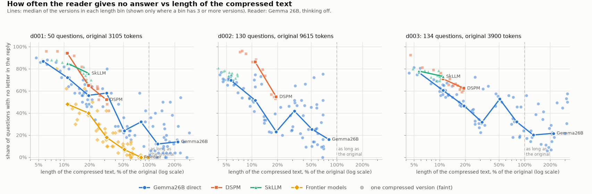
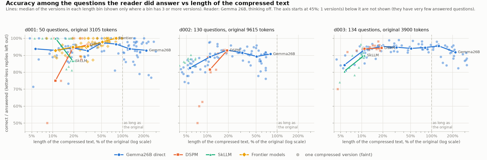

# Benchmark: compressed dialogues read by Gemma

Date: 2026-11-17 · Reader: `cyankiwi/gemma-4-26B-A4B-it-AWQ-4bit` (config `Gemma26B_ThinkOff`) on a vLLM server · Seed: 42

The reader LLM gets **only the compressed text** (as chat history) and answers a single-choice survey (5 answers, one correct) written for the original dialogue. The share of correct answers is the score of the compressed text. Every question is asked in a separate chat, answers are shuffled once (same order for every version). See `utils/benchmark_compressed.py` for details.

## Main observations

All numbers are in the tables below; the "shorter" tables leave out versions that are as long as the original. Statements are about this reader (Gemma 26B, thinking off) and this data, and the dialogues are only three, so treat them as a first picture.

1. **The reader abstains instead of guessing.** About half of all queries (21 410 of 42 304) got no letter, because the text does not contain the fact. So the accuracy mostly measures how many facts survived, and "accuracy among answered" (about 83–96% for most methods) shows that the facts which did survive are used correctly.
2. **Frontier models keep the most facts per token (d001 only).** Mean accuracy 77% at a median of 37% of the original tokens; the best strongly compressed versions: Sonnet 5.5 Medium at 32% of the original gives 90%, at 25% gives 84%. Frontier files exist only for d001.
3. **The local Gemma compressors are much weaker.** `compress_Gemma26B`: 44–45% mean accuracy at 14–20% of the tokens; DSPM and SkLLM compress hardest (5–21% of the tokens) and keep the fewest facts (mean accuracy 16–30%).
4. **`compress_Gemma26B` often does not compress.** On d001 37 of 90 and on d003 28 of 90 versions are as long as or longer than the original (up to 278%); the best scores of this method come from such versions, so read the "shorter" tables.
5. **Compression removes facts; it does not make the reader worse.** Among the questions the reader does answer, accuracy stays high at every length (medians of the length bins: 75–100%, see the charts); what grows with shortening is the share of questions with no answer. The reader's replies without a letter are real refusals ("The provided text does not contain..."), see the examples.
6. **Prompt p03 (the most detailed one) gives the best accuracy** on the same compressor; the clean comparison is Gemma with thinking off, where all prompts keep the requested length (see the prompt comparison section).
7. **Noise level:** a difference of one question between two versions is within the repeatability of the reader (see the last section).

## Charts: how each method works depending on the length of the compressed text

Each dot is one compressed version, the line is the median of the versions in a length bin (bins with fewer than 3 versions are not drawn). The x axis is the length of the compressed text as a share of the original, on a log scale; right of the dashed line the text is longer than the original. The numbers behind the dots are in the tables of each dialogue below.

### Accuracy


The longer the text, the more facts the reader finds, for every method and every dialogue. At the same length Frontier models are ahead on d001, and the local Gemma compressors are close to each other. The lines are not smooth because there are only a few versions per bin (the zigzag of `compress_Gemma26B` on d002 and d003 is that noise, not a trend).

### Why the accuracy falls: the reader stops answering





The first chart is the mirror image of the accuracy chart: the shorter the text, the more questions end without a letter. The second chart leaves those out: **among the questions the reader does answer, accuracy stays high at every length** (the medians of the length bins lie between 75% and 100%; the lowest values come from the very shortest DSPM and SkLLM versions, which answer so few questions that their value is noisy). So compression mostly **removes facts**, and the facts that remain are used correctly.

## How to read the numbers

- **Accuracy** = correct answers / questions. A missing or unreadable answer counts as wrong.
- **No answer** = the reader gave no letter. We checked the raw replies of the trial run: this is not a technical failure, the model says *"Please provide the text so I can answer"* (no text) or *"The provided text does not contain information regarding..."* (compressed text without the fact). So "no answer" is a measure of **facts that were lost**, and the model abstains instead of guessing.
- **No Text** (floor): the reader sees only the questions. Because it abstains instead of guessing, the floor is **below** the 20% of random guessing.
- **Original Text** (ceiling): the reader sees the full dialogue. A compressed text is good when it is close to this number, not to 100%.
- **% of original**: tokens of the compressed text / tokens of the original text (the lower, the stronger the compression).
- **target words** is only the length the compressor was asked for. The benchmark always uses the whole text that really came out; its real length is in **words** and **tokens**.

## Setup

- Server: `http://192.168.0.53:8000`, concurrency 32, max model length 16384
- Reader settings: temperature 0.0, top_p 1.0, max answer tokens 8, reasoning off
- 12 runs, 42304 LLM queries in total, 21410 of them without a letter (counted as wrong)
- Not benchmarked: `d004` (a story, not a dialogue; has no compressed versions yet)

Command of each run (the raw results are in `data/`):

```
uv run utils/benchmark_compressed.py data/data.d001.toml data/compress.DSPM.toml --base-url http://192.168.0.53:8000 --output data/benchmark.DSPM.d001.toml
uv run utils/benchmark_compressed.py data/data.d002.toml data/compress.DSPM.toml --base-url http://192.168.0.53:8000 --output data/benchmark.DSPM.d002.toml
uv run utils/benchmark_compressed.py data/data.d003.toml data/compress.DSPM.toml --base-url http://192.168.0.53:8000 --output data/benchmark.DSPM.d003.toml
uv run utils/benchmark_compressed.py data/data.d001.toml data/compress.Frontier.p01.d001.toml --base-url http://192.168.0.53:8000 --output data/benchmark.Frontier.p01.d001.toml
uv run utils/benchmark_compressed.py data/data.d001.toml data/compress.Frontier.p02.d001.toml --base-url http://192.168.0.53:8000 --output data/benchmark.Frontier.p02.d001.toml
uv run utils/benchmark_compressed.py data/data.d001.toml data/compress.Frontier.p03.d001.toml --base-url http://192.168.0.53:8000 --output data/benchmark.Frontier.p03.d001.toml
uv run utils/benchmark_compressed.py data/data.d001.toml data/compress.Gemma26B.toml --base-url http://192.168.0.53:8000 --output data/benchmark.Gemma26B.d001.toml
uv run utils/benchmark_compressed.py data/data.d002.toml data/compress.Gemma26B.toml --base-url http://192.168.0.53:8000 --output data/benchmark.Gemma26B.d002.toml
uv run utils/benchmark_compressed.py data/data.d003.toml data/compress.Gemma26B.toml --base-url http://192.168.0.53:8000 --output data/benchmark.Gemma26B.d003.toml
uv run utils/benchmark_compressed.py data/data.d001.toml data/compress.SkLLM.toml --base-url http://192.168.0.53:8000 --output data/benchmark.SkLLM.d001.toml
uv run utils/benchmark_compressed.py data/data.d002.toml data/compress.SkLLM.toml --base-url http://192.168.0.53:8000 --output data/benchmark.SkLLM.d002.toml
uv run utils/benchmark_compressed.py data/data.d003.toml data/compress.SkLLM.toml --base-url http://192.168.0.53:8000 --output data/benchmark.SkLLM.d003.toml
```

## d001: 50 questions, original text 2065 words / 3105 tokens

Floor (no text): **6/50 = 12.0%** (44 no answer). Ceiling (original text): **50/50 = 100.0%** (0 no answer).

### Summary by method

| method | versions | tokens (min–max) | % of original (median) | accuracy mean | accuracy best | mean as % of ceiling | no answer (mean) | accuracy among answered (mean) |
|---|---:|---:|---:|---:|---:|---:|---:|---:|
| Gemma26B direct (compress_Gemma26B) | 90 | 145–11497 | 58% | 58.2% | 98.0% | 58% | 38% | 93.3% |
| DSPM (Gemma26B) | 15 | 192–1043 | 21% | 28.1% | 56.0% | 28% | 70% | 84.1% |
| SkLLM (Gemma26B) | 15 | 171–645 | 16% | 19.2% | 26.0% | 19% | 79% | 94.6% |
| Frontier models | 54 | 253–3009 | 37% | 77.4% | 100.0% | 77% | 20% | 96.4% |

### Only versions that are really shorter than the original

Some versions are as long as, or longer than, the original (the compressor did not shorten the text). They are legitimately high-scoring but are not compression, so here they are left out.

| method | versions shorter / all | % of original (median) | accuracy mean | accuracy best | no answer (mean) | accuracy among answered (mean) |
|---|---:|---:|---:|---:|---:|---:|
| Gemma26B direct (compress_Gemma26B) | 53 / 90 | 20% | 45.1% | 82.0% | 52% | 93.6% |
| DSPM (Gemma26B) | 15 / 15 | 21% | 28.1% | 56.0% | 70% | 84.1% |
| SkLLM (Gemma26B) | 15 / 15 | 16% | 19.2% | 26.0% | 79% | 94.6% |
| Frontier models | 54 / 54 | 37% | 77.4% | 100.0% | 20% | 96.4% |

### d001: Gemma26B direct (compress_Gemma26B)

| prompt | source LLM | target words | words | tokens | % of original | correct | accuracy | no answer | accuracy among answered |
|---|---|---:|---:|---:|---:|---:|---:|---:|---:|
| p01 | Gemma26B_ThinkMedium | 1200 | 6829 | 8634 | 278% | 49/50 | 98.0% | 0 | 98.0% |
| p01 | Gemma26B_ThinkMedium | 1100 | 4156 | 6313 | 203% | 48/50 | 96.0% | 2 | 100.0% |
| p01 | Gemma26B_ThinkMedium | 1000 | 3122 | 4516 | 145% | 45/50 | 90.0% | 4 | 97.8% |
| p01 | Gemma26B_ThinkMedium | 900 | 3999 | 4879 | 157% | 40/50 | 80.0% | 8 | 95.2% |
| p01 | Gemma26B_ThinkMedium | 800 | 3181 | 5110 | 165% | 40/50 | 80.0% | 5 | 88.9% |
| p01 | Gemma26B_ThinkMedium | 700 | 2557 | 3433 | 111% | 31/50 | 62.0% | 14 | 86.1% |
| p01 | Gemma26B_ThinkMedium | 600 | 2736 | 3663 | 118% | 28/50 | 56.0% | 20 | 93.3% |
| p01 | Gemma26B_ThinkMedium | 500 | 2059 | 2826 | 91% | 28/50 | 56.0% | 21 | 96.6% |
| p01 | Gemma26B_ThinkMedium | 400 | 3214 | 4382 | 141% | 25/50 | 50.0% | 21 | 86.2% |
| p01 | Gemma26B_ThinkMedium | 350 | 4030 | 5831 | 188% | 30/50 | 60.0% | 19 | 96.8% |
| p01 | Gemma26B_ThinkMedium | 300 | 3205 | 4507 | 145% | 24/50 | 48.0% | 25 | 96.0% |
| p01 | Gemma26B_ThinkMedium | 250 | 833 | 1113 | 36% | 20/50 | 40.0% | 29 | 95.2% |
| p01 | Gemma26B_ThinkMedium | 200 | 711 | 995 | 32% | 9/50 | 18.0% | 40 | 90.0% |
| p01 | Gemma26B_ThinkMedium | 150 | 2214 | 3265 | 105% | 28/50 | 56.0% | 18 | 87.5% |
| p01 | Gemma26B_ThinkMedium | 100 | 682 | 1007 | 32% | 20/50 | 40.0% | 29 | 95.2% |
| p02 | Gemma26B_ThinkMedium | 1200 | 2716 | 4003 | 129% | 45/50 | 90.0% | 2 | 93.8% |
| p02 | Gemma26B_ThinkMedium | 1100 | 4145 | 5535 | 178% | 44/50 | 88.0% | 2 | 91.7% |
| p02 | Gemma26B_ThinkMedium | 1000 | 2138 | 3162 | 102% | 45/50 | 90.0% | 1 | 91.8% |
| p02 | Gemma26B_ThinkMedium | 900 | 2732 | 3829 | 123% | 48/50 | 96.0% | 0 | 96.0% |
| p02 | Gemma26B_ThinkMedium | 800 | 1779 | 2691 | 87% | 41/50 | 82.0% | 5 | 91.1% |
| p02 | Gemma26B_ThinkMedium | 700 | 2150 | 3255 | 105% | 43/50 | 86.0% | 3 | 91.5% |
| p02 | Gemma26B_ThinkMedium | 600 | 3888 | 4956 | 160% | 37/50 | 74.0% | 10 | 92.5% |
| p02 | Gemma26B_ThinkMedium | 500 | 2690 | 4640 | 149% | 38/50 | 76.0% | 9 | 92.7% |
| p02 | Gemma26B_ThinkMedium | 400 | 1904 | 2801 | 90% | 34/50 | 68.0% | 16 | 100.0% |
| p02 | Gemma26B_ThinkMedium | 350 | 3073 | 4622 | 149% | 38/50 | 76.0% | 5 | 84.4% |
| p02 | Gemma26B_ThinkMedium | 300 | 3081 | 4668 | 150% | 35/50 | 70.0% | 15 | 100.0% |
| p02 | Gemma26B_ThinkMedium | 250 | 1012 | 1562 | 50% | 32/50 | 64.0% | 18 | 100.0% |
| p02 | Gemma26B_ThinkMedium | 200 | 859 | 1350 | 43% | 26/50 | 52.0% | 24 | 100.0% |
| p02 | Gemma26B_ThinkMedium | 150 | 3327 | 5425 | 175% | 34/50 | 68.0% | 7 | 79.1% |
| p02 | Gemma26B_ThinkMedium | 100 | 5269 | 7982 | 257% | 33/50 | 66.0% | 7 | 76.7% |
| p03 | Gemma26B_ThinkMedium | 1200 | 3292 | 4964 | 160% | 45/50 | 90.0% | 0 | 90.0% |
| p03 | Gemma26B_ThinkMedium | 1100 | 3416 | 4983 | 160% | 47/50 | 94.0% | 2 | 97.9% |
| p03 | Gemma26B_ThinkMedium | 1000 | 2653 | 4511 | 145% | 48/50 | 96.0% | 2 | 100.0% |
| p03 | Gemma26B_ThinkMedium | 900 | 3215 | 4818 | 155% | 49/50 | 98.0% | 0 | 98.0% |
| p03 | Gemma26B_ThinkMedium | 800 | 2537 | 3657 | 118% | 46/50 | 92.0% | 3 | 97.9% |
| p03 | Gemma26B_ThinkMedium | 700 | 4277 | 7241 | 233% | 47/50 | 94.0% | 2 | 97.9% |
| p03 | Gemma26B_ThinkMedium | 600 | 2570 | 3749 | 121% | 42/50 | 84.0% | 6 | 95.5% |
| p03 | Gemma26B_ThinkMedium | 500 | 3899 | 6077 | 196% | 43/50 | 86.0% | 6 | 97.7% |
| p03 | Gemma26B_ThinkMedium | 400 | 6820 | 11497 | 370% | 40/50 | 80.0% | 7 | 93.0% |
| p03 | Gemma26B_ThinkMedium | 350 | 3252 | 4751 | 153% | 36/50 | 72.0% | 13 | 97.3% |
| p03 | Gemma26B_ThinkMedium | 300 | 4075 | 6647 | 214% | 39/50 | 78.0% | 8 | 92.9% |
| p03 | Gemma26B_ThinkMedium | 250 | 3218 | 5498 | 177% | 23/50 | 46.0% | 25 | 92.0% |
| p03 | Gemma26B_ThinkMedium | 200 | 3578 | 6823 | 220% | 35/50 | 70.0% | 14 | 97.2% |
| p03 | Gemma26B_ThinkMedium | 150 | 4657 | 9283 | 299% | 36/50 | 72.0% | 11 | 92.3% |
| p03 | Gemma26B_ThinkMedium | 100 | 4142 | 7276 | 234% | 18/50 | 36.0% | 27 | 78.3% |
| p01 | Gemma26B_ThinkOff | 1200 | 1284 | 1862 | 60% | 37/50 | 74.0% | 12 | 97.4% |
| p01 | Gemma26B_ThinkOff | 1100 | 1227 | 1813 | 58% | 38/50 | 76.0% | 12 | 100.0% |
| p01 | Gemma26B_ThinkOff | 1000 | 1259 | 1810 | 58% | 40/50 | 80.0% | 10 | 100.0% |
| p01 | Gemma26B_ThinkOff | 900 | 2069 | 2404 | 77% | 17/50 | 34.0% | 29 | 81.0% |
| p01 | Gemma26B_ThinkOff | 800 | 1018 | 1440 | 46% | 37/50 | 74.0% | 12 | 97.4% |
| p01 | Gemma26B_ThinkOff | 700 | 644 | 882 | 28% | 17/50 | 34.0% | 31 | 89.5% |
| p01 | Gemma26B_ThinkOff | 600 | 635 | 887 | 29% | 24/50 | 48.0% | 23 | 88.9% |
| p01 | Gemma26B_ThinkOff | 500 | 473 | 661 | 21% | 17/50 | 34.0% | 32 | 94.4% |
| p01 | Gemma26B_ThinkOff | 400 | 394 | 542 | 17% | 16/50 | 32.0% | 33 | 94.1% |
| p01 | Gemma26B_ThinkOff | 350 | 369 | 518 | 17% | 11/50 | 22.0% | 35 | 73.3% |
| p01 | Gemma26B_ThinkOff | 300 | 278 | 353 | 11% | 9/50 | 18.0% | 40 | 90.0% |
| p01 | Gemma26B_ThinkOff | 250 | 241 | 309 | 10% | 8/50 | 16.0% | 41 | 88.9% |
| p01 | Gemma26B_ThinkOff | 200 | 187 | 249 | 8% | 7/50 | 14.0% | 43 | 100.0% |
| p01 | Gemma26B_ThinkOff | 150 | 150 | 197 | 6% | 6/50 | 12.0% | 44 | 100.0% |
| p01 | Gemma26B_ThinkOff | 100 | 105 | 145 | 5% | 5/50 | 10.0% | 45 | 100.0% |
| p02 | Gemma26B_ThinkOff | 1200 | 383 | 584 | 19% | 22/50 | 44.0% | 26 | 91.7% |
| p02 | Gemma26B_ThinkOff | 1100 | 361 | 567 | 18% | 24/50 | 48.0% | 24 | 92.3% |
| p02 | Gemma26B_ThinkOff | 1000 | 393 | 611 | 20% | 25/50 | 50.0% | 24 | 96.2% |
| p02 | Gemma26B_ThinkOff | 900 | 360 | 574 | 18% | 24/50 | 48.0% | 23 | 88.9% |
| p02 | Gemma26B_ThinkOff | 800 | 325 | 516 | 17% | 21/50 | 42.0% | 28 | 95.5% |
| p02 | Gemma26B_ThinkOff | 700 | 445 | 666 | 21% | 23/50 | 46.0% | 26 | 95.8% |
| p02 | Gemma26B_ThinkOff | 600 | 394 | 589 | 19% | 22/50 | 44.0% | 28 | 100.0% |
| p02 | Gemma26B_ThinkOff | 500 | 366 | 564 | 18% | 19/50 | 38.0% | 30 | 95.0% |
| p02 | Gemma26B_ThinkOff | 400 | 342 | 531 | 17% | 18/50 | 36.0% | 29 | 85.7% |
| p02 | Gemma26B_ThinkOff | 350 | 326 | 504 | 16% | 19/50 | 38.0% | 28 | 86.4% |
| p02 | Gemma26B_ThinkOff | 300 | 300 | 469 | 15% | 19/50 | 38.0% | 31 | 100.0% |
| p02 | Gemma26B_ThinkOff | 250 | 263 | 415 | 13% | 20/50 | 40.0% | 29 | 95.2% |
| p02 | Gemma26B_ThinkOff | 200 | 232 | 356 | 11% | 14/50 | 28.0% | 36 | 100.0% |
| p02 | Gemma26B_ThinkOff | 150 | 173 | 278 | 9% | 10/50 | 20.0% | 39 | 90.9% |
| p02 | Gemma26B_ThinkOff | 100 | 103 | 163 | 5% | 5/50 | 10.0% | 43 | 71.4% |
| p03 | Gemma26B_ThinkOff | 1200 | 1036 | 1567 | 50% | 36/50 | 72.0% | 11 | 92.3% |
| p03 | Gemma26B_ThinkOff | 1100 | 1381 | 2103 | 68% | 40/50 | 80.0% | 10 | 100.0% |
| p03 | Gemma26B_ThinkOff | 1000 | 1144 | 1683 | 54% | 38/50 | 76.0% | 9 | 92.7% |
| p03 | Gemma26B_ThinkOff | 900 | 1258 | 1898 | 61% | 41/50 | 82.0% | 8 | 97.6% |
| p03 | Gemma26B_ThinkOff | 800 | 1131 | 1709 | 55% | 35/50 | 70.0% | 14 | 97.2% |
| p03 | Gemma26B_ThinkOff | 700 | 844 | 1240 | 40% | 35/50 | 70.0% | 14 | 97.2% |
| p03 | Gemma26B_ThinkOff | 600 | 912 | 1341 | 43% | 34/50 | 68.0% | 14 | 94.4% |
| p03 | Gemma26B_ThinkOff | 500 | 517 | 722 | 23% | 31/50 | 62.0% | 17 | 93.9% |
| p03 | Gemma26B_ThinkOff | 400 | 443 | 651 | 21% | 26/50 | 52.0% | 23 | 96.3% |
| p03 | Gemma26B_ThinkOff | 350 | 337 | 511 | 16% | 23/50 | 46.0% | 25 | 92.0% |
| p03 | Gemma26B_ThinkOff | 300 | 299 | 471 | 15% | 20/50 | 40.0% | 29 | 95.2% |
| p03 | Gemma26B_ThinkOff | 250 | 246 | 377 | 12% | 16/50 | 32.0% | 33 | 94.1% |
| p03 | Gemma26B_ThinkOff | 200 | 214 | 348 | 11% | 16/50 | 32.0% | 32 | 88.9% |
| p03 | Gemma26B_ThinkOff | 150 | 152 | 289 | 9% | 13/50 | 26.0% | 36 | 92.9% |
| p03 | Gemma26B_ThinkOff | 100 | 106 | 195 | 6% | 7/50 | 14.0% | 42 | 87.5% |

### d001: DSPM (Gemma26B)

| prompt | source LLM | target words | words | tokens | % of original | correct | accuracy | no answer | accuracy among answered |
|---|---|---:|---:|---:|---:|---:|---:|---:|---:|
| NA | DSPM/Gemma26B | 1200 | 764 | 1043 | 34% | 28/50 | 56.0% | 21 | 96.6% |
| NA | DSPM/Gemma26B | 1100 | 737 | 996 | 32% | 25/50 | 50.0% | 24 | 96.2% |
| NA | DSPM/Gemma26B | 1000 | 573 | 796 | 26% | 21/50 | 42.0% | 26 | 87.5% |
| NA | DSPM/Gemma26B | 900 | 559 | 778 | 25% | 17/50 | 34.0% | 31 | 89.5% |
| NA | DSPM/Gemma26B | 800 | 562 | 765 | 25% | 17/50 | 34.0% | 31 | 89.5% |
| NA | DSPM/Gemma26B | 700 | 603 | 819 | 26% | 22/50 | 44.0% | 28 | 100.0% |
| NA | DSPM/Gemma26B | 600 | 469 | 624 | 20% | 17/50 | 34.0% | 33 | 100.0% |
| NA | DSPM/Gemma26B | 500 | 557 | 767 | 25% | 18/50 | 36.0% | 32 | 100.0% |
| NA | DSPM/Gemma26B | 400 | 482 | 650 | 21% | 17/50 | 34.0% | 32 | 94.4% |
| NA | DSPM/Gemma26B | 350 | 413 | 565 | 18% | 14/50 | 28.0% | 35 | 93.3% |
| NA | DSPM/Gemma26B | 300 | 345 | 502 | 16% | 8/50 | 16.0% | 41 | 88.9% |
| NA | DSPM/Gemma26B | 250 | 255 | 405 | 13% | 3/50 | 6.0% | 46 | 75.0% |
| NA | DSPM/Gemma26B | 200 | 191 | 326 | 10% | 3/50 | 6.0% | 47 | 100.0% |
| NA | DSPM/Gemma26B | 150 | 117 | 258 | 8% | 1/50 | 2.0% | 48 | 50.0% |
| NA | DSPM/Gemma26B | 100 | 77 | 192 | 6% | 0/50 | 0.0% | 48 | 0.0% |

### d001: SkLLM (Gemma26B)

| prompt | source LLM | target words | words | tokens | % of original | correct | accuracy | no answer | accuracy among answered |
|---|---|---:|---:|---:|---:|---:|---:|---:|---:|
| NA | Gemma26B | 1200 | 413 | 581 | 19% | 13/50 | 26.0% | 34 | 81.2% |
| NA | Gemma26B | 1100 | 417 | 580 | 19% | 12/50 | 24.0% | 38 | 100.0% |
| NA | Gemma26B | 1000 | 396 | 556 | 18% | 13/50 | 26.0% | 37 | 100.0% |
| NA | Gemma26B | 900 | 458 | 645 | 21% | 13/50 | 26.0% | 35 | 86.7% |
| NA | Gemma26B | 800 | 383 | 527 | 17% | 9/50 | 18.0% | 41 | 100.0% |
| NA | Gemma26B | 700 | 391 | 526 | 17% | 10/50 | 20.0% | 38 | 83.3% |
| NA | Gemma26B | 600 | 360 | 488 | 16% | 9/50 | 18.0% | 39 | 81.8% |
| NA | Gemma26B | 500 | 407 | 562 | 18% | 13/50 | 26.0% | 35 | 86.7% |
| NA | Gemma26B | 400 | 359 | 478 | 15% | 11/50 | 22.0% | 39 | 100.0% |
| NA | Gemma26B | 350 | 282 | 373 | 12% | 8/50 | 16.0% | 42 | 100.0% |
| NA | Gemma26B | 300 | 256 | 333 | 11% | 8/50 | 16.0% | 42 | 100.0% |
| NA | Gemma26B | 250 | 218 | 294 | 9% | 7/50 | 14.0% | 43 | 100.0% |
| NA | Gemma26B | 200 | 193 | 254 | 8% | 6/50 | 12.0% | 44 | 100.0% |
| NA | Gemma26B | 150 | 159 | 221 | 7% | 6/50 | 12.0% | 44 | 100.0% |
| NA | Gemma26B | 100 | 113 | 171 | 6% | 6/50 | 12.0% | 44 | 100.0% |

### d001: Frontier models

| prompt | source LLM | target words | words | tokens | % of original | correct | accuracy | no answer | accuracy among answered |
|---|---|---:|---:|---:|---:|---:|---:|---:|---:|
| p01 | ChatGPT default | 1200 | 1751 | 2471 | 80% | 48/50 | 96.0% | 1 | 98.0% |
| p01 | ChatGPT default | 1000 | 1382 | 1953 | 63% | 48/50 | 96.0% | 2 | 100.0% |
| p01 | ChatGPT default | 800 | 1218 | 1738 | 56% | 43/50 | 86.0% | 6 | 97.7% |
| p01 | ChatGPT default | 600 | 861 | 1247 | 40% | 38/50 | 76.0% | 11 | 97.4% |
| p01 | ChatGPT default | 400 | 530 | 766 | 25% | 27/50 | 54.0% | 21 | 93.1% |
| p01 | ChatGPT default | 200 | 254 | 353 | 11% | 23/50 | 46.0% | 24 | 88.5% |
| p02 | ChatGPT default | 1200 | 1577 | 1880 | 61% | 49/50 | 98.0% | 0 | 98.0% |
| p02 | ChatGPT default | 1000 | 1445 | 2014 | 65% | 45/50 | 90.0% | 4 | 97.8% |
| p02 | ChatGPT default | 800 | 1091 | 1339 | 43% | 43/50 | 86.0% | 7 | 100.0% |
| p02 | ChatGPT default | 600 | 750 | 937 | 30% | 35/50 | 70.0% | 13 | 94.6% |
| p02 | ChatGPT default | 400 | 577 | 742 | 24% | 36/50 | 72.0% | 12 | 94.7% |
| p02 | ChatGPT default | 200 | 320 | 426 | 14% | 25/50 | 50.0% | 24 | 96.2% |
| p03 | ChatGPT default | 1200 | 1240 | 1824 | 59% | 49/50 | 98.0% | 1 | 100.0% |
| p03 | ChatGPT default | 1000 | 1261 | 1835 | 59% | 49/50 | 98.0% | 1 | 100.0% |
| p03 | ChatGPT default | 800 | 1104 | 1610 | 52% | 45/50 | 90.0% | 4 | 97.8% |
| p03 | ChatGPT default | 600 | 696 | 1010 | 33% | 40/50 | 80.0% | 9 | 97.6% |
| p03 | ChatGPT default | 400 | 506 | 787 | 25% | 34/50 | 68.0% | 15 | 97.1% |
| p03 | ChatGPT default | 200 | 243 | 389 | 13% | 26/50 | 52.0% | 22 | 92.9% |
| p01 | Gemini 3 Medium | 1200 | 2065 | 3007 | 97% | 50/50 | 100.0% | 0 | 100.0% |
| p01 | Gemini 3 Medium | 1000 | 1391 | 1891 | 61% | 43/50 | 86.0% | 6 | 97.7% |
| p01 | Gemini 3 Medium | 800 | 1134 | 1537 | 50% | 43/50 | 86.0% | 6 | 97.7% |
| p01 | Gemini 3 Medium | 600 | 714 | 973 | 31% | 25/50 | 50.0% | 21 | 86.2% |
| p01 | Gemini 3 Medium | 400 | 471 | 669 | 22% | 24/50 | 48.0% | 25 | 96.0% |
| p01 | Gemini 3 Medium | 200 | 195 | 253 | 8% | 10/50 | 20.0% | 40 | 100.0% |
| p02 | Gemini 3 Medium | 1200 | 649 | 975 | 31% | 40/50 | 80.0% | 8 | 95.2% |
| p02 | Gemini 3 Medium | 1000 | 677 | 971 | 31% | 39/50 | 78.0% | 9 | 95.1% |
| p02 | Gemini 3 Medium | 800 | 673 | 947 | 30% | 37/50 | 74.0% | 11 | 94.9% |
| p02 | Gemini 3 Medium | 600 | 541 | 783 | 25% | 33/50 | 66.0% | 13 | 89.2% |
| p02 | Gemini 3 Medium | 400 | 420 | 598 | 19% | 31/50 | 62.0% | 19 | 100.0% |
| p02 | Gemini 3 Medium | 200 | 239 | 331 | 11% | 17/50 | 34.0% | 31 | 89.5% |
| p03 | Gemini 3 Medium | 1200 | 2065 | 3009 | 97% | 50/50 | 100.0% | 0 | 100.0% |
| p03 | Gemini 3 Medium | 1000 | 1038 | 1532 | 49% | 43/50 | 86.0% | 5 | 95.6% |
| p03 | Gemini 3 Medium | 800 | 1298 | 1911 | 62% | 41/50 | 82.0% | 7 | 95.3% |
| p03 | Gemini 3 Medium | 600 | 942 | 1380 | 44% | 36/50 | 72.0% | 12 | 94.7% |
| p03 | Gemini 3 Medium | 400 | 547 | 810 | 26% | 33/50 | 66.0% | 15 | 94.3% |
| p03 | Gemini 3 Medium | 200 | 289 | 468 | 15% | 27/50 | 54.0% | 20 | 90.0% |
| p01 | Sonnet 5.5 Medium | 1200 | 1833 | 2684 | 86% | 50/50 | 100.0% | 0 | 100.0% |
| p01 | Sonnet 5.5 Medium | 1000 | 1595 | 2363 | 76% | 50/50 | 100.0% | 0 | 100.0% |
| p01 | Sonnet 5.5 Medium | 800 | 1346 | 1979 | 64% | 48/50 | 96.0% | 1 | 98.0% |
| p01 | Sonnet 5.5 Medium | 600 | 1089 | 1611 | 52% | 45/50 | 90.0% | 3 | 95.7% |
| p01 | Sonnet 5.5 Medium | 400 | 777 | 1171 | 38% | 34/50 | 68.0% | 11 | 87.2% |
| p01 | Sonnet 5.5 Medium | 200 | 349 | 538 | 17% | 17/50 | 34.0% | 31 | 89.5% |
| p02 | Sonnet 5.5 Medium | 1200 | 997 | 1340 | 43% | 48/50 | 96.0% | 2 | 100.0% |
| p02 | Sonnet 5.5 Medium | 1000 | 907 | 1172 | 38% | 45/50 | 90.0% | 5 | 100.0% |
| p02 | Sonnet 5.5 Medium | 800 | 759 | 1009 | 32% | 45/50 | 90.0% | 5 | 100.0% |
| p02 | Sonnet 5.5 Medium | 600 | 753 | 998 | 32% | 45/50 | 90.0% | 5 | 100.0% |
| p02 | Sonnet 5.5 Medium | 400 | 556 | 767 | 25% | 42/50 | 84.0% | 8 | 100.0% |
| p02 | Sonnet 5.5 Medium | 200 | 295 | 441 | 14% | 31/50 | 62.0% | 17 | 93.9% |
| p03 | Sonnet 5.5 Medium | 1200 | 1266 | 1898 | 61% | 50/50 | 100.0% | 0 | 100.0% |
| p03 | Sonnet 5.5 Medium | 1000 | 1103 | 1697 | 55% | 49/50 | 98.0% | 1 | 100.0% |
| p03 | Sonnet 5.5 Medium | 800 | 1043 | 1585 | 51% | 46/50 | 92.0% | 3 | 97.9% |
| p03 | Sonnet 5.5 Medium | 600 | 756 | 1141 | 37% | 44/50 | 88.0% | 5 | 97.8% |
| p03 | Sonnet 5.5 Medium | 400 | 555 | 884 | 28% | 43/50 | 86.0% | 7 | 100.0% |
| p03 | Sonnet 5.5 Medium | 200 | 253 | 421 | 14% | 32/50 | 64.0% | 15 | 91.4% |

## d002: 130 questions, original text 7409 words / 9615 tokens

Floor (no text): **16/130 = 12.3%** (114 no answer). Ceiling (original text): **130/130 = 100.0%** (0 no answer).

### Summary by method

| method | versions | tokens (min–max) | % of original (median) | accuracy mean | accuracy best | mean as % of ceiling | no answer (mean) | accuracy among answered (mean) |
|---|---:|---:|---:|---:|---:|---:|---:|---:|
| Gemma26B direct (compress_Gemma26B) | 90 | 134–6736 | 14% | 43.9% | 91.5% | 44% | 50% | 86.0% |
| DSPM (Gemma26B) | 13 | 269–1815 | 10% | 15.6% | 43.1% | 16% | 82% | 73.0% |
| SkLLM (Gemma26B) | 15 | 136–650 | 5% | 18.4% | 23.8% | 18% | 78% | 83.3% |

### Only versions that are really shorter than the original

Some versions are as long as, or longer than, the original (the compressor did not shorten the text). They are legitimately high-scoring but are not compression, so here they are left out.

| method | versions shorter / all | % of original (median) | accuracy mean | accuracy best | no answer (mean) | accuracy among answered (mean) |
|---|---:|---:|---:|---:|---:|---:|
| Gemma26B direct (compress_Gemma26B) | 90 / 90 | 14% | 43.9% | 91.5% | 50% | 86.0% |
| DSPM (Gemma26B) | 13 / 13 | 10% | 15.6% | 43.1% | 82% | 73.0% |
| SkLLM (Gemma26B) | 15 / 15 | 5% | 18.4% | 23.8% | 78% | 83.3% |

### d002: Gemma26B direct (compress_Gemma26B)

| prompt | source LLM | target words | words | tokens | % of original | correct | accuracy | no answer | accuracy among answered |
|---|---|---:|---:|---:|---:|---:|---:|---:|---:|
| p01 | Gemma26B_ThinkMedium | 1200 | 2133 | 2796 | 29% | 91/130 | 70.0% | 31 | 91.9% |
| p01 | Gemma26B_ThinkMedium | 1100 | 5250 | 6736 | 70% | 109/130 | 83.9% | 10 | 90.8% |
| p01 | Gemma26B_ThinkMedium | 1000 | 2744 | 3587 | 37% | 97/130 | 74.6% | 28 | 95.1% |
| p01 | Gemma26B_ThinkMedium | 900 | 2283 | 2916 | 30% | 86/130 | 66.1% | 36 | 91.5% |
| p01 | Gemma26B_ThinkMedium | 800 | 2786 | 3785 | 39% | 92/130 | 70.8% | 23 | 86.0% |
| p01 | Gemma26B_ThinkMedium | 700 | 1903 | 2618 | 27% | 64/130 | 49.2% | 60 | 91.4% |
| p01 | Gemma26B_ThinkMedium | 600 | 2581 | 3258 | 34% | 64/130 | 49.2% | 61 | 92.8% |
| p01 | Gemma26B_ThinkMedium | 500 | 2302 | 3094 | 32% | 60/130 | 46.2% | 64 | 90.9% |
| p01 | Gemma26B_ThinkMedium | 400 | 2875 | 4025 | 42% | 58/130 | 44.6% | 61 | 84.1% |
| p01 | Gemma26B_ThinkMedium | 350 | 3219 | 4105 | 43% | 40/130 | 30.8% | 86 | 90.9% |
| p01 | Gemma26B_ThinkMedium | 300 | 2583 | 3121 | 32% | 40/130 | 30.8% | 84 | 87.0% |
| p01 | Gemma26B_ThinkMedium | 250 | 4238 | 5561 | 58% | 58/130 | 44.6% | 58 | 80.6% |
| p01 | Gemma26B_ThinkMedium | 200 | 746 | 1056 | 11% | 30/130 | 23.1% | 97 | 90.9% |
| p01 | Gemma26B_ThinkMedium | 150 | 2397 | 3684 | 38% | 57/130 | 43.9% | 67 | 90.5% |
| p01 | Gemma26B_ThinkMedium | 100 | 764 | 1058 | 11% | 46/130 | 35.4% | 83 | 97.9% |
| p02 | Gemma26B_ThinkMedium | 1200 | 2111 | 2856 | 30% | 92/130 | 70.8% | 32 | 93.9% |
| p02 | Gemma26B_ThinkMedium | 1100 | 4030 | 5211 | 54% | 104/130 | 80.0% | 18 | 92.9% |
| p02 | Gemma26B_ThinkMedium | 1000 | 4452 | 6644 | 69% | 104/130 | 80.0% | 13 | 88.9% |
| p02 | Gemma26B_ThinkMedium | 900 | 4445 | 5705 | 59% | 104/130 | 80.0% | 15 | 90.4% |
| p02 | Gemma26B_ThinkMedium | 800 | 1989 | 2738 | 28% | 74/130 | 56.9% | 49 | 91.4% |
| p02 | Gemma26B_ThinkMedium | 700 | 3211 | 4455 | 46% | 92/130 | 70.8% | 33 | 94.8% |
| p02 | Gemma26B_ThinkMedium | 600 | 1567 | 2096 | 22% | 68/130 | 52.3% | 59 | 95.8% |
| p02 | Gemma26B_ThinkMedium | 500 | 2212 | 3063 | 32% | 58/130 | 44.6% | 67 | 92.1% |
| p02 | Gemma26B_ThinkMedium | 400 | 1265 | 1802 | 19% | 72/130 | 55.4% | 51 | 91.1% |
| p02 | Gemma26B_ThinkMedium | 350 | 3266 | 4788 | 50% | 67/130 | 51.5% | 59 | 94.4% |
| p02 | Gemma26B_ThinkMedium | 300 | 4793 | 6302 | 66% | 81/130 | 62.3% | 41 | 91.0% |
| p02 | Gemma26B_ThinkMedium | 250 | 2707 | 3849 | 40% | 73/130 | 56.1% | 49 | 90.1% |
| p02 | Gemma26B_ThinkMedium | 200 | 812 | 1229 | 13% | 31/130 | 23.8% | 95 | 88.6% |
| p02 | Gemma26B_ThinkMedium | 150 | 871 | 1252 | 13% | 40/130 | 30.8% | 86 | 90.9% |
| p02 | Gemma26B_ThinkMedium | 100 | 671 | 1028 | 11% | 38/130 | 29.2% | 91 | 97.4% |
| p03 | Gemma26B_ThinkMedium | 1200 | 4191 | 6568 | 68% | 119/130 | 91.5% | 0 | 91.5% |
| p03 | Gemma26B_ThinkMedium | 1100 | 3467 | 4905 | 51% | 112/130 | 86.2% | 13 | 95.7% |
| p03 | Gemma26B_ThinkMedium | 1000 | 3077 | 4166 | 43% | 109/130 | 83.9% | 12 | 92.4% |
| p03 | Gemma26B_ThinkMedium | 900 | 4461 | 6342 | 66% | 107/130 | 82.3% | 12 | 90.7% |
| p03 | Gemma26B_ThinkMedium | 800 | 3823 | 5085 | 53% | 100/130 | 76.9% | 18 | 89.3% |
| p03 | Gemma26B_ThinkMedium | 700 | 5400 | 6589 | 69% | 100/130 | 76.9% | 21 | 91.7% |
| p03 | Gemma26B_ThinkMedium | 600 | 3779 | 5371 | 56% | 84/130 | 64.6% | 33 | 86.6% |
| p03 | Gemma26B_ThinkMedium | 500 | 3787 | 5426 | 56% | 85/130 | 65.4% | 33 | 87.6% |
| p03 | Gemma26B_ThinkMedium | 400 | 4220 | 5716 | 59% | 87/130 | 66.9% | 28 | 85.3% |
| p03 | Gemma26B_ThinkMedium | 350 | 3928 | 5565 | 58% | 59/130 | 45.4% | 62 | 86.8% |
| p03 | Gemma26B_ThinkMedium | 300 | 3832 | 5556 | 58% | 83/130 | 63.8% | 34 | 86.5% |
| p03 | Gemma26B_ThinkMedium | 250 | 4067 | 6599 | 69% | 48/130 | 36.9% | 67 | 76.2% |
| p03 | Gemma26B_ThinkMedium | 200 | 4819 | 6610 | 69% | 66/130 | 50.8% | 50 | 82.5% |
| p03 | Gemma26B_ThinkMedium | 150 | 2754 | 5180 | 54% | 28/130 | 21.5% | 94 | 77.8% |
| p03 | Gemma26B_ThinkMedium | 100 | 3574 | 6621 | 69% | 26/130 | 20.0% | 98 | 81.2% |
| p01 | Gemma26B_ThinkOff | 1200 | 1061 | 1403 | 15% | 76/130 | 58.5% | 44 | 88.4% |
| p01 | Gemma26B_ThinkOff | 1100 | 1002 | 1337 | 14% | 73/130 | 56.1% | 48 | 89.0% |
| p01 | Gemma26B_ThinkOff | 1000 | 747 | 973 | 10% | 53/130 | 40.8% | 67 | 84.1% |
| p01 | Gemma26B_ThinkOff | 900 | 770 | 1009 | 10% | 56/130 | 43.1% | 65 | 86.2% |
| p01 | Gemma26B_ThinkOff | 800 | 678 | 896 | 9% | 48/130 | 36.9% | 70 | 80.0% |
| p01 | Gemma26B_ThinkOff | 700 | 674 | 900 | 9% | 51/130 | 39.2% | 69 | 83.6% |
| p01 | Gemma26B_ThinkOff | 600 | 573 | 765 | 8% | 40/130 | 30.8% | 81 | 81.6% |
| p01 | Gemma26B_ThinkOff | 500 | 487 | 636 | 7% | 35/130 | 26.9% | 88 | 83.3% |
| p01 | Gemma26B_ThinkOff | 400 | 394 | 514 | 5% | 28/130 | 21.5% | 94 | 77.8% |
| p01 | Gemma26B_ThinkOff | 350 | 342 | 454 | 5% | 29/130 | 22.3% | 91 | 74.4% |
| p01 | Gemma26B_ThinkOff | 300 | 306 | 402 | 4% | 27/130 | 20.8% | 97 | 81.8% |
| p01 | Gemma26B_ThinkOff | 250 | 228 | 299 | 3% | 19/130 | 14.6% | 103 | 70.4% |
| p01 | Gemma26B_ThinkOff | 200 | 185 | 235 | 2% | 17/130 | 13.1% | 108 | 77.3% |
| p01 | Gemma26B_ThinkOff | 150 | 151 | 194 | 2% | 15/130 | 11.5% | 111 | 78.9% |
| p01 | Gemma26B_ThinkOff | 100 | 99 | 134 | 1% | 11/130 | 8.5% | 115 | 73.3% |
| p02 | Gemma26B_ThinkOff | 1200 | 458 | 661 | 7% | 45/130 | 34.6% | 76 | 83.3% |
| p02 | Gemma26B_ThinkOff | 1100 | 399 | 569 | 6% | 35/130 | 26.9% | 90 | 87.5% |
| p02 | Gemma26B_ThinkOff | 1000 | 409 | 569 | 6% | 34/130 | 26.2% | 90 | 85.0% |
| p02 | Gemma26B_ThinkOff | 900 | 422 | 606 | 6% | 38/130 | 29.2% | 86 | 86.4% |
| p02 | Gemma26B_ThinkOff | 800 | 370 | 500 | 5% | 34/130 | 26.2% | 91 | 87.2% |
| p02 | Gemma26B_ThinkOff | 700 | 386 | 504 | 5% | 32/130 | 24.6% | 92 | 84.2% |
| p02 | Gemma26B_ThinkOff | 600 | 438 | 587 | 6% | 36/130 | 27.7% | 85 | 80.0% |
| p02 | Gemma26B_ThinkOff | 500 | 405 | 543 | 6% | 29/130 | 22.3% | 96 | 85.3% |
| p02 | Gemma26B_ThinkOff | 400 | 361 | 517 | 5% | 28/130 | 21.5% | 92 | 73.7% |
| p02 | Gemma26B_ThinkOff | 350 | 328 | 441 | 5% | 30/130 | 23.1% | 92 | 78.9% |
| p02 | Gemma26B_ThinkOff | 300 | 302 | 420 | 4% | 24/130 | 18.5% | 100 | 80.0% |
| p02 | Gemma26B_ThinkOff | 250 | 247 | 349 | 4% | 22/130 | 16.9% | 100 | 73.3% |
| p02 | Gemma26B_ThinkOff | 200 | 248 | 354 | 4% | 20/130 | 15.4% | 104 | 76.9% |
| p02 | Gemma26B_ThinkOff | 150 | 163 | 231 | 2% | 17/130 | 13.1% | 108 | 77.3% |
| p02 | Gemma26B_ThinkOff | 100 | 145 | 219 | 2% | 16/130 | 12.3% | 108 | 72.7% |
| p03 | Gemma26B_ThinkOff | 1200 | 1597 | 2200 | 23% | 93/130 | 71.5% | 26 | 89.4% |
| p03 | Gemma26B_ThinkOff | 1100 | 1223 | 1622 | 17% | 94/130 | 72.3% | 29 | 93.1% |
| p03 | Gemma26B_ThinkOff | 1000 | 1167 | 1539 | 16% | 93/130 | 71.5% | 30 | 93.0% |
| p03 | Gemma26B_ThinkOff | 900 | 1023 | 1343 | 14% | 82/130 | 63.1% | 44 | 95.3% |
| p03 | Gemma26B_ThinkOff | 800 | 1014 | 1343 | 14% | 87/130 | 66.9% | 40 | 96.7% |
| p03 | Gemma26B_ThinkOff | 700 | 769 | 1023 | 11% | 68/130 | 52.3% | 54 | 89.5% |
| p03 | Gemma26B_ThinkOff | 600 | 682 | 911 | 9% | 61/130 | 46.9% | 60 | 87.1% |
| p03 | Gemma26B_ThinkOff | 500 | 534 | 734 | 8% | 53/130 | 40.8% | 70 | 88.3% |
| p03 | Gemma26B_ThinkOff | 400 | 385 | 520 | 5% | 32/130 | 24.6% | 91 | 82.1% |
| p03 | Gemma26B_ThinkOff | 350 | 355 | 495 | 5% | 35/130 | 26.9% | 85 | 77.8% |
| p03 | Gemma26B_ThinkOff | 300 | 310 | 438 | 5% | 34/130 | 26.2% | 89 | 82.9% |
| p03 | Gemma26B_ThinkOff | 250 | 240 | 347 | 4% | 25/130 | 19.2% | 99 | 80.6% |
| p03 | Gemma26B_ThinkOff | 200 | 206 | 292 | 3% | 24/130 | 18.5% | 99 | 77.4% |
| p03 | Gemma26B_ThinkOff | 150 | 153 | 221 | 2% | 22/130 | 16.9% | 100 | 73.3% |
| p03 | Gemma26B_ThinkOff | 100 | 96 | 155 | 2% | 14/130 | 10.8% | 110 | 70.0% |

### d002: DSPM (Gemma26B)

| prompt | source LLM | target words | words | tokens | % of original | correct | accuracy | no answer | accuracy among answered |
|---|---|---:|---:|---:|---:|---:|---:|---:|---:|
| NA | DSPM/Gemma26B | 1200 | 1335 | 1815 | 19% | 56/130 | 43.1% | 69 | 91.8% |
| NA | DSPM/Gemma26B | 1100 | 1243 | 1744 | 18% | 55/130 | 42.3% | 71 | 93.2% |
| NA | DSPM/Gemma26B | 1000 | 1135 | 1623 | 17% | 52/130 | 40.0% | 74 | 92.9% |
| NA | DSPM/Gemma26B | 900 | 909 | 1372 | 14% | 31/130 | 23.8% | 96 | 91.2% |
| NA | DSPM/Gemma26B | 800 | 814 | 1284 | 13% | 22/130 | 16.9% | 103 | 81.5% |
| NA | DSPM/Gemma26B | 700 | 628 | 1070 | 11% | 12/130 | 9.2% | 115 | 80.0% |
| NA | DSPM/Gemma26B | 600 | 563 | 975 | 10% | 16/130 | 12.3% | 112 | 88.9% |
| NA | DSPM/Gemma26B | 500 | 396 | 818 | 9% | 5/130 | 3.9% | 122 | 62.5% |
| NA | DSPM/Gemma26B | 400 | 355 | 737 | 8% | 3/130 | 2.3% | 125 | 60.0% |
| NA | DSPM/Gemma26B | 350 | 325 | 698 | 7% | 3/130 | 2.3% | 124 | 50.0% |
| NA | DSPM/Gemma26B | 300 | 131 | 290 | 3% | 2/130 | 1.5% | 126 | 50.0% |
| NA | DSPM/Gemma26B | 250 | 122 | 269 | 3% | 2/130 | 1.5% | 126 | 50.0% |
| NA | DSPM/Gemma26B | 200 | 123 | 272 | 3% | 4/130 | 3.1% | 123 | 57.1% |

### d002: SkLLM (Gemma26B)

| prompt | source LLM | target words | words | tokens | % of original | correct | accuracy | no answer | accuracy among answered |
|---|---|---:|---:|---:|---:|---:|---:|---:|---:|
| NA | Gemma26B | 1200 | 462 | 650 | 7% | 30/130 | 23.1% | 96 | 88.2% |
| NA | Gemma26B | 1100 | 481 | 644 | 7% | 28/130 | 21.5% | 98 | 87.5% |
| NA | Gemma26B | 1000 | 385 | 545 | 6% | 30/130 | 23.1% | 94 | 83.3% |
| NA | Gemma26B | 900 | 389 | 509 | 5% | 30/130 | 23.1% | 96 | 88.2% |
| NA | Gemma26B | 800 | 422 | 561 | 6% | 28/130 | 21.5% | 99 | 90.3% |
| NA | Gemma26B | 700 | 442 | 619 | 6% | 31/130 | 23.8% | 93 | 83.8% |
| NA | Gemma26B | 600 | 425 | 553 | 6% | 29/130 | 22.3% | 97 | 87.9% |
| NA | Gemma26B | 500 | 401 | 520 | 5% | 26/130 | 20.0% | 100 | 86.7% |
| NA | Gemma26B | 400 | 345 | 461 | 5% | 24/130 | 18.5% | 102 | 85.7% |
| NA | Gemma26B | 350 | 338 | 443 | 5% | 25/130 | 19.2% | 101 | 86.2% |
| NA | Gemma26B | 300 | 284 | 386 | 4% | 21/130 | 16.2% | 105 | 84.0% |
| NA | Gemma26B | 250 | 235 | 311 | 3% | 17/130 | 13.1% | 109 | 81.0% |
| NA | Gemma26B | 200 | 173 | 224 | 2% | 15/130 | 11.5% | 110 | 75.0% |
| NA | Gemma26B | 150 | 151 | 207 | 2% | 12/130 | 9.2% | 113 | 70.6% |
| NA | Gemma26B | 100 | 94 | 136 | 1% | 12/130 | 9.2% | 113 | 70.6% |

## d003: 134 questions, original text 3095 words / 3900 tokens

Floor (no text): **8/134 = 6.0%** (126 no answer). Ceiling (original text): **134/134 = 100.0%** (0 no answer).

### Summary by method

| method | versions | tokens (min–max) | % of original (median) | accuracy mean | accuracy best | mean as % of ceiling | no answer (mean) | accuracy among answered (mean) |
|---|---:|---:|---:|---:|---:|---:|---:|---:|
| Gemma26B direct (compress_Gemma26B) | 90 | 135–12409 | 33% | 51.4% | 85.8% | 51% | 45% | 92.2% |
| DSPM (Gemma26B) | 15 | 176–742 | 15% | 29.5% | 38.1% | 29% | 69% | 92.7% |
| SkLLM (Gemma26B) | 15 | 137–417 | 10% | 21.8% | 27.6% | 22% | 75% | 86.6% |

### Only versions that are really shorter than the original

Some versions are as long as, or longer than, the original (the compressor did not shorten the text). They are legitimately high-scoring but are not compression, so here they are left out.

| method | versions shorter / all | % of original (median) | accuracy mean | accuracy best | no answer (mean) | accuracy among answered (mean) |
|---|---:|---:|---:|---:|---:|---:|
| Gemma26B direct (compress_Gemma26B) | 62 / 90 | 18% | 44.9% | 80.6% | 52% | 92.6% |
| DSPM (Gemma26B) | 15 / 15 | 15% | 29.5% | 38.1% | 69% | 92.7% |
| SkLLM (Gemma26B) | 15 / 15 | 10% | 21.8% | 27.6% | 75% | 86.6% |

### d003: Gemma26B direct (compress_Gemma26B)

| prompt | source LLM | target words | words | tokens | % of original | correct | accuracy | no answer | accuracy among answered |
|---|---|---:|---:|---:|---:|---:|---:|---:|---:|
| p01 | Gemma26B_ThinkMedium | 1200 | 5404 | 8230 | 211% | 98/134 | 73.1% | 28 | 92.5% |
| p01 | Gemma26B_ThinkMedium | 1100 | 3637 | 4599 | 118% | 110/134 | 82.1% | 19 | 95.7% |
| p01 | Gemma26B_ThinkMedium | 1000 | 2545 | 3432 | 88% | 101/134 | 75.4% | 26 | 93.5% |
| p01 | Gemma26B_ThinkMedium | 900 | 1981 | 2739 | 70% | 89/134 | 66.4% | 40 | 94.7% |
| p01 | Gemma26B_ThinkMedium | 800 | 6552 | 7989 | 205% | 110/134 | 82.1% | 9 | 88.0% |
| p01 | Gemma26B_ThinkMedium | 700 | 2199 | 2944 | 75% | 85/134 | 63.4% | 43 | 93.4% |
| p01 | Gemma26B_ThinkMedium | 600 | 2654 | 3522 | 90% | 67/134 | 50.0% | 61 | 91.8% |
| p01 | Gemma26B_ThinkMedium | 500 | 2093 | 2873 | 74% | 57/134 | 42.5% | 73 | 93.4% |
| p01 | Gemma26B_ThinkMedium | 400 | 2320 | 3193 | 82% | 69/134 | 51.5% | 61 | 94.5% |
| p01 | Gemma26B_ThinkMedium | 350 | 5811 | 12409 | 318% | 59/134 | 44.0% | 67 | 88.1% |
| p01 | Gemma26B_ThinkMedium | 300 | 3041 | 4110 | 105% | 55/134 | 41.0% | 75 | 93.2% |
| p01 | Gemma26B_ThinkMedium | 250 | 3983 | 5290 | 136% | 73/134 | 54.5% | 52 | 89.0% |
| p01 | Gemma26B_ThinkMedium | 200 | 9410 | 12383 | 318% | 48/134 | 35.8% | 77 | 84.2% |
| p01 | Gemma26B_ThinkMedium | 150 | 3911 | 6382 | 164% | 74/134 | 55.2% | 46 | 84.1% |
| p01 | Gemma26B_ThinkMedium | 100 | 6653 | 9349 | 240% | 56/134 | 41.8% | 66 | 82.4% |
| p02 | Gemma26B_ThinkMedium | 1200 | 4400 | 8162 | 209% | 103/134 | 76.9% | 19 | 89.6% |
| p02 | Gemma26B_ThinkMedium | 1100 | 3540 | 4766 | 122% | 105/134 | 78.4% | 24 | 95.5% |
| p02 | Gemma26B_ThinkMedium | 1000 | 5592 | 7190 | 184% | 115/134 | 85.8% | 8 | 91.3% |
| p02 | Gemma26B_ThinkMedium | 900 | 4919 | 7470 | 192% | 112/134 | 83.6% | 12 | 91.8% |
| p02 | Gemma26B_ThinkMedium | 800 | 5034 | 8276 | 212% | 97/134 | 72.4% | 30 | 93.3% |
| p02 | Gemma26B_ThinkMedium | 700 | 5247 | 6946 | 178% | 111/134 | 82.8% | 15 | 93.3% |
| p02 | Gemma26B_ThinkMedium | 600 | 2100 | 2838 | 73% | 84/134 | 62.7% | 47 | 96.6% |
| p02 | Gemma26B_ThinkMedium | 500 | 4490 | 6483 | 166% | 75/134 | 56.0% | 55 | 94.9% |
| p02 | Gemma26B_ThinkMedium | 400 | 1356 | 1788 | 46% | 53/134 | 39.6% | 77 | 93.0% |
| p02 | Gemma26B_ThinkMedium | 350 | 1378 | 1887 | 48% | 57/134 | 42.5% | 74 | 95.0% |
| p02 | Gemma26B_ThinkMedium | 300 | 1298 | 1777 | 46% | 66/134 | 49.2% | 62 | 91.7% |
| p02 | Gemma26B_ThinkMedium | 250 | 1865 | 2545 | 65% | 57/134 | 42.5% | 75 | 96.6% |
| p02 | Gemma26B_ThinkMedium | 200 | 888 | 1265 | 32% | 47/134 | 35.1% | 83 | 92.2% |
| p02 | Gemma26B_ThinkMedium | 150 | 679 | 1014 | 26% | 34/134 | 25.4% | 97 | 91.9% |
| p02 | Gemma26B_ThinkMedium | 100 | 962 | 1458 | 37% | 46/134 | 34.3% | 86 | 95.8% |
| p03 | Gemma26B_ThinkMedium | 1200 | 2023 | 2827 | 72% | 108/134 | 80.6% | 24 | 98.2% |
| p03 | Gemma26B_ThinkMedium | 1100 | 3364 | 4637 | 119% | 100/134 | 74.6% | 32 | 98.0% |
| p03 | Gemma26B_ThinkMedium | 1000 | 2545 | 3388 | 87% | 103/134 | 76.9% | 24 | 93.6% |
| p03 | Gemma26B_ThinkMedium | 900 | 2567 | 3789 | 97% | 98/134 | 73.1% | 32 | 96.1% |
| p03 | Gemma26B_ThinkMedium | 800 | 2981 | 4138 | 106% | 105/134 | 78.4% | 23 | 94.6% |
| p03 | Gemma26B_ThinkMedium | 700 | 4883 | 6062 | 155% | 113/134 | 84.3% | 16 | 95.8% |
| p03 | Gemma26B_ThinkMedium | 600 | 3304 | 4910 | 126% | 103/134 | 76.9% | 27 | 96.3% |
| p03 | Gemma26B_ThinkMedium | 500 | 4594 | 7630 | 196% | 94/134 | 70.2% | 35 | 94.9% |
| p03 | Gemma26B_ThinkMedium | 400 | 5443 | 8007 | 205% | 91/134 | 67.9% | 39 | 95.8% |
| p03 | Gemma26B_ThinkMedium | 350 | 5327 | 8665 | 222% | 101/134 | 75.4% | 24 | 91.8% |
| p03 | Gemma26B_ThinkMedium | 300 | 8139 | 12266 | 315% | 85/134 | 63.4% | 41 | 91.4% |
| p03 | Gemma26B_ThinkMedium | 250 | 6256 | 10889 | 279% | 67/134 | 50.0% | 60 | 90.5% |
| p03 | Gemma26B_ThinkMedium | 200 | 3031 | 5620 | 144% | 59/134 | 44.0% | 65 | 85.5% |
| p03 | Gemma26B_ThinkMedium | 150 | 7382 | 12081 | 310% | 55/134 | 41.0% | 71 | 87.3% |
| p03 | Gemma26B_ThinkMedium | 100 | 8252 | 11667 | 299% | 91/134 | 67.9% | 29 | 86.7% |
| p01 | Gemma26B_ThinkOff | 1200 | 944 | 1219 | 31% | 89/134 | 66.4% | 41 | 95.7% |
| p01 | Gemma26B_ThinkOff | 1100 | 1020 | 1321 | 34% | 94/134 | 70.2% | 39 | 98.9% |
| p01 | Gemma26B_ThinkOff | 1000 | 843 | 1124 | 29% | 84/134 | 62.7% | 46 | 95.5% |
| p01 | Gemma26B_ThinkOff | 900 | 876 | 1128 | 29% | 86/134 | 64.2% | 41 | 92.5% |
| p01 | Gemma26B_ThinkOff | 800 | 753 | 975 | 25% | 72/134 | 53.7% | 58 | 94.7% |
| p01 | Gemma26B_ThinkOff | 700 | 716 | 936 | 24% | 73/134 | 54.5% | 57 | 94.8% |
| p01 | Gemma26B_ThinkOff | 600 | 555 | 740 | 19% | 61/134 | 45.5% | 68 | 92.4% |
| p01 | Gemma26B_ThinkOff | 500 | 454 | 618 | 16% | 51/134 | 38.1% | 76 | 87.9% |
| p01 | Gemma26B_ThinkOff | 400 | 394 | 546 | 14% | 45/134 | 33.6% | 86 | 93.8% |
| p01 | Gemma26B_ThinkOff | 350 | 336 | 476 | 12% | 41/134 | 30.6% | 90 | 93.2% |
| p01 | Gemma26B_ThinkOff | 300 | 320 | 456 | 12% | 47/134 | 35.1% | 81 | 88.7% |
| p01 | Gemma26B_ThinkOff | 250 | 295 | 426 | 11% | 41/134 | 30.6% | 88 | 89.1% |
| p01 | Gemma26B_ThinkOff | 200 | 178 | 230 | 6% | 21/134 | 15.7% | 108 | 80.8% |
| p01 | Gemma26B_ThinkOff | 150 | 151 | 194 | 5% | 21/134 | 15.7% | 109 | 84.0% |
| p01 | Gemma26B_ThinkOff | 100 | 97 | 135 | 3% | 14/134 | 10.4% | 115 | 73.7% |
| p02 | Gemma26B_ThinkOff | 1200 | 292 | 388 | 10% | 49/134 | 36.6% | 80 | 90.7% |
| p02 | Gemma26B_ThinkOff | 1100 | 293 | 399 | 10% | 55/134 | 41.0% | 75 | 93.2% |
| p02 | Gemma26B_ThinkOff | 1000 | 303 | 427 | 11% | 46/134 | 34.3% | 80 | 85.2% |
| p02 | Gemma26B_ThinkOff | 900 | 291 | 392 | 10% | 46/134 | 34.3% | 84 | 92.0% |
| p02 | Gemma26B_ThinkOff | 800 | 309 | 424 | 11% | 54/134 | 40.3% | 76 | 93.1% |
| p02 | Gemma26B_ThinkOff | 700 | 480 | 661 | 17% | 64/134 | 47.8% | 67 | 95.5% |
| p02 | Gemma26B_ThinkOff | 600 | 481 | 672 | 17% | 68/134 | 50.7% | 63 | 95.8% |
| p02 | Gemma26B_ThinkOff | 500 | 336 | 497 | 13% | 54/134 | 40.3% | 76 | 93.1% |
| p02 | Gemma26B_ThinkOff | 400 | 306 | 436 | 11% | 43/134 | 32.1% | 87 | 91.5% |
| p02 | Gemma26B_ThinkOff | 350 | 303 | 438 | 11% | 49/134 | 36.6% | 82 | 94.2% |
| p02 | Gemma26B_ThinkOff | 300 | 283 | 425 | 11% | 49/134 | 36.6% | 82 | 94.2% |
| p02 | Gemma26B_ThinkOff | 250 | 253 | 364 | 9% | 40/134 | 29.8% | 92 | 95.2% |
| p02 | Gemma26B_ThinkOff | 200 | 230 | 331 | 8% | 37/134 | 27.6% | 94 | 92.5% |
| p02 | Gemma26B_ThinkOff | 150 | 153 | 226 | 6% | 27/134 | 20.2% | 104 | 90.0% |
| p02 | Gemma26B_ThinkOff | 100 | 101 | 146 | 4% | 22/134 | 16.4% | 108 | 84.6% |
| p03 | Gemma26B_ThinkOff | 1200 | 727 | 1018 | 26% | 85/134 | 63.4% | 44 | 94.4% |
| p03 | Gemma26B_ThinkOff | 1100 | 856 | 1180 | 30% | 98/134 | 73.1% | 30 | 94.2% |
| p03 | Gemma26B_ThinkOff | 1000 | 1523 | 2093 | 54% | 66/134 | 49.2% | 67 | 98.5% |
| p03 | Gemma26B_ThinkOff | 900 | 746 | 1021 | 26% | 89/134 | 66.4% | 40 | 94.7% |
| p03 | Gemma26B_ThinkOff | 800 | 824 | 1144 | 29% | 95/134 | 70.9% | 36 | 96.9% |
| p03 | Gemma26B_ThinkOff | 700 | 687 | 958 | 25% | 79/134 | 59.0% | 54 | 98.8% |
| p03 | Gemma26B_ThinkOff | 600 | 562 | 787 | 20% | 70/134 | 52.2% | 61 | 95.9% |
| p03 | Gemma26B_ThinkOff | 500 | 497 | 701 | 18% | 68/134 | 50.7% | 62 | 94.4% |
| p03 | Gemma26B_ThinkOff | 400 | 395 | 552 | 14% | 59/134 | 44.0% | 73 | 96.7% |
| p03 | Gemma26B_ThinkOff | 350 | 351 | 490 | 13% | 56/134 | 41.8% | 75 | 94.9% |
| p03 | Gemma26B_ThinkOff | 300 | 328 | 456 | 12% | 58/134 | 43.3% | 73 | 95.1% |
| p03 | Gemma26B_ThinkOff | 250 | 292 | 418 | 11% | 51/134 | 38.1% | 80 | 94.4% |
| p03 | Gemma26B_ThinkOff | 200 | 216 | 308 | 8% | 38/134 | 28.4% | 89 | 84.4% |
| p03 | Gemma26B_ThinkOff | 150 | 145 | 212 | 5% | 28/134 | 20.9% | 100 | 82.4% |
| p03 | Gemma26B_ThinkOff | 100 | 99 | 170 | 4% | 28/134 | 20.9% | 102 | 87.5% |

### d003: DSPM (Gemma26B)

| prompt | source LLM | target words | words | tokens | % of original | correct | accuracy | no answer | accuracy among answered |
|---|---|---:|---:|---:|---:|---:|---:|---:|---:|
| NA | DSPM/Gemma26B | 1200 | 520 | 699 | 18% | 47/134 | 35.1% | 85 | 95.9% |
| NA | DSPM/Gemma26B | 1100 | 531 | 714 | 18% | 51/134 | 38.1% | 79 | 92.7% |
| NA | DSPM/Gemma26B | 1000 | 540 | 729 | 19% | 48/134 | 35.8% | 83 | 94.1% |
| NA | DSPM/Gemma26B | 900 | 556 | 742 | 19% | 50/134 | 37.3% | 81 | 94.3% |
| NA | DSPM/Gemma26B | 800 | 523 | 695 | 18% | 47/134 | 35.1% | 84 | 94.0% |
| NA | DSPM/Gemma26B | 700 | 444 | 600 | 15% | 43/134 | 32.1% | 89 | 95.6% |
| NA | DSPM/Gemma26B | 600 | 496 | 672 | 17% | 51/134 | 38.1% | 82 | 98.1% |
| NA | DSPM/Gemma26B | 500 | 473 | 633 | 16% | 44/134 | 32.8% | 87 | 93.6% |
| NA | DSPM/Gemma26B | 400 | 380 | 512 | 13% | 37/134 | 27.6% | 95 | 94.9% |
| NA | DSPM/Gemma26B | 350 | 420 | 564 | 14% | 45/134 | 33.6% | 87 | 95.7% |
| NA | DSPM/Gemma26B | 300 | 363 | 500 | 13% | 43/134 | 32.1% | 88 | 93.5% |
| NA | DSPM/Gemma26B | 250 | 291 | 400 | 10% | 30/134 | 22.4% | 102 | 93.8% |
| NA | DSPM/Gemma26B | 200 | 219 | 329 | 8% | 26/134 | 19.4% | 106 | 92.9% |
| NA | DSPM/Gemma26B | 150 | 160 | 243 | 6% | 23/134 | 17.2% | 109 | 92.0% |
| NA | DSPM/Gemma26B | 100 | 72 | 176 | 5% | 7/134 | 5.2% | 124 | 70.0% |

### d003: SkLLM (Gemma26B)

| prompt | source LLM | target words | words | tokens | % of original | correct | accuracy | no answer | accuracy among answered |
|---|---|---:|---:|---:|---:|---:|---:|---:|---:|
| NA | Gemma26B | 1200 | 267 | 368 | 9% | 31/134 | 23.1% | 99 | 88.6% |
| NA | Gemma26B | 1100 | 282 | 391 | 10% | 37/134 | 27.6% | 93 | 90.2% |
| NA | Gemma26B | 1000 | 283 | 382 | 10% | 31/134 | 23.1% | 100 | 91.2% |
| NA | Gemma26B | 900 | 283 | 380 | 10% | 28/134 | 20.9% | 105 | 96.6% |
| NA | Gemma26B | 800 | 309 | 412 | 11% | 33/134 | 24.6% | 98 | 91.7% |
| NA | Gemma26B | 700 | 300 | 401 | 10% | 35/134 | 26.1% | 95 | 89.7% |
| NA | Gemma26B | 600 | 301 | 403 | 10% | 35/134 | 26.1% | 97 | 94.6% |
| NA | Gemma26B | 500 | 311 | 417 | 11% | 31/134 | 23.1% | 99 | 88.6% |
| NA | Gemma26B | 400 | 294 | 389 | 10% | 32/134 | 23.9% | 98 | 88.9% |
| NA | Gemma26B | 350 | 271 | 355 | 9% | 34/134 | 25.4% | 93 | 82.9% |
| NA | Gemma26B | 300 | 214 | 286 | 7% | 27/134 | 20.2% | 104 | 90.0% |
| NA | Gemma26B | 250 | 234 | 309 | 8% | 29/134 | 21.6% | 97 | 78.4% |
| NA | Gemma26B | 200 | 200 | 259 | 7% | 24/134 | 17.9% | 105 | 82.8% |
| NA | Gemma26B | 150 | 140 | 188 | 5% | 20/134 | 14.9% | 107 | 74.1% |
| NA | Gemma26B | 100 | 95 | 137 | 4% | 12/134 | 9.0% | 117 | 70.6% |

## Prompts p01, p02, p03 compared on the same compressor

`compress_Gemma26B` (with thinking off and with thinking medium) and the three Frontier models were each run with the same three compression prompts and the same list of target lengths (15 targets for Gemma, 6 for Frontier; DSPM and SkLLM use their own prompts and are not part of this comparison). So every prompt can be compared with the others on exactly the same targets.

<details><summary>The three prompts, in full (from <code>data/prompts.compress.toml</code>)</summary>

**p01**

```text
[system]
Shorten the provided dialogue to approximately {target_words} words.
Don't comment, don't ask questions, don't add headlines, don't use MarkDown. Use raw text.

[user]
Dialogue to Shorten:

{dialogue}
```

**p02**

```text
[user]
Shorten the dialogue below to retain important information.
This shortened dialogue will be used by LLM to maintain dialogue history; this is to reduce token usage. Therefore, it is important to retain names, intentions, facts, and agreements.
Prepare a shortened text in raw text, of approximately {target_words} words.
Don't comment, don't ask questions, don't add headlines. Just give me the shortened dialogue.

{dialogue}
```

**p03**

```text
[system]
You are an expert dialogue summarizer. Shorten the provided dialogue while preserving as much factual detail as possible to maintain context for dialogue history and minimize token usage.

Strict Guidelines:

1. Preserve Format: Maintain the original dialogue format (e.g., `Speaker: Line`) line-by-line or turn-by-turn. Do not convert this into a prose summary or third-person narrative.
2. Key Details to Retain: Prioritize entity names, core intentions, specific facts, numbers/dates, decisions, and explicitly agreed-upon actions.
3. Word Budget: Your shortened dialogue must be as close as possible to exactly {target_words} words. Use your full budget to capture maximum detail without exceeding it.
4. Output Constraints: Output *only* the shortened dialogue. Do not include introductions, commentary, explanations, labels, or Markdown headers.

[user]
Dialogue to Shorten:

{dialogue}
```

</details>

In short: **p01** only asks to shorten the dialogue to about N words; **p02** also says why (the text will replace the chat history) and what to keep (names, intentions, facts, agreements); **p03** is the most detailed: an expert role, keep the `Speaker: line` format, a list of details to keep (names, numbers, dates, decisions, agreed actions) and a strict word budget.

### Accuracy

Mean accuracy over the same targets; **bold** = the best prompt in the row. "Best on targets" counts on how many targets the prompt had the highest accuracy (ties count for every prompt that has them).

| compressor | dialogue | targets | p01 | p02 | p03 | best on targets p01 / p02 / p03 |
|---|---|---:|---:|---:|---:|---:|
| compress_Gemma26B, thinking off | d001 | 15 | 38.5% | 38.0% | **54.8%** | 3 / 1 / 11 |
| compress_Gemma26B, thinking off | d002 | 15 | 29.6% | 22.6% | **41.9%** | 0 / 1 / 14 |
| compress_Gemma26B, thinking off | d003 | 15 | 41.8% | 35.0% | **48.2%** | 2 / 0 / 13 |
| compress_Gemma26B, thinking medium | d001 | 15 | 62.0% | 76.4% | **79.2%** | 2 / 3 / 10 |
| compress_Gemma26B, thinking medium | d002 | 15 | 50.9% | 56.3% | **62.2%** | 2 / 2 / 11 |
| compress_Gemma26B, thinking medium | d003 | 15 | 57.3% | 57.8% | **68.3%** | 4 / 2 / 9 |
| Frontier: ChatGPT default | d001 | 6 | 75.7% | 77.7% | **81.0%** | 0 / 2 / 5 |
| Frontier: Gemini 3 Medium | d001 | 6 | 65.0% | 65.7% | **76.7%** | 3 / 0 / 5 |
| Frontier: Sonnet 5.5 Medium | d001 | 6 | 81.3% | 85.3% | **88.0%** | 4 / 1 / 3 |

### Real length of the texts

A longer text keeps more facts, so the accuracy of a prompt has to be read together with how long its texts really are. "words / target" is the median of (real words / target words): 1.0 means the compressor kept the requested length. "not shorter" counts versions that are as long as the original or longer.

| compressor | dialogue | words / target p01 / p02 / p03 | % of original tokens (median) p01 / p02 / p03 | not shorter p01 / p02 / p03 |
|---|---|---:|---:|---:|
| compress_Gemma26B, thinking off | d001 | 1.05 / 0.73 / 1.07 | 21% / 17% / 23% | 0 / 0 / 0 |
| compress_Gemma26B, thinking off | d002 | 0.95 / 0.81 / 1.07 | 7% / 5% / 8% | 0 / 0 / 0 |
| compress_Gemma26B, thinking off | d003 | 0.96 / 0.77 / 0.99 | 16% / 11% / 18% | 0 / 0 / 0 |
| compress_Gemma26B, thinking medium | d001 | 4.44 / 4.29 / 7.80 | 141% / 129% / 177% | 11 / 11 / 15 |
| compress_Gemma26B, thinking medium | d002 | 4.60 / 4.45 / 7.71 | 34% / 32% / 58% | 0 / 0 / 0 |
| compress_Gemma26B, thinking medium | d003 | 5.80 / 4.53 / 9.19 | 118% / 73% / 155% | 9 / 7 / 12 |
| Frontier: ChatGPT default | d001 | 1.41 / 1.40 / 1.24 | 48% / 37% / 42% | 0 / 0 / 0 |
| Frontier: Gemini 3 Medium | d001 | 1.29 / 0.87 / 1.51 | 40% / 28% / 47% | 0 / 0 / 0 |
| Frontier: Sonnet 5.5 Medium | d001 | 1.71 / 1.10 / 1.26 | 58% / 32% / 44% | 0 / 0 / 0 |

### What the tables say

- **p03 has the highest mean accuracy in 9 of 9 rows.**
- The cleanest comparison is **Gemma with thinking off**: all three prompts keep close to the requested length (words / target about 0.7–1.1) and no version is longer than the original, so the difference comes from the prompt and not from the length. There p03 beats the better of p01 and p02 by +16 points on d001, +12 points on d002, +6 points on d003. p02 writes the shortest texts (about 0.7–0.8 of the target) and on d002 and d003 scores below p01.
- **Gemma with thinking medium ignores the target length**: its texts are 4–9 times longer than requested, p03 the most, and on d001 and d003 many versions are not shorter than the original. In this row a higher accuracy mostly means a longer text, so it does not show which prompt compresses better.
- **Frontier models (d001 only, 6 targets each)**: p03 is best on average for all three, but the margins are small for 6 versions (a difference of one question is 2%) and partly follow the length: Gemini writes much longer texts with p03 than with p02. ChatGPT writes slightly shorter texts with p03 and still scores best with it. For Sonnet 5.5, p01 is best on more single targets, while p03 has the best mean.

### Per target

Accuracy and real length (words) of every version, side by side for the three prompts.

<details><summary>compress_Gemma26B, thinking off, d001</summary>

| target words | p01 words | p01 accuracy | p02 words | p02 accuracy | p03 words | p03 accuracy |
|---:|---:|---:|---:|---:|---:|---:|
| 1200 | 1284 | **74%** | 383 | 44% | 1036 | 72% |
| 1100 | 1227 | 76% | 361 | 48% | 1381 | **80%** |
| 1000 | 1259 | **80%** | 393 | 50% | 1144 | 76% |
| 900 | 2069 | 34% | 360 | 48% | 1258 | **82%** |
| 800 | 1018 | **74%** | 325 | 42% | 1131 | 70% |
| 700 | 644 | 34% | 445 | 46% | 844 | **70%** |
| 600 | 635 | 48% | 394 | 44% | 912 | **68%** |
| 500 | 473 | 34% | 366 | 38% | 517 | **62%** |
| 400 | 394 | 32% | 342 | 36% | 443 | **52%** |
| 350 | 369 | 22% | 326 | 38% | 337 | **46%** |
| 300 | 278 | 18% | 300 | 38% | 299 | **40%** |
| 250 | 241 | 16% | 263 | **40%** | 246 | 32% |
| 200 | 187 | 14% | 232 | 28% | 214 | **32%** |
| 150 | 150 | 12% | 173 | 20% | 152 | **26%** |
| 100 | 105 | 10% | 103 | 10% | 106 | **14%** |

</details>

<details><summary>compress_Gemma26B, thinking off, d002</summary>

| target words | p01 words | p01 accuracy | p02 words | p02 accuracy | p03 words | p03 accuracy |
|---:|---:|---:|---:|---:|---:|---:|
| 1200 | 1061 | 58% | 458 | 35% | 1597 | **72%** |
| 1100 | 1002 | 56% | 399 | 27% | 1223 | **72%** |
| 1000 | 747 | 41% | 409 | 26% | 1167 | **72%** |
| 900 | 770 | 43% | 422 | 29% | 1023 | **63%** |
| 800 | 678 | 37% | 370 | 26% | 1014 | **67%** |
| 700 | 674 | 39% | 386 | 25% | 769 | **52%** |
| 600 | 573 | 31% | 438 | 28% | 682 | **47%** |
| 500 | 487 | 27% | 405 | 22% | 534 | **41%** |
| 400 | 394 | 22% | 361 | 22% | 385 | **25%** |
| 350 | 342 | 22% | 328 | 23% | 355 | **27%** |
| 300 | 306 | 21% | 302 | 18% | 310 | **26%** |
| 250 | 228 | 15% | 247 | 17% | 240 | **19%** |
| 200 | 185 | 13% | 248 | 15% | 206 | **18%** |
| 150 | 151 | 12% | 163 | 13% | 153 | **17%** |
| 100 | 99 | 8% | 145 | **12%** | 96 | 11% |

</details>

<details><summary>compress_Gemma26B, thinking off, d003</summary>

| target words | p01 words | p01 accuracy | p02 words | p02 accuracy | p03 words | p03 accuracy |
|---:|---:|---:|---:|---:|---:|---:|
| 1200 | 944 | **66%** | 292 | 37% | 727 | 63% |
| 1100 | 1020 | 70% | 293 | 41% | 856 | **73%** |
| 1000 | 843 | **63%** | 303 | 34% | 1523 | 49% |
| 900 | 876 | 64% | 291 | 34% | 746 | **66%** |
| 800 | 753 | 54% | 309 | 40% | 824 | **71%** |
| 700 | 716 | 54% | 480 | 48% | 687 | **59%** |
| 600 | 555 | 46% | 481 | 51% | 562 | **52%** |
| 500 | 454 | 38% | 336 | 40% | 497 | **51%** |
| 400 | 394 | 34% | 306 | 32% | 395 | **44%** |
| 350 | 336 | 31% | 303 | 37% | 351 | **42%** |
| 300 | 320 | 35% | 283 | 37% | 328 | **43%** |
| 250 | 295 | 31% | 253 | 30% | 292 | **38%** |
| 200 | 178 | 16% | 230 | 28% | 216 | **28%** |
| 150 | 151 | 16% | 153 | 20% | 145 | **21%** |
| 100 | 97 | 10% | 101 | 16% | 99 | **21%** |

</details>

<details><summary>compress_Gemma26B, thinking medium, d001</summary>

| target words | p01 words | p01 accuracy | p02 words | p02 accuracy | p03 words | p03 accuracy |
|---:|---:|---:|---:|---:|---:|---:|
| 1200 | 6829 | **98%** | 2716 | 90% | 3292 | 90% |
| 1100 | 4156 | **96%** | 4145 | 88% | 3416 | 94% |
| 1000 | 3122 | 90% | 2138 | 90% | 2653 | **96%** |
| 900 | 3999 | 80% | 2732 | 96% | 3215 | **98%** |
| 800 | 3181 | 80% | 1779 | 82% | 2537 | **92%** |
| 700 | 2557 | 62% | 2150 | 86% | 4277 | **94%** |
| 600 | 2736 | 56% | 3888 | 74% | 2570 | **84%** |
| 500 | 2059 | 56% | 2690 | 76% | 3899 | **86%** |
| 400 | 3214 | 50% | 1904 | 68% | 6820 | **80%** |
| 350 | 4030 | 60% | 3073 | **76%** | 3252 | 72% |
| 300 | 3205 | 48% | 3081 | 70% | 4075 | **78%** |
| 250 | 833 | 40% | 1012 | **64%** | 3218 | 46% |
| 200 | 711 | 18% | 859 | 52% | 3578 | **70%** |
| 150 | 2214 | 56% | 3327 | 68% | 4657 | **72%** |
| 100 | 682 | 40% | 5269 | **66%** | 4142 | 36% |

</details>

<details><summary>compress_Gemma26B, thinking medium, d002</summary>

| target words | p01 words | p01 accuracy | p02 words | p02 accuracy | p03 words | p03 accuracy |
|---:|---:|---:|---:|---:|---:|---:|
| 1200 | 2133 | 70% | 2111 | 71% | 4191 | **92%** |
| 1100 | 5250 | 84% | 4030 | 80% | 3467 | **86%** |
| 1000 | 2744 | 75% | 4452 | 80% | 3077 | **84%** |
| 900 | 2283 | 66% | 4445 | 80% | 4461 | **82%** |
| 800 | 2786 | 71% | 1989 | 57% | 3823 | **77%** |
| 700 | 1903 | 49% | 3211 | 71% | 5400 | **77%** |
| 600 | 2581 | 49% | 1567 | 52% | 3779 | **65%** |
| 500 | 2302 | 46% | 2212 | 45% | 3787 | **65%** |
| 400 | 2875 | 45% | 1265 | 55% | 4220 | **67%** |
| 350 | 3219 | 31% | 3266 | **52%** | 3928 | 45% |
| 300 | 2583 | 31% | 4793 | 62% | 3832 | **64%** |
| 250 | 4238 | 45% | 2707 | **56%** | 4067 | 37% |
| 200 | 746 | 23% | 812 | 24% | 4819 | **51%** |
| 150 | 2397 | **44%** | 871 | 31% | 2754 | 22% |
| 100 | 764 | **35%** | 671 | 29% | 3574 | 20% |

</details>

<details><summary>compress_Gemma26B, thinking medium, d003</summary>

| target words | p01 words | p01 accuracy | p02 words | p02 accuracy | p03 words | p03 accuracy |
|---:|---:|---:|---:|---:|---:|---:|
| 1200 | 5404 | 73% | 4400 | 77% | 2023 | **81%** |
| 1100 | 3637 | **82%** | 3540 | 78% | 3364 | 75% |
| 1000 | 2545 | 75% | 5592 | **86%** | 2545 | 77% |
| 900 | 1981 | 66% | 4919 | **84%** | 2567 | 73% |
| 800 | 6552 | **82%** | 5034 | 72% | 2981 | 78% |
| 700 | 2199 | 63% | 5247 | 83% | 4883 | **84%** |
| 600 | 2654 | 50% | 2100 | 63% | 3304 | **77%** |
| 500 | 2093 | 43% | 4490 | 56% | 4594 | **70%** |
| 400 | 2320 | 51% | 1356 | 40% | 5443 | **68%** |
| 350 | 5811 | 44% | 1378 | 43% | 5327 | **75%** |
| 300 | 3041 | 41% | 1298 | 49% | 8139 | **63%** |
| 250 | 3983 | **54%** | 1865 | 43% | 6256 | 50% |
| 200 | 9410 | 36% | 888 | 35% | 3031 | **44%** |
| 150 | 3911 | **55%** | 679 | 25% | 7382 | 41% |
| 100 | 6653 | 42% | 962 | 34% | 8252 | **68%** |

</details>

<details><summary>Frontier: ChatGPT default, d001</summary>

| target words | p01 words | p01 accuracy | p02 words | p02 accuracy | p03 words | p03 accuracy |
|---:|---:|---:|---:|---:|---:|---:|
| 1200 | 1751 | 96% | 1577 | **98%** | 1240 | **98%** |
| 1000 | 1382 | 96% | 1445 | 90% | 1261 | **98%** |
| 800 | 1218 | 86% | 1091 | 86% | 1104 | **90%** |
| 600 | 861 | 76% | 750 | 70% | 696 | **80%** |
| 400 | 530 | 54% | 577 | **72%** | 506 | 68% |
| 200 | 254 | 46% | 320 | 50% | 243 | **52%** |

</details>

<details><summary>Frontier: Gemini 3 Medium, d001</summary>

| target words | p01 words | p01 accuracy | p02 words | p02 accuracy | p03 words | p03 accuracy |
|---:|---:|---:|---:|---:|---:|---:|
| 1200 | 2065 | **100%** | 649 | 80% | 2065 | **100%** |
| 1000 | 1391 | **86%** | 677 | 78% | 1038 | **86%** |
| 800 | 1134 | **86%** | 673 | 74% | 1298 | 82% |
| 600 | 714 | 50% | 541 | 66% | 942 | **72%** |
| 400 | 471 | 48% | 420 | 62% | 547 | **66%** |
| 200 | 195 | 20% | 239 | 34% | 289 | **54%** |

</details>

<details><summary>Frontier: Sonnet 5.5 Medium, d001</summary>

| target words | p01 words | p01 accuracy | p02 words | p02 accuracy | p03 words | p03 accuracy |
|---:|---:|---:|---:|---:|---:|---:|
| 1200 | 1833 | **100%** | 997 | 96% | 1266 | **100%** |
| 1000 | 1595 | **100%** | 907 | 90% | 1103 | 98% |
| 800 | 1346 | **96%** | 759 | 90% | 1043 | 92% |
| 600 | 1089 | **90%** | 753 | **90%** | 756 | 88% |
| 400 | 777 | 68% | 556 | 84% | 555 | **86%** |
| 200 | 349 | 34% | 295 | 62% | 253 | **64%** |

</details>

## Examples: real prompts

Every question is a separate chat of four messages (system, the compressed text as earlier chat history, an assistant acknowledgement, the question). Below is the real text sent to the reader for question 1 of d001; the compressed dialogue is replaced by the tag `<COMPRESSED_DIALOGUE>`. The correct answer to this question is **E**; the order of answers is shuffled once (seed 42) and is the same for every version.

```text
[system]
You answer single choice questions about a text. The user first gives you the text, and then asks a question with lettered answers. Use only the information from the given text. Reply with the letter of the correct answer and nothing else.

[user]
This is the text. Read it, I will ask you a question about it.

<COMPRESSED_DIALOGUE>

[assistant]
I have read the text. I am ready for the question.

[user]
Choose the correct answer. Reply with the letter only.

Question: Who answered the phone initially, and what is her relationship to Mr. Nowak?

Answers:
A) A neighbor answered; she lives next door.
B) His wife answered; she is Mr. Nowak's spouse.
C) His son answered; he is Mr. Nowak's son.
D) A nurse answered; she works for the care program.
E) Julia answered; she is Mr. Nowak's daughter.
```

**Why there is a prompt with no dialogue at all (No Text).** It is a reference point, not a compression method: it measures how many questions can be answered from the question and its answers alone, by general knowledge, by an answer that gives itself away, or by guessing. It is the floor of the scale: a compressed text helps only as far as it scores above it. Here the floor is low (6–12%) because Gemma refuses to answer without a text instead of guessing, which also shows that the survey answers do not give themselves away. For this reference point the history is left out and the reader sees only this:

```text
[system]
You answer single choice questions about a text. The user first gives you the text, and then asks a question with lettered answers. Use only the information from the given text. Reply with the letter of the correct answer and nothing else.

[user]
Choose the correct answer. Reply with the letter only.

Question: Who answered the phone initially, and what is her relationship to Mr. Nowak?

Answers:
A) A neighbor answered; she lives next door.
B) His wife answered; she is Mr. Nowak's spouse.
C) His son answered; he is Mr. Nowak's son.
D) A nurse answered; she works for the care program.
E) Julia answered; she is Mr. Nowak's daughter.
```

### What goes into `<COMPRESSED_DIALOGUE>`

**The whole compressed text, exactly as it is stored in the compressed file.** Nothing is cut or shortened by the benchmark, and the target length is not used: `target_words` is only what the compressor was asked for, the benchmark takes the text that really came out, and all lengths in this report (`words`, `tokens`, the x axis of the charts) are the real lengths of that text.

Check: one question was asked about three real versions and the number of prompt tokens counted by the vLLM server was compared with the token count stored in the compressed file. After subtracting the fixed part of the prompt (214 tokens), the remainder equals the stored count minus a constant 19 tokens (the two counts are made in slightly different ways), also for the longest version, so the reader gets the whole text:

| version (d001) | characters | `text_tokens` in the file | prompt tokens minus the fixed part |
|---|---:|---:|---:|
| Gemma26B_ThinkOff p01, target 100 | 690 | 145 | 126 |
| Gemma26B_ThinkOff p01, target 1100 | 7052 | 1813 | 1794 |
| Gemma26B_ThinkMedium p03, target 400 | 50316 | 11497 | 11478 |

Four real versions of d001, one per method, in full (the original dialogue d001 has 2065 words):

<details><summary>Frontier model: Sonnet 5.5 Medium, prompt p02, target 600 words: 753 words, 998 tokens (click to show the whole text)</summary>

```text
Marta (Home Care Support Program agent) called Mr. Edward Nowak for the Friday check-in; his daughter Julia answered first. Julia reported: ankle swelling returned (Tuesday socks left deep marks, trouble with shoes), breathlessness on stairs to bathroom, weight 83.4 kg Monday vs 85.1 kg this morning (gain of 1.7 kg in four days, recorded on fridge sheet), poor sleep Wednesday and Thursday, now uses two pillows, found in armchair at 3 a.m., skipped evening pills Wednesday. No falls since one two weeks ago; slightly dizzy when standing fast; no chest pain; good appetite but secretly eats salty food (pickles hidden behind bread box). Marta said she would flag the weight gain for the nurse.

Speaking with Mr. Nowak, he downplayed symptoms ("old car"), but on checking admitted a small dent on his shin, stops once on stairs, and sleeps with an extra pillow, wakes with chest tightness like someone sitting on it, and relieves it in the armchair. Marta said this is not "just age," may be fluid buildup, and medication can be adjusted. He fears hospital ("not going back, food was a crime"); Marta promised nothing but said it is often just a dose change at home. He agreed the nurse may call today.

Missed pills: he fell asleep watching a whale documentary. The skipped one is the yellow diuretic (water pill), which he dislikes because taking it in the evening makes him get up three times at night, which he finds humiliating. Hospital told him evening dosing, or he got used to it. Marta will ask the nurse to confirm with the doctor and likely move it to morning, which may also reduce fall risk. He asked Julia to write it down.

Physiotherapy: one and a half sessions last week. Monday with therapist Kuba (walking with a cane, which he dislikes); Thursday stopped after 20 minutes due to tiredness, more next week. Balance slightly better. Almost slipped in the bathroom Sunday, grabbed towel rail, no fall. Grab bars and non-slip mat not yet installed; Julia's husband has promised for three weeks. Marta will tell Julia it is urgent (Mr. Nowak asked that Julia relay it so the husband isn't offended); if not done by Monday, the program's home-safety service can send someone.

Blood sugar (morning readings): 7.9 Monday, 8.6 Wednesday, 10.2 Thursday (after eating a third of a cake at Uncle Staszek's), 9.1 today. Marta noted the readings. He reported foggy vision in the left eye, attributed to the cataract.

Upcoming appointments (Julia keeps the calendar): echocardiogram next Wednesday at 10:30, about 40 minutes, painless (he dislikes cold gel; Marta will mention it); cardiology consultation with Dr. Wiśniewska on the Friday after (he likes her); cataract surgery, left eye, on the 24th of next month, a day procedure requiring someone to accompany him. Beforehand he needs a pre-operative eye clinic check-up and a cardiologist's note that his heart is stable; surgery might be postponed if fluid is uncontrolled, which motivates him to take the water pill. Julia has arranged time off for the surgery day but cannot take him to the echo because she works that morning. Marta will arrange the program's medical transport; he accepts a driver but wants a quiet one (not one who talks politics) and needs an arm to the entrance. Marta noted "prefers quiet driver, needs arm to the entrance."

Mood: he admitted it is hard sometimes; he used to fix everything and dislikes being a burden. Marta reassured him. His grandson visits Sundays and teaches him chess on the tablet, the best part of his week. Marta offered a weekly program volunteer visit; he wants cards, not chess.

Marta's summary of the plan: nurse calls today about weight gain, swelling, night breathlessness, and asks the doctor about moving the water pill to the morning; grab bars installed this week; echo next Wednesday with quiet driver; cardiology Friday; physiotherapy continues with full sessions; Marta will look into a card-playing volunteer. Mr. Nowak asked to negotiate pickles (two a week); Marta said to discuss portions with the nurse, not hidden. Safety instruction: if weight rises more than 1 kg overnight or breathlessness worsens, call the number on the card immediately, or emergency services if he cannot breathe.

Back with Julia: she said he admitted the night symptoms, which is unusual. Marta will have the nurse call within the hour; Julia will send a photo of the weight sheet later today. Next check-in next Friday, or sooner if anything changes.
```

</details>

<details><summary>compress_Gemma26B: Gemma26B_ThinkOff, prompt p01, target 200 words: 187 words, 249 tokens (click to show the whole text)</summary>

```text
Marta from the Home Care Support Program called Mr. Nowak for a weekly check-in. His daughter, Julia, reported concerns regarding his recent weight gain of 1.7 kilos, ankle swelling, shortness of breath, and poor sleep. She also noted he missed a dose of his diuretic due to nighttime bathroom trips.

During the conversation with Mr. Nowak, he admitted to experiencing chest tightness at night and difficulty breathing on stairs. He explained that he skips his evening diuretic because frequent nighttime urination is humiliating. Marta plans to have a nurse contact him to discuss adjusting his medication schedule to the morning, which may alleviate both the swelling and the nighttime discomfort.

Other issues addressed included a near-fall in the bathroom, prompting a need for urgent installation of grab bars and non-slip mats. Mr. Nowak’s blood sugar levels have also been elevated following dietary indiscretions. Looking ahead, the plan includes an echocardiogram next Wednesday—for which Marta will arrange quiet transport—a cardiology consultation on Friday, and upcoming cataract surgery. To support his mental well-being, Marta will look into arranging a weekly volunteer visit for card games.
```

</details>

<details><summary>DSPM: the shortest version: 77 words, 192 tokens (click to show the whole text)</summary>

```text
[DEC] Patient agrees
[DEC] Potential treatment
[DEC] Agent 1
[DEC] Patient will
[DEC] Agent will
[DEC] Negotiate frequency
[DEC] Agent Mr.
[DEC] Note Wednesday
[DEC] Communication Julia
[DEC] Nurse proposes
[DEC] If Monday,
[DEC] Patient Mr.
[CON] Emergency 1
[DEC] Requesting Mr.
[DEC] Propose moving
[DEC] Patient refuses
[CON] Evening administration
[CON] Cataract surgery
[CON] Pre-operative check-up
[DEC] Patient Thursday
[DEC] Flag 1.7
[DEC] Caregiver requires
[DEC] Patient disputes
[DEC] Postponement of
[DEC] Cataract 24th
```

</details>

<details><summary>SkLLM: the shortest version: 113 words, 171 tokens (click to show the whole text)</summary>

```text
Marta, a Home Care Support agent, conducted a weekly check-in with Mr. Nowak and his daughter, Julia. Key health concerns include a 1.7kg weight gain, ankle swelling, shortness of breath, and nocturnal chest tightness, likely due to fluid retention. Mr. Nowak also admitted to skipping diuretic medication to avoid nighttime bathroom trips. 

**Action Plan:**
* **Medical:** A nurse will call to discuss medication adjustments (moving the diuretic to mornings) and address fluid issues.
* **Safety:** Urgent installation of bathroom grab bars is required.
* **Follow-ups:** Upcoming echocardiogram, cardiology consultation, and cataract surgery are scheduled.
* **Support:** Transport and a volunteer for card games will be arranged.
```

</details>

## Examples: real replies of the reader

To see the replies themselves, all 8800 queries of d001 (every compressed version of every file, plus the two reference points) were asked once more with exactly the same prompts and settings, and the raw replies were kept. The scores of this re-run match the benchmark: Original Text 50/50 in both, and 5060 vs 5061 correct answers over all compressed versions (the difference of one is the non-determinism described at the end of this file).

| form of the reply | queries | share |
|---|---:|---:|
| a bare letter, as the prompt asks (e.g. `C`) | 5350 | 60.8% |
| a letter inside a longer reply | 38 | 0.4% |
| **no letter at all** | 3412 | 38.8% |

The reader never returned a decorated letter alone (such as `**B**` or `B)`): it either gives the bare letter or leaves the schema. The 38 "letters inside a longer reply" are 34 replies where the parser mistook the article *a* or an option list for answer A (see the last part of this section) and 4 where the reader started with the letter and added a note or the text of the answer (e.g. `B (Note: Looking at the text`). The share of replies without a letter, by source:


| source | queries | bare letter | no letter |
|---|---:|---:|---:|
| reference points | 100 | 56% | 44% |
| Gemma26B direct | 4500 | 61% | 38% |
| DSPM | 750 | 30% | 70% |
| SkLLM | 750 | 21% | 79% |
| Frontier models | 2700 | 79% | 20% |

### Replies to question 1

The same question as in the prompt above (correct answer: **E**), as answered by a few real versions:

| text given to the reader | reply | verdict |
|---|---|---|
| none (No Text) | `Please provide the text so I can answer` | no letter, counted as wrong |
| the full original dialogue | `E` | correct |
| Frontier, Sonnet 5.5 p02, target 600 | `E` | correct |
| compress_Gemma26B, p01, target 200 | `E` | correct |
| DSPM (shortest) | `The provided text does not contain information regarding` | no letter, counted as wrong |
| SkLLM (shortest) | `E` | correct |

### When the reader does not answer by the schema

3412 of 8800 replies (39%) had no letter. The replies are cut after 8 tokens (the benchmark setting), so below is the beginning of each reply and how often such a beginning occurred, and then examples of what the same question gives when the reader is allowed to write up to 200 tokens.

| beginning of the reply (as cut at 8 tokens) | queries | share of no-letter replies |
|---|---:|---:|
| `The provided text does not contain information regarding` | 2254 | 66.1% |
| `None of the provided answers are mentioned in` | 415 | 12.2% |
| `I cannot answer this question because the text` | 346 | 10.1% |
| `None of the above.` | 131 | 3.8% |
| `I am sorry, but the provided text` | 130 | 3.8% |
| `Please provide the text so I can answer` | 42 | 1.2% |
| `Based on the text provided, there is` | 30 | 0.9% |
| `The provided text states "Next Wednesday is` | 29 | 0.8% |
| (other beginnings) | 35 | 1.0% |

Examples with the full reply (up to 200 tokens), every one of them a question that counts as wrong in the benchmark:

- **Gemma26B**, question 10 (correct: D), 8-token reply `None of the above. (Note:`
  
  > None of the above. (Note: The provided text does not contain information about hidden food in the kitchen.)

- **Gemma26B**, question 43 (correct: A), 8-token reply `The provided text does not contain information regarding`
  
  > The provided text does not contain information regarding the specific date of the cataract surgery or which eye is to be treated first. Therefore, none of the options can be confirmed using only the information from the given text.

- **Gemma26B**, question 26 (correct: A), 8-token reply `I cannot answer this question because the provided`
  
  > I cannot answer this question because the provided text does not contain information regarding the duration of Mr. Nowak's physiotherapy session.

- **Gemma26B**, question 43 (correct: A), 8-token reply `I am sorry, but the provided text`
  
  > I am sorry, but the provided text does not contain information regarding the date of Mr. Nowak's cataract surgery or which eye was to be treated first. Therefore, I cannot answer the question using only the information from the given text.

- **reference point (No Text)**, question 5 (correct: D), 8-token reply `Please provide the text so I can answer`
  
  > Please provide the text so I can answer the question.

- **Gemma26B**, question 4 (correct: E), 8-token reply `The text provided does not state which day`
  
  > The text provided does not state which day of the week the check-in call occurred; it only mentions the date of the echocardiogram (Wednesday), the cardiology consultation (Friday), and the deadline for grab bar installation (Monday). Therefore, the correct answer cannot be determined from the text.

- **Gemma26B**, question 42 (correct: E), 8-token reply `Based on the text provided, there is`
  
  > Based on the text provided, there is no mention of a "Dr. Wiśniewska." Therefore, the information required to answer the question is not present in the text.

### Does the 8-token limit hide real answers?

A random sample of 400 of the 3412 letter-less replies was asked again with a budget of 200 tokens. 363 replies ended on their own, 37 were cut at 200 tokens. Only **29** of the 400 (7%) contain an explicit choice of a letter (found with a simple pattern: "answer is X", "**X**" or a line with only the letter), and **8** of those are correct. So the letter-less replies are real refusals, not answers hidden behind a long introduction; a longer budget would change the score very little. The numbers are from a sample and from a heuristic, so read them as an order of magnitude.

### A weakness of the answer parser

`parse_letter` takes the first stand-alone letter A–E of the reply (upper-cased). In 34 cases of this re-run (0.39% of the queries) this was not an answer but the article *a* or an option list: `The provided text does not contain a specific...` and `None of the provided options (A,...` were read as the answer **A**. Only 3 of them were counted as correct (by chance, when A was the correct answer), so the effect on the scores is negligible; the other 31 were wrong anyway. It would still be cleaner to accept a letter only at the beginning of the reply; the script was left unchanged here.

## Repeatability check

The two reference points are computed again in every run of the same dialogue, so they show how repeatable the reader is (temperature 0, same seed). Differences found, as (correct, no answer) pairs:

- d001 No Text: [(6, 43), (6, 44)]

The number of correct answers is the same; only the number of abstentions moved by one. This is probably the small non-determinism of batched GPU inference (not verified), so differences of 1 question (2% on d001) between versions are noise.

