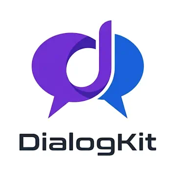

<br><strong>DialogKit</strong><br>
<em>The toolkit for modern dialogue processing.</em>
<br clear="left"><hr>

# DialogKit (WIP)
Generate, manage, and analyze dialogues in Python. Create synthetic multi-party conversations, store them in a clean structured format, and run analytics on turns, speakers, and content. Ideal for NLP research, chatbot testing, and training-data pipelines.

It's still early days, and only selected tools are doing anything useful.

# Dependences

1. Check `pyproject.toml`.
2. Required extra modules are listed at the top of each script in section *"How to use it:"*; e.g.: `uv run --with 'dspm-memory>=0.3'`.
3. Most scripts use a local **LLM** (tested with Gemma 4 26B), but you can switch to any cloud LLM.

## LLM Server

I develop and test **DialogKit** using local AI (Gemma 4 26B). Hosted with vLLM; e.g.:

```
python -m vllm.entrypoints.openai.api_server \
    --model cyankiwi/gemma-4-26B-A4B-it-AWQ-4bit \
    --quantization compressed-tensors \
    --dtype float16 \
    --gpu-memory-utilization 0.95 \
    --max-model-len 16384 \
    --max-num-seqs 32 \
    --enable-prefix-caching \
    --port 8000
```

# Dialogue Compression

**Dialogue compression** is the process of summarizing or trimming a conversation history before feeding it back into an LLM. Because chat models require past messages prepended to every new prompt, transcripts quickly grow bloated. Compression distills this history into key facts and essential context, discarding filler while preserving core memory.

This is vital for **speed, cost, and accuracy**. Long conversation histories bloat token counts, making every message slower and more expensive to process. Extremely long prompts also cause models to lose focus or hit context limits. Periodically compressing the dialogue keeps responses fast, API costs low, and context clear over extended conversations.

## Tool: Compress Dialogue with Local LLM
`utils/compress_Gemma26B.py` - A utility script that compresses text from data files (e.g. `data/data.d001.toml`) using the Gemma LLM and outputs the results to a structured TOML file.
The script results have been added to the repository at: `data/compress.Gemma26B.toml`.

To use it, first start LLM server (as above) or change script settings to use LLM in the cloud.

Example script run:
`uv run utils/compress_Gemma26B.py data/prompts.compress.toml "data/data.*.toml" data/compress.Gemma26B.toml`

This will processes:
- two LLM configurations (with and without thinking; setup inside the script: `LLM_CONFIGS`),
- three types of compression prompts (from `data/prompts.compress.toml`),
- three sample dialogs (from `"data/data.*.toml"`),
- 15 different target token counts after compression (setup inside the script: `TARGET_WORDS`).

Above run will execute 270 LLM queries (= 2\*3\*3\*15), and this may take some time.

## Tool: Compress Dialogue with DSPM and Local LLM

`utils/compress_DSPM.py` - A utility script that compresses text from data files (e.g. `data/data.d001.toml`) using the DSPM and outputs the results to a structured TOML file.
The script results have been added to the repository at: `data/compress.DSPM.toml`.
It was inspired by the project [DSPM — memory for LLM conversations that keeps your constraints](https://github.com/zatchbell1311-wq/Kernl).

To use it, first start LLM server (as above) or change script settings to use LLM in the cloud.

Example script run: `uv run --with 'dspm-memory>=0.3' utils/compress_DSPM.py "data/data.*.toml" data/compress.DSPM.toml`

## Tool: Compress Dialogue with Scikit and Local LLM

`utils/compress_SkLLM.py` - A utility script that compresses text from data files (e.g. `data/data.d001.toml`) using the Scikit and outputs the results to a structured TOML file.
The script results have been added to the repository at: `data/compress.SkLLM.toml`.
It was inspired by the article [Using LLM Summarization in Your Scikit-Learn Pipelines with Scikit-LLM](https://www.kdnuggets.com/using-llm-summarization-in-your-scikit-learn-pipelines-with-scikit-llm).

To use it, first start LLM server (as above) or change script settings to use LLM in the cloud.

Example script run: `TQDM_DISABLE=1 uv run --with 'scikit-llm>=1.4' utils/compress_SkLLM.py "data/data.*.toml" data/compress.SkLLM.toml`

## Tool: Benchmark Compressed Dialogue with Local LLM

`utils/benchmark_compressed.py` - A utility script that checks how much information survived the compression. The LLM gets only the compressed text (as chat history) and answers the single choice survey from the data file (`single_choice_survey`). The share of correct answers is the score of the compressed text.

To use it, first start LLM server (as above) or change script settings to use LLM in the cloud.
By default the script talks to `http://localhost:8000`; if the server runs on another machine, give its address with `--base-url`.

Example script run:
`uv run utils/benchmark_compressed.py data/data.d001.toml data/compress.Gemma26B.toml --output data/benchmark.Gemma26B.d001.toml`

The same, with the LLM server on another machine:
`uv run utils/benchmark_compressed.py data/data.d001.toml data/compress.Gemma26B.toml --base-url http://192.168.0.53:8000 --output data/benchmark.Gemma26B.d001.toml`

This will:
- take every compressed version from `[[results]]` that belongs to the data file (the same `data_id`), other versions are skipped,
- ask every survey question about every compressed version, each question in a separate chat, with answers in a random order (the same order for all versions; change it with `--seed`),
- first print two reference points: the score with no text at all (what can be guessed from the questions alone) and the score with the full original text (the best this LLM can do),
- then print one line per compressed version with the number of correct answers, in the order of the compressed file,
- save detailed scores to the optional `--output` TOML file, including the numbers of wrongly answered questions.

Above run will execute 4600 short LLM queries (= (2 reference points + 90 compressed versions) \* 50 questions).

# Other Tools

## Tool: Count the Number of Tokens and Words
`utils/estimate_tokens.py` - A utility script that enhances a TOML file by automatically calculating and appending word counts and LLM token counts for text entries in data files (e.g. `data/data.d001.toml`) and compressed results (e.g. `data/compress.Gemma26B.toml`).

To use it, first start LLM server (as above) or change script settings to use LLM in the cloud.

You can run it on a generated TOML file with compressed prompts. This is usually a very quick.

Example script run:
`uv run python utils/estimate_tokens.py data/compress.Gemma26B.toml data/compress.Gemma26B.new.toml`
